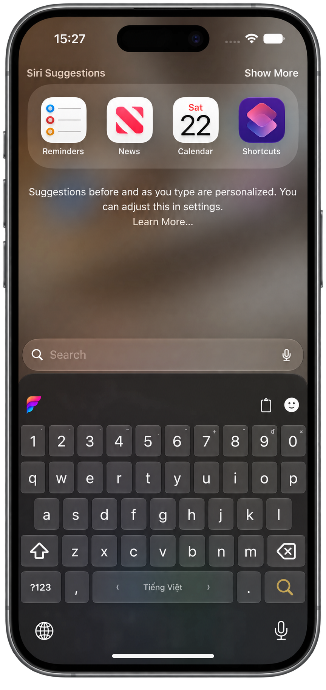
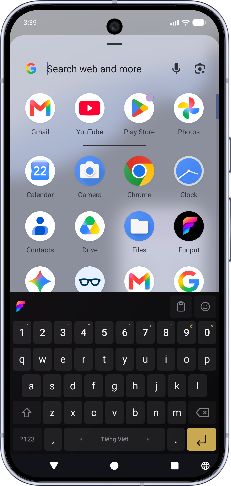
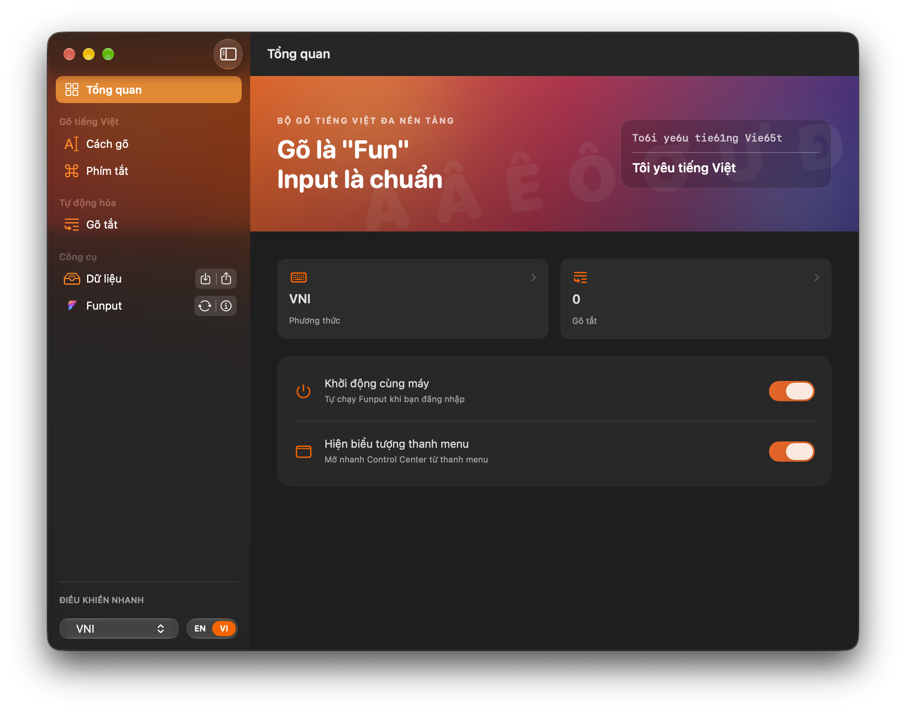
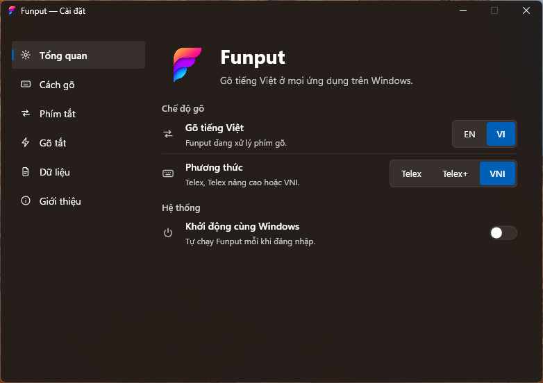
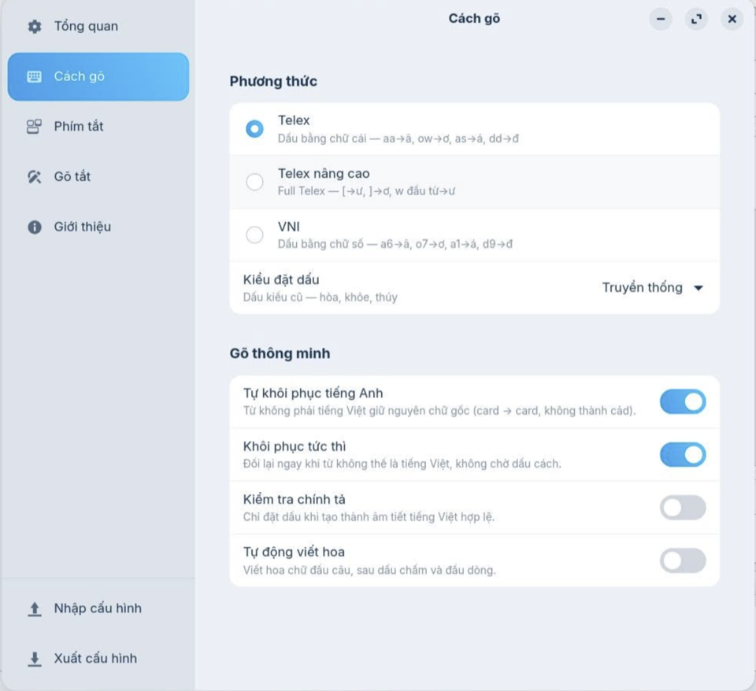
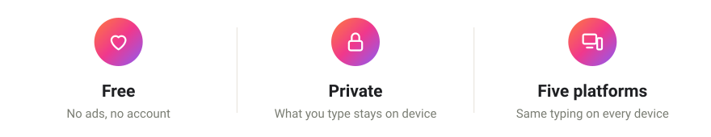
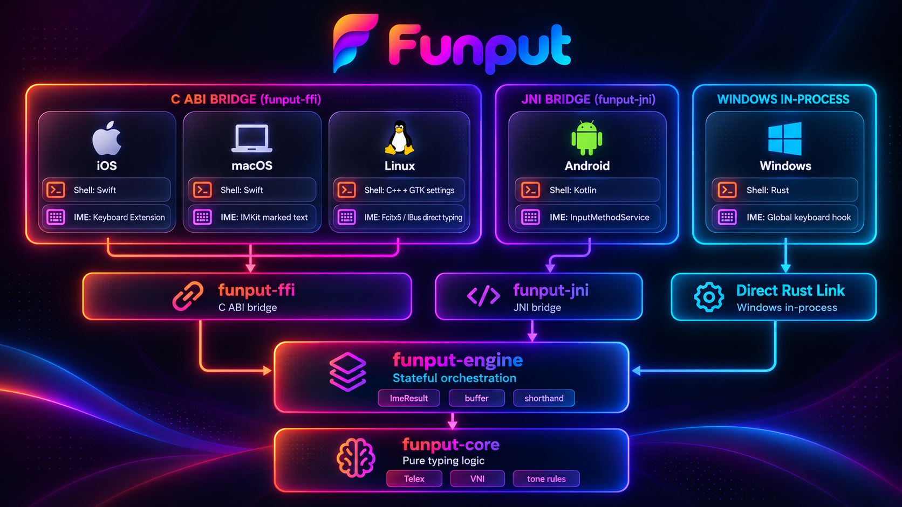

<p align="right">
  <a href="README.md">Tiếng Việt</a> | <strong>English</strong>
</p>

<p align="center">
  
</p>

<h3 align="center">An open-source Vietnamese keyboard for every device</h3>

<p align="center">
  <a href="https://github.com/Funput/Funput/releases/latest"></a>
  <a href="https://github.com/Funput/Funput/actions/workflows/ci.yml"></a>
  <a href="LICENSE"></a>
  <a href="https://github.com/Funput/Funput/stargazers"></a>
</p>

<p align="center">
  <a href="https://funput.app"><strong>Website</strong></a> &nbsp;|&nbsp;
  <a href="https://docs.funput.app/docs/install/"><strong>Installation guide</strong></a> &nbsp;|&nbsp;
  <a href="https://github.com/Funput/Funput/issues"><strong>Report an issue</strong></a>
</p>

<p align="center">
  <picture>
    <source media="(prefers-color-scheme: dark)" srcset="assets/readme/typing-demo-dark.svg">
    
  </picture>
</p>

<br>

<div align="center">
  <table>
    <tr>
      <td align="center" valign="top" width="20%">
        <a href="https://apps.apple.com/vn/app/id6788829996">
          <picture>
            <source media="(prefers-color-scheme: dark)" srcset="https://funput.app/ios-dark.svg">
            
          </picture>
          <br><strong>iOS</strong><br>
          <sub>App Store</sub>
        </a>
      </td>
      <td align="center" valign="top" width="20%">
        <a href="https://play.google.com/store/apps/details?id=app.funput.funput">
          <picture>
            <source media="(prefers-color-scheme: dark)" srcset="https://funput.app/android-dark.svg">
            
          </picture>
          <br><strong>Android</strong><br>
          <sub>Google Play</sub>
        </a>
      </td>
      <td align="center" valign="top" width="20%">
        <a href="https://github.com/Funput/Funput/releases/latest">
          <picture>
            <source media="(prefers-color-scheme: dark)" srcset="https://funput.app/apple-dark.svg">
            
          </picture>
          <br><strong>macOS</strong><br>
          <sub>GitHub download</sub>
        </a>
      </td>
      <td align="center" valign="top" width="20%">
        <a href="https://apps.microsoft.com/store/detail/9NR3WL5PD4ZS">
          <picture>
            <source media="(prefers-color-scheme: dark)" srcset="https://funput.app/windows-dark.svg">
            
          </picture>
          <br><strong>Windows</strong><br>
          <sub>Microsoft Store</sub>
        </a>
      </td>
      <td align="center" valign="top" width="20%">
        <a href="https://docs.funput.app/docs/install/linux">
          <picture>
            <source media="(prefers-color-scheme: dark)" srcset="https://funput.app/linux-dark.svg">
            
          </picture>
          <br><strong>Linux</strong><br>
          <sub>Fcitx5 and IBus</sub>
        </a>
      </td>
    </tr>
  </table>
</div>

<p align="center">
  <sub>Windows also has a no-install version on the <a href="https://github.com/Funput/Funput/releases/latest">Releases</a> page.</sub>
</p>

## Screenshots

<div align="center">
  <table>
    <tr>
      <td align="center" valign="middle" width="50%">
        <a href="assets/screenshot/ios.png">
          
        </a>
        <br><sub><strong>iOS</strong></sub>
      </td>
      <td align="center" valign="middle" width="50%">
        <a href="assets/screenshot/android.png">
          
        </a>
        <br><sub><strong>Android</strong></sub>
      </td>
    </tr>
  </table>
  <table>
    <tr>
      <td align="center" valign="middle" width="33%">
        <a href="assets/screenshot/macOS.png">
          
        </a>
        <br><sub><strong>macOS</strong></sub>
      </td>
      <td align="center" valign="middle" width="33%">
        <a href="assets/screenshot/windows.png">
          
        </a>
        <br><sub><strong>Windows</strong></sub>
      </td>
      <td align="center" valign="middle" width="33%">
        <a href="assets/screenshot/linux.png">
          
        </a>
        <br><sub><strong>Linux</strong></sub>
      </td>
    </tr>
  </table>
</div>

<br>

<p align="center">
  <picture>
    <source media="(prefers-color-scheme: dark)" srcset="assets/readme/pillars-en-dark.svg">
    
  </picture>
</p>

<p align="center">
  Plenty of small touches are waiting for you in Settings.
</p>

<details>
<summary><strong>Our privacy promises</strong></summary>
<br>

An input method sees everything you type, so Funput keeps these promises, and you can check each one in the source:

- **No data collection.** No analytics, ads or automatic crash reporting SDKs. No account needed.
- **What you type stays on your device.** Suggestions, the personal dictionary and everything the keyboard learns are stored locally.
- **The Android keyboard has no network access.** The Internet permission is stripped from the keyboard process at build time. Only the settings app goes online, to fetch news.
- **No automatic clipboard reads.** On iOS the keyboard pastes only when you tap the system Paste button.

</details>

## For developers

All five platforms share one Rust core. iOS, macOS and Linux call it through [`funput-ffi`](crates/funput-ffi) (C ABI), Android through [`funput-jni`](crates/funput-jni), and Windows links [`funput-engine`](crates/funput-engine) directly.

<details>
<summary><strong>Show the architecture diagram</strong></summary>
<br>
<p align="center">
  <a href="assets/design/architecture.png">
    
  </a>
</p>
</details>

Run the core test suite:

```bash
cargo test --workspace
```

Each platform has its own build guide:
[iOS](platforms/ios/README.md), [Android](platforms/android/README.md), [macOS](platforms/macos/README.md), [Windows](platforms/windows/README.md), [Linux](platforms/linux/README.md).
Feature designs live in [`docs/features`](docs/features).

Funput is under active development and ships often. Bug reports, discussions and pull requests are all welcome.

## Support the project

Funput is free for everyone. If you find it useful, you can support it through GitHub Sponsors, a bank transfer, or simply by starring the repo.

<p align="center">
  <a href="https://github.com/sponsors/Funput"></a>
  <a href="https://github.com/Funput/Funput"></a>
</p>

<details>
<summary><strong>Bank transfer by QR code</strong></summary>
<br>
<p align="center">
  
</p>
</details>

## License

Released under the [MIT](LICENSE) license. © Funput.

<p align="center">
  <sub>Made with ❤️ by Funput</sub>
</p>
