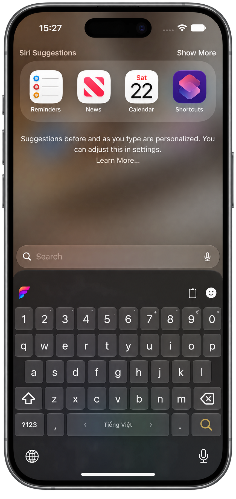
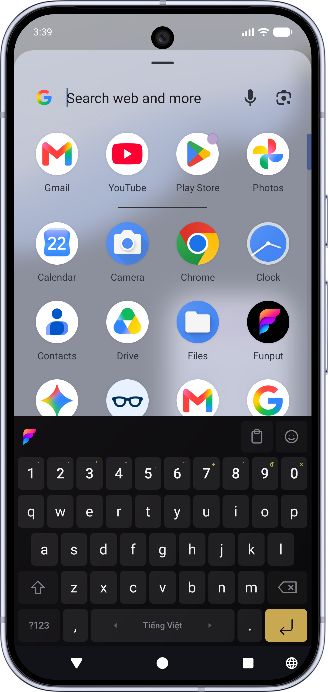
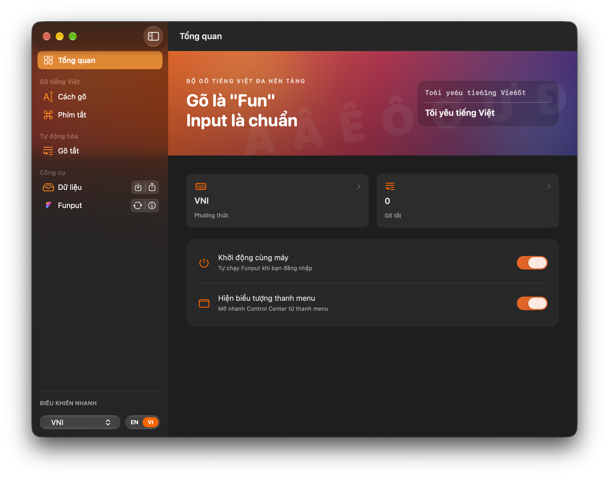
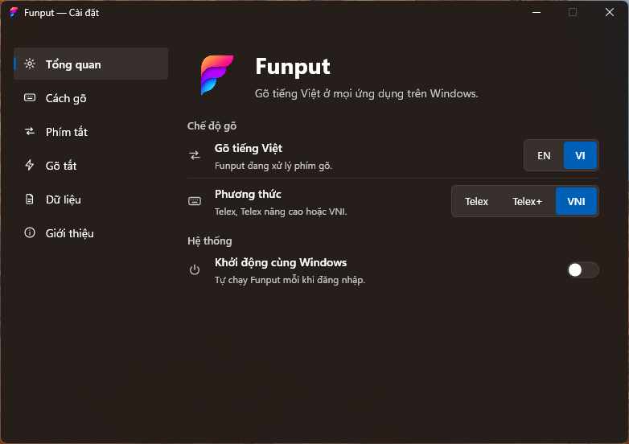
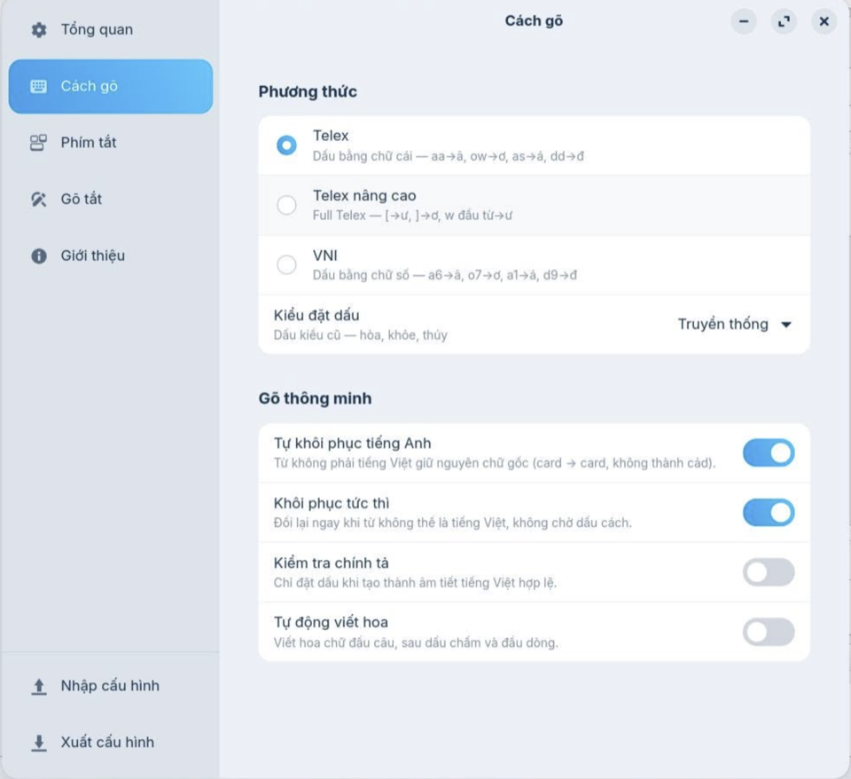

<p align="right">
  <strong>Tiếng Việt</strong> | <a href="README.en.md">English</a>
</p>

<p align="center">
  
</p>

<h3 align="center">Bộ gõ tiếng Việt mã nguồn mở cho mọi thiết bị</h3>

<p align="center">
  <a href="https://github.com/Funput/Funput/releases/latest"></a>
  <a href="https://github.com/Funput/Funput/actions/workflows/ci.yml"></a>
  <a href="LICENSE"></a>
  <a href="https://github.com/Funput/Funput/stargazers"></a>
</p>

<p align="center">
  <a href="https://funput.app"><strong>Trang chủ</strong></a> &nbsp;|&nbsp;
  <a href="https://docs.funput.app/docs/install/"><strong>Hướng dẫn cài đặt</strong></a> &nbsp;|&nbsp;
  <a href="https://github.com/Funput/Funput/issues"><strong>Báo lỗi</strong></a>
</p>

<p align="center">
  <picture>
    <source media="(prefers-color-scheme: dark)" srcset="assets/readme/typing-demo-dark.svg">
    
  </picture>
</p>

<br>

<div align="center">
  <table>
    <tr>
      <td align="center" valign="top" width="20%">
        <a href="https://apps.apple.com/vn/app/id6788829996">
          <picture>
            <source media="(prefers-color-scheme: dark)" srcset="https://funput.app/ios-dark.svg">
            
          </picture>
          <br><strong>iOS</strong><br>
          <sub>App Store</sub>
        </a>
      </td>
      <td align="center" valign="top" width="20%">
        <a href="https://play.google.com/store/apps/details?id=app.funput.funput">
          <picture>
            <source media="(prefers-color-scheme: dark)" srcset="https://funput.app/android-dark.svg">
            
          </picture>
          <br><strong>Android</strong><br>
          <sub>Google Play</sub>
        </a>
      </td>
      <td align="center" valign="top" width="20%">
        <a href="https://github.com/Funput/Funput/releases/latest">
          <picture>
            <source media="(prefers-color-scheme: dark)" srcset="https://funput.app/apple-dark.svg">
            
          </picture>
          <br><strong>macOS</strong><br>
          <sub>Tải từ GitHub</sub>
        </a>
      </td>
      <td align="center" valign="top" width="20%">
        <a href="https://apps.microsoft.com/store/detail/9NR3WL5PD4ZS">
          <picture>
            <source media="(prefers-color-scheme: dark)" srcset="https://funput.app/windows-dark.svg">
            
          </picture>
          <br><strong>Windows</strong><br>
          <sub>Microsoft Store</sub>
        </a>
      </td>
      <td align="center" valign="top" width="20%">
        <a href="https://docs.funput.app/docs/install/linux">
          <picture>
            <source media="(prefers-color-scheme: dark)" srcset="https://funput.app/linux-dark.svg">
            
          </picture>
          <br><strong>Linux</strong><br>
          <sub>Fcitx5 và IBus</sub>
        </a>
      </td>
    </tr>
  </table>
</div>

<p align="center">
  <sub>Windows còn có bản chạy ngay không cần cài, tải ở trang <a href="https://github.com/Funput/Funput/releases/latest">Releases</a>.</sub>
</p>

## Giao diện

<div align="center">
  <table>
    <tr>
      <td align="center" valign="middle" width="50%">
        <a href="assets/screenshot/ios.png">
          
        </a>
        <br><sub><strong>iOS</strong></sub>
      </td>
      <td align="center" valign="middle" width="50%">
        <a href="assets/screenshot/android.png">
          
        </a>
        <br><sub><strong>Android</strong></sub>
      </td>
    </tr>
  </table>
  <table>
    <tr>
      <td align="center" valign="middle" width="33%">
        <a href="assets/screenshot/macOS.png">
          
        </a>
        <br><sub><strong>macOS</strong></sub>
      </td>
      <td align="center" valign="middle" width="33%">
        <a href="assets/screenshot/windows.png">
          
        </a>
        <br><sub><strong>Windows</strong></sub>
      </td>
      <td align="center" valign="middle" width="33%">
        <a href="assets/screenshot/linux.png">
          
        </a>
        <br><sub><strong>Linux</strong></sub>
      </td>
    </tr>
  </table>
</div>

<br>

<p align="center">
  <picture>
    <source media="(prefers-color-scheme: dark)" srcset="assets/readme/pillars-vi-dark.svg">
    
  </picture>
</p>

<p align="center">
  Còn nhiều điều nhỏ đang chờ bạn khám phá trong phần Cài đặt.
</p>

<details>
<summary><strong>Cam kết quyền riêng tư</strong></summary>
<br>

Bộ gõ nhìn thấy mọi thứ bạn gõ, nên Funput giữ những cam kết sau và bạn có thể tự kiểm chứng trong mã nguồn:

- **Không thu thập dữ liệu.** Không có SDK thống kê, quảng cáo hay báo lỗi tự động. Không cần tài khoản.
- **Chữ bạn gõ ở lại trên máy.** Gợi ý từ, từ điển cá nhân và những gì bàn phím học được đều lưu cục bộ.
- **Bàn phím Android không có quyền truy cập mạng.** Quyền Internet bị gỡ khỏi tiến trình bàn phím ngay lúc build. Chỉ app cài đặt dùng mạng để tải tin tức.
- **Không tự đọc clipboard.** Trên iOS, bàn phím chỉ dán khi bạn bấm nút Dán của hệ thống.

</details>

## Dành cho nhà phát triển

Năm nền tảng dùng chung một lõi Rust. iOS, macOS và Linux gọi qua [`funput-ffi`](crates/funput-ffi) (C ABI), Android qua [`funput-jni`](crates/funput-jni), còn Windows link thẳng [`funput-engine`](crates/funput-engine).

<details>
<summary><strong>Xem sơ đồ kiến trúc</strong></summary>
<br>
<p align="center">
  <a href="assets/design/architecture.png">
    
  </a>
</p>
</details>

Chạy test cho phần lõi:

```bash
cargo test --workspace
```

Hướng dẫn build cho từng nền tảng nằm trong README riêng:
[iOS](platforms/ios/README.md), [Android](platforms/android/README.md), [macOS](platforms/macos/README.md), [Windows](platforms/windows/README.md), [Linux](platforms/linux/README.md).
Thiết kế của từng tính năng được ghi ở [`docs/features`](docs/features).

Funput đang được phát triển tích cực và có bản mới thường xuyên. Mọi báo lỗi, thảo luận và pull request đều được chào đón.

## Ủng hộ

Funput miễn phí cho mọi người. Nếu thấy hữu ích, bạn có thể ủng hộ dự án qua GitHub Sponsors, chuyển khoản, hoặc đơn giản là tặng repo một ngôi sao.

<p align="center">
  <a href="https://github.com/sponsors/Funput"></a>
  <a href="https://github.com/Funput/Funput"></a>
</p>

<details>
<summary><strong>Chuyển khoản qua mã QR</strong></summary>
<br>
<p align="center">
  
</p>
</details>

## Giấy phép

Phát hành theo giấy phép [MIT](LICENSE). © Funput.

<p align="center">
  <sub>Made with ❤️ by Funput</sub>
</p>
