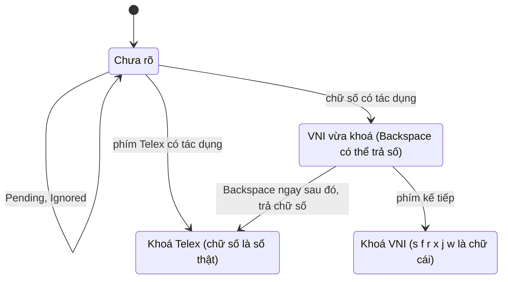
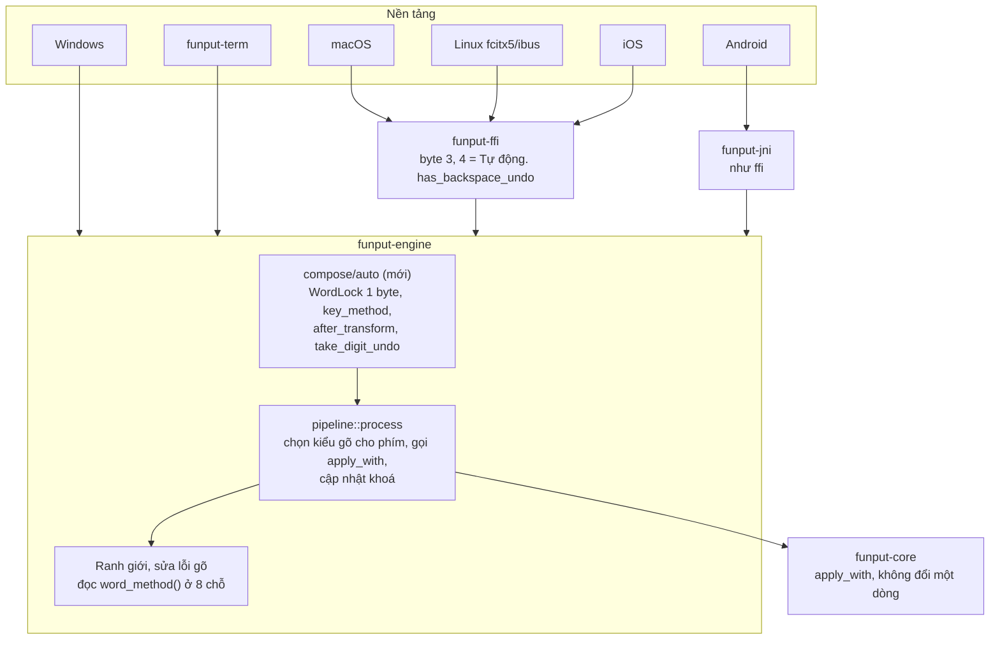

# Kiểu gõ Tự động: Telex và VNI, khoá theo từ

## Trạng thái

Bản thiết kế, chưa hiện thực. Đây là nơi mọi quyết định thiết kế sống: chỗ nào hiện thực lệch khỏi
bản viết này thì sửa lại ngay trong PR đó và đánh dấu **Đã đổi khi hiện thực**. Thứ tự PR ở mục
[Kế hoạch triển khai](#kế-hoạch-triển-khai-theo-pr).

## Tóm tắt

Kiểu gõ **Tự động** cho người dùng gõ Telex và VNI trong cùng một chế độ. Mỗi từ được **khoá** theo
kiểu gõ của phím bỏ dấu đầu tiên thực sự có tác dụng, và từ đã khoá thì cư xử y hệt kiểu gõ cố định
tương ứng. Toàn bộ logic nằm trong `funput-engine`. `funput-core` không đổi một dòng nào; 5 nền tảng
chỉ thêm một giá trị cấu hình.

**Mục tiêu**

- Một chế độ gõ được cả `vieejt` lẫn `vie65t`, chuyển qua lại giữa các từ mà không cần phím tắt.
- **Không tụt hậu với kiểu gõ cố định:** khi Tự động tắt, đường chạy của Telex, Telex nâng cao và VNI
  giữ nguyên từng byte.
- **Tự động mà không có chữ số thì giống hệt Telex:** mọi chuỗi phím không chứa chữ số cho ra kết quả
  y như Telex. Chứng minh bằng bộ diff 70k chuỗi.
- Không cấp phát thêm trên luồng phím nóng. `Session` tăng tối đa 2 byte, không dùng thêm heap.

**Phi mục tiêu**

- Không tự đổi kiểu gõ trong cài đặt, không học thói quen gõ, không lưu gì về văn bản đã gõ.
- Không đoán kiểu gõ từ ngữ cảnh ứng dụng.
- Không cứu mọi ca chữ số dính sau chữ (`tuan1`). Ca này có luật Backspace riêng ở mục
  [Luật Backspace trả lại chữ số](#luật-backspace-trả-lại-chữ-số).

## Đặc tả hành vi

Mỗi từ bắt đầu ở trạng thái **chưa rõ** và được khoá ngay tại lần bấm đầu tiên mà `funput-core` trả
về `TransformKind::Applied`. Khoá theo họ của phím vừa bấm: chữ số thì VNI, còn lại thì Telex. Khoá
không bao giờ chuyển thẳng từ Telex sang VNI hay ngược lại. Nó chỉ quay về chưa rõ khi từ kết thúc,
hoặc khi Backspace xóa hết chữ đã biến đổi.



Hết từ, `adopt`, hoặc Backspace để lại buffer toàn ASCII: mọi trạng thái quay về Chưa rõ. Khoá chỉ đi
một chiều trong một từ. Lối duy nhất từ VNI sang Telex là Backspace ngay sau chữ số vừa khoá.

**Cách đọc một phím theo trạng thái của từ**

| Trạng thái từ | Chữ số `0`–`9` | `s f r x j w z`, `aa ee oo dd` | Chữ cái khác |
| --- | --- | --- | --- |
| Chưa rõ | bộ phân loại VNI | bộ phân loại Telex | chữ cái |
| Khoá Telex | chữ số thật | phím bỏ dấu Telex | chữ cái |
| Khoá VNI | phím bỏ dấu VNI | chữ cái | chữ cái |

Phím chỉ khoá khi nó thực sự biến đổi chữ. Ba kiểu kết quả còn lại không khoá: `Pending` (chữ số
không có nguyên âm để bỏ dấu, như `h2`), `Ignored` (`ng` + `1`) và `Reverted` (`ass`, `a11`). Riêng
`Reverted` chỉ xảy ra khi từ đã khoá từ trước, nên khoá được giữ.

**Ví dụ**

| Phím gõ | Diễn biến | Kết quả |
| --- | --- | --- |
| `vieejt2` | `ee` khoá Telex, `2` là số thật | `việt2` |
| `vie65ts` | `6` khoá VNI, `s` là chữ cái | `việts` |
| `khoong2` | `oo` khoá Telex | `không2` |
| `d9i` | `9` khoá VNI | `đi` |
| `h2o` | `2` không có nguyên âm, vẫn chưa rõ | `h2o` |
| `sao` | `s` đầu từ là chữ cái, vẫn chưa rõ | `sao` |
| `ass` | `s` khoá Telex, `s` thứ hai huỷ dấu, giữ khoá | `as` |
| `tuan1` | `1` khoá VNI | `tuán`, Backspace ngay sau đó trả về `tuan1` |

**Ca khó**

| Tình huống | Hành vi |
| --- | --- |
| Backspace mà buffer còn chữ có dấu (`việ` sau khi xóa `t`) | giữ khoá |
| Backspace làm buffer chỉ còn ASCII (`viê` thành `vi`) | về chưa rõ |
| Mở lại từ cũ qua `Engine::adopt` (`việt`) | chưa rõ. Gõ `2` hay `f` đều là đổi dấu hợp lệ |
| Chữ số đầu từ, numpad, `500k` | không đổi: đi thẳng qua như hiện nay, vì xảy ra trước khi tới pipeline |
| Phím lật (flip) | giữ khoá. Flip chỉ ghim dạng hiển thị |
| Từ không có phím bỏ dấu nào (`anh`, `the`) | chưa rõ tới cuối từ. Tầng ranh giới xử nó như Telex |

## Kiến trúc

Khoá theo từ là trạng thái của phiên gõ, nên nó thuộc về `funput-engine`. `funput-core` giữ đúng vai
một hàm thuần: với mỗi phím, engine chọn `InputMethod` rồi truyền vào `apply_with` như bây giờ. Điều
này làm được vì trong core chỉ có đúng một chỗ đọc `options.method`, là `match` ở
[transform/mod.rs:15](../../crates/funput-core/src/composition/transform/mod.rs). Đã grep để xác nhận.



Nền tảng và cầu nối chỉ truyền một giá trị cấu hình. Khoá sinh ra, được đọc và mất đi đều trong
`funput-engine`.

| Tầng | Thay đổi |
| --- | --- |
| `funput-core` | Không đổi. API, ABI và bảng phím giữ nguyên |
| `funput-engine` | Module mới `compose/auto/` (chọn kiểu gõ cho từng phím, chốt khoá, Backspace). Thêm `Session::lock` và `EngineConfig::auto_method`. 8 chỗ chuyển từ `config.method` sang `word_method(session)` |
| `funput-config` | Trường `auto_method: bool` (serde default `false`) đặt cạnh `method`. ID riêng trong tài liệu chuyển cấu hình |
| `funput-ffi` / `funput-jni` | Byte kiểu gõ nhận thêm `3` = Tự động (nền Telex) và `4` = Tự động (nền Telex nâng cao). Không đổi struct |
| 5 nền tảng | Thêm một lựa chọn "Tự động" trong cài đặt. Chỉ nền tảng nào chưa tiêu kết quả của `on_backspace` mới phải nối thêm luật Backspace |

**Vì sao dùng cờ chứ không thêm `InputMethod::Auto`**

1. `Method::from_core` trong `funput-config` có `unreachable!` cho biến thể mới. Thêm biến thể mà quên
   nối ở đâu là panic lúc chạy.
2. Serde đọc giá trị enum lạ là lỗi. File cấu hình có `"method": "auto"` chuyển sang máy chạy bản cũ
   có thể làm hỏng cả file. Một trường bool lạ thì bản cũ bỏ qua và vẫn gõ Telex.
3. Các phép so sánh `== InputMethod::Telex` (ví dụ collision ở
   [class.rs:64](../../crates/funput-engine/src/compose/collision/class.rs)) sẽ âm thầm sai với biến thể
   mới. Với thiết kế này, chúng nhận `word_method()`, luôn là một trong ba kiểu cố định đã có test.
4. Tự động với nền Telex nâng cao có sẵn mà không phải nhân đôi biến thể.

**Bất biến thiết kế:** `word_method()` luôn trả về một `InputMethod` cố định. Từ chưa rõ hoặc khoá
Telex trả về nền Telex đã cấu hình, từ khoá VNI trả về `Vni`. Vì vậy mọi luật ở ranh giới từ, khôi
phục tiếng Anh và sửa lỗi gõ chạy đúng đường đã được kiểm chứng của kiểu gõ cố định.

## Mô hình dữ liệu

Toàn bộ trạng thái mới là một enum 1 byte trong `Session` và một bool trong `EngineConfig`. Không
dùng heap, không lưu lịch sử.

```rust
// crates/funput-engine/src/compose/auto/lock.rs

/// Which grammar the live word committed to. Per-word: `Session::clear` resets it.
#[derive(Debug, Clone, Copy, PartialEq, Eq, Default)]
#[repr(u8)]
pub(crate) enum WordLock {
    /// No key has transformed the word yet; both grammars still read it the same.
    #[default]
    Undecided,
    Telex,
    Vni,
    /// VNI, locked by the very last key. The one state Backspace may hand back
    /// as a literal digit; any further key demotes it to `Vni`.
    VniFresh,
}
```

```rust
// EngineConfig (model/config.rs)
/// "Tự động": compose Telex and VNI side by side, locking each word to the
/// grammar of its first transforming key. `method` then names the Telex base
/// (`Telex` or `TelexAdvanced`); `configure` normalises `Vni` to `Telex`.
pub auto_method: bool,
```

Hai hàm đọc, cả hai `#[inline]`, không cấp phát:

```rust
/// The grammar this keystroke is classified under.
pub(crate) fn key_method(session: &Session, key: char) -> InputMethod {
    let config = &session.config;
    if !config.auto_method {
        return config.method; // fixed methods: the path they have today
    }
    match session.lock {
        WordLock::Vni | WordLock::VniFresh => InputMethod::Vni,
        WordLock::Undecided if key.is_ascii_digit() => InputMethod::Vni,
        _ => config.method, // the Telex base
    }
}

/// The grammar the whole word is judged under at its boundary.
pub(crate) fn word_method(session: &Session) -> InputMethod {
    let config = &session.config;
    match (config.auto_method, session.lock) {
        (true, WordLock::Vni | WordLock::VniFresh) => InputMethod::Vni,
        _ => config.method,
    }
}
```

| Trường | Kích thước | Vòng đời |
| --- | --- | --- |
| `Session::lock: WordLock` | 1 byte, nhiều khả năng nằm gọn trong padding cạnh `enabled` và `glue` | reset ở `clear()`. `resync_after_backspace` tính lại |
| `EngineConfig::auto_method: bool` | 1 byte | cấu hình. Đổi giá trị thì xóa từ đang gõ, như khi đổi `method` |

Một test `size_of::<Session>()` ghim kích thước hiện tại, để PR không âm thầm làm nó phình ra.

## Luồng phím nóng

Luồng phím nóng chỉ đổi ở hai dòng trong
[pipeline.rs](../../crates/funput-engine/src/compose/pipeline.rs): chọn kiểu gõ trước `apply_with`,
cập nhật khoá sau đó. Pipeline đã có sẵn `result.kind` và `key` ở đúng chỗ này, nên không phải tính
lại gì.

```rust
// compose/pipeline.rs, process()
let method = auto::key_method(session, key);
let mut result = apply_with(&session.buffer, key, session.config.compose_options_for(method));
auto::after_transform(session, result.kind, key);
// ...rest of process() unchanged
```

```rust
// compose/auto/lock.rs
pub(crate) fn after_transform(session: &mut Session, kind: TransformKind, key: char) {
    if !session.config.auto_method {
        return;
    }
    session.lock = match (session.lock, kind) {
        (WordLock::Undecided, TransformKind::Applied) if key.is_ascii_digit() => WordLock::VniFresh,
        (WordLock::Undecided, TransformKind::Applied) => WordLock::Telex,
        (WordLock::VniFresh, _) => WordLock::Vni,
        (lock, _) => lock,
    };
}
```

`EngineConfig::compose_options()` tách thành `compose_options_for(method)`. Hàm cũ gọi hàm mới với
`self.method`, nên mọi chỗ gọi khác không đổi. `ComposeOptions` là `Copy` và vốn đã được dựng lại ở
mỗi phím.

**Các đường vào khác**

| Đường vào | Xử lý khoá |
| --- | --- |
| Ranh giới từ, `Engine::clear`, host reset | `Session::clear()` đưa về `Undecided` |
| Phím huỷ dấu (`Reverted`), pipeline viết lại `keys` | giữ nguyên. Khoá không phụ thuộc `keys`, nên việc viết lại không làm lệch gì |
| `on_backspace` | chạy luật trả chữ số trước (mục riêng), rồi `resync_after_backspace`: buffer toàn ASCII thì về `Undecided`, `VniFresh` thì hạ xuống `Vni`, còn lại giữ |
| `Engine::adopt` | gọi `clear()` nên về `Undecided` |
| `flip_composing` | giữ |
| `is_word_boundary` (`[` `]` của Telex nâng cao) | đọc `word_method()`. Từ khoá VNI gặp `[` thì ngắt từ, giống VNI cố định |

**Vì sao khoá không lưu vị trí trong `keys`:** pipeline viết lại `keys` khi huỷ dấu, còn Backspace
thay `keys` bằng chính `buffer` đã ghép. Một chỉ số vào `keys` sẽ sai sau cả hai thao tác. Thay vào
đó, sau Backspace khoá được suy lại từ buffer. Buffer còn chữ có dấu nghĩa là phép biến đổi đã khoá
từ vẫn còn trên màn hình. `str::is_ascii` trên vài byte là rẻ nhất có thể.

## Tầng ranh giới từ

Có 8 chỗ trong engine đang đọc `config.method` để phán xét cả từ. Tất cả chuyển sang đọc
`word_method(session)`. Khi Tự động tắt, hai giá trị này bằng nhau, nên kiểu gõ cố định không đổi
hành vi. Không chỗ nào cần luật riêng cho Tự động.

| Chỗ | Đang đọc | Việc cần làm | Nếu bỏ sót |
| --- | --- | --- | --- |
| [collision/class.rs:64](../../crates/funput-engine/src/compose/collision/class.rs) | `config.method == class.method()` | `Collision::matching` nhận `InputMethod` thay cho `&EngineConfig` | `two` thành `tơ` quay lại (#661) |
| [doubled/mod.rs:44](../../crates/funput-engine/src/compose/doubled/mod.rs) | `config.method.is_telex_family()` | `word_method` | từ khoá VNI bị khôi phục phím đúp kiểu Telex |
| [boundary/mod.rs:85](../../crates/funput-engine/src/compose/boundary/mod.rs) `keystrokes_intend_vietnamese` | `is_telex_family()` cho `w` chưa giải | `word_method`. Mệnh đề "có chữ số" giữ nguyên, xem ghi chú | từ VNI có `w` bị hiểu là chưa xong |
| [boundary/mod.rs:19](../../crates/funput-engine/src/compose/boundary/mod.rs) `is_word_boundary` | tham số `method` | nơi gọi ở [process.rs:62](../../crates/funput-engine/src/engine/process.rs) truyền `word_method` | `[` trong từ VNI biến thành `ư` |
| [pipeline/display.rs:73](../../crates/funput-engine/src/compose/pipeline/display.rs) | `is_definitely_invalid_in(.., config.method)` | `word_method` | khôi phục sớm sai. Âm cuối địa danh `h/l/r` mất ở từ VNI |
| [correction/preview.rs:102](../../crates/funput-engine/src/correction/preview.rs) | như trên | `word_method` | thanh xem trước sửa lỗi phán sai |
| [correction/gate.rs:48](../../crates/funput-engine/src/correction/gate.rs) `has_literal_digit` | `!= InputMethod::Vni` | `word_method` | từ VNI có chữ số còn lại bị loại khỏi sửa lỗi gõ |
| [correction/generate/tiers.rs:98](../../crates/funput-engine/src/correction/generate/tiers.rs) `Evidence::new` | `config.method` | `word_method`. Kéo theo `key_role`, bảng chữ cái chèn và phím lân cận hàng số | sinh ứng viên sai bảng. Thang chi phí đã chỉnh bị lệch |

**Ghi chú về `keystrokes_intend_vietnamese`:** mệnh đề "có chữ số trong `keys`" giữ nguyên, vì hai
kiểu cố định đang dùng chung nó. Từ khoá VNI gặp nó đúng như VNI cố định, từ khoá Telex có chữ số
thật gặp nó đúng như Telex cố định. Đổi mệnh đề này sẽ làm Telex cố định đổi hành vi: `chaof2` hiện
giữ `chào2`, sửa thì sẽ bị khôi phục thành `chaof2`. Vì vậy không đổi.

**Giữ cho bảng này đúng về lâu dài:** thêm script gác `scripts/check-word-method.sh`, theo mẫu
`check-pasteboard-reads.sh`. Script cấm đọc `config.method` trong `compose/` và `correction/`, trừ
`compose/auto/` và một danh sách cho phép ghi rõ lý do (ví dụ `prepare_key`, chạy khi buffer còn rỗng
nên luôn ở trạng thái chưa rõ). Luật mới viết sau này không thể vô tình đọc nhầm kiểu gõ trong cài
đặt.

## Luật Backspace trả lại chữ số

Nếu Backspace là thao tác **ngay sau** chữ số vừa khoá từ sang VNI, nó không xóa ký tự mà trả từ về
đúng phím đã gõ. Từ đó được khoá Telex, nên chữ số gõ tiếp theo là số thật. Ví dụ `tuán` + Backspace
thành `tuan1`, gõ tiếp `2` ra `tuan12`.

**Điều kiện:** `auto_method` bật, `lock == VniFresh`, buffer không rỗng.

**Không tốn thêm bộ nhớ.** Khi từ còn chưa rõ thì chưa có phím nào được áp (`Applied`). Vì vậy ngay
trước chữ số khoá, `buffer` bằng `keys` bỏ chữ số đó, và `keys` hiện tại chính là văn bản cần trả
lại. Không phải lưu buffer cũ. Bất biến này được ghim bằng `debug_assert!` và property test.

```rust
// compose/auto/undo.rs
pub(crate) fn take_digit_undo(session: &mut Session) -> Option<ImeResult> {
    if session.lock != WordLock::VniFresh || session.buffer.is_empty() {
        return None;
    }
    let prefix = common_prefix_bytes(&session.buffer, &session.keys);
    let erase = session.buffer[prefix..].chars().count();
    let result = ImeResult::send(erase, session.keys[prefix..].to_string());
    session.buffer.clear();
    session.buffer.push_str(&session.keys);
    session.vn_form.clear();
    session.vn_form.push_str(&session.keys);
    session.lock = WordLock::Telex;
    Some(result)
}
```

`Engine::on_backspace` gọi hàm này ngay sau `correction::take_undo`, trước khi xóa ký tự. Sau đó
`buffer == keys`, nên ranh giới từ không còn gì để khôi phục, không cần ghim `RestoreOverride`.

**Host phải nuốt phím Backspace.** Hiện nền tảng desktop cho Backspace đi qua ứng dụng trước rồi mới
đồng bộ engine. iOS và Android thì đã hỏi `has_correction_undo()` trước. Thiết kế tổng quát hoá hàm
này:

```rust
/// Whether the next Backspace is an undo the engine answers itself (a typo
/// correction, or a digit that just locked the word to VNI). The host then
/// swallows the key and applies `on_backspace()`'s result instead.
pub fn has_backspace_undo(&self) -> bool {
    self.has_correction_undo() || auto::digit_undo_pending(&self.session)
}
```

`has_correction_undo` giữ nguyên cho tương thích, đánh dấu là nên dùng hàm mới. FFI thêm
`funput_engine_has_backspace_undo`, JNI thêm hàm tương ứng.

**Giá phải trả cho người gõ VNI:** gõ `a1` rồi Backspace ngay thì ra `a1`, chứ không phải xóa chữ
`á`. Giá này thấp, vì người VNI đổi dấu bằng cách gõ chữ số khác ngay (`tuán` + `2` thành `tuàn`),
không cần Backspace. Bấm thêm một Backspace nữa thì xóa `1` như bình thường. Chỗ này nằm trong mục câu
hỏi mở.

## Hiệu năng và bộ nhớ

Tự động không thêm lần cấp phát nào trên mỗi phím và không thêm bảng dữ liệu nào. Chi phí là vài nhánh
rẽ nhánh đoán trước được.

| Đường chạy | Thêm khi Tự động tắt | Thêm khi Tự động bật | Cấp phát |
| --- | --- | --- | --- |
| Mỗi phím gõ vào từ | 2 lần kiểm tra bool | 2 `match` trên `u8` và 1 `is_ascii_digit` | 0 |
| Ranh giới từ | `word_method` đọc 2 trường, khoảng 7 lần | như bên trái | 0 |
| Backspace | 1 so sánh | thêm `is_ascii` trên buffer vài byte | 0 |
| Backspace trả chữ số | không chạy | 1 `String` trong `ImeResult`, giống mọi lần sửa chữ trên màn hình | 1, hiếm gặp |
| Sửa lỗi gõ | không đổi | mỗi từ dùng **một** bảng chữ cái theo khoá, không gộp hai bảng, nên số ứng viên bằng kiểu cố định | 0 |

**Bộ nhớ:** `Session` tăng 1 byte, `EngineConfig` tăng 1 byte. `funput-core` không đổi nên kích thước
binary và ngân sách bộ nhớ của bàn phím iOS không bị ảnh hưởng.

**Cổng chặn trong CI cho mỗi PR của tính năng**

- Ngân sách cấp phát mỗi phím (hiện là 2 lần và 24 byte) chạy thêm một cấu hình `auto_method = true`.
  Con số không được tăng.
- Bench độ trễ [latency.rs](../../crates/funput-ffi/benches/latency.rs) thêm biến thể Tự động. Chênh
  lệch so với Telex phải nằm trong nhiễu đo.
- Test `size_of::<Session>()` và `size_of::<WordLock>() == 1`.
- Cổng tối đa 150 dòng mỗi file. `compose/auto/` chia sẵn thành `lock.rs`, `undo.rs`, `mod.rs` và
  test riêng.

## Cấu hình, giao thức và tương thích ngược

Mọi tầng dùng chung một cách biểu diễn: `method` là nền Telex, kèm cờ `auto_method`. Riêng trên dây
FFI/JNI, cặp này được gộp vào byte kiểu gõ để không phải đổi struct C. Bản cũ gặp giá trị mới sẽ quay
về Telex, không lỗi.

| Tầng | Biểu diễn | Bản cũ đọc giá trị mới |
| --- | --- | --- |
| `EngineConfig` | `method` + `auto_method: bool`. `configure` chuẩn hoá `Vni` thành `Telex` khi cờ bật | không áp dụng |
| `Engine` API | `set_auto_method(bool)`, `auto_method()`. Đổi giá trị thì xóa từ đang gõ, giống `set_method` | không áp dụng |
| `funput-config` (file cài đặt) | `"auto_method": true` với `#[serde(default)]` | bỏ qua trường lạ và gõ theo `method`. Đã kiểm: crate không dùng `deny_unknown_fields` |
| Tài liệu chuyển cấu hình ([CONFIG_FORMAT.md](../../platforms/CONFIG_FORMAT.md)) | khoá `auto_method`. ID kiểu gõ giữ nguyên `telex` / `telex_advanced` / `vni` | như trên |
| `funput-ffi` | byte `3` = Tự động nền Telex, `4` = Tự động nền Telex nâng cao. `decode_method` trả về `(InputMethod, bool)`. Getter trả `3`/`4` khi cờ bật | `decode_method` hiện đã quy giá trị lạ về Telex |
| `funput-jni` | cùng bảng giá trị, khớp với `EngineConfiguration` bên Kotlin | đã quy giá trị lạ về Telex |
| Nhập cấu hình UniKey | UniKey không có Tự động, không đổi | không áp dụng |

**Phím tắt xoay vòng kiểu gõ** (`funput-term` và các nền tảng có phím tắt): Telex, VNI, Tự động, rồi
quay lại Telex. Test `cycle_method_key_switches_telex_vni` được mở rộng tương ứng.

**Không có di chuyển dữ liệu:** cài đặt có sẵn không có `auto_method`, nên đọc ra `false`. Người dùng
hiện tại không thấy gì thay đổi cho tới khi tự chọn Tự động.

## Việc trên 5 nền tảng

Nền tảng không chứa logic gõ nào. Mỗi nền tảng chỉ làm 2 việc: thêm lựa chọn "Tự động", và hỏi
`has_backspace_undo()` trước khi cho Backspace đi qua. iOS và Android đã có sẵn đường này cho hoàn tác
sửa lỗi gõ. Desktop thì phải nối mới.

| Nền tảng | Cầu nối | Cài đặt | Backspace trả chữ số | Riêng |
| --- | --- | --- | --- | --- |
| macOS | `funput-ffi`, [FunputComposer.swift](../../platforms/macos/Funput/IME/FunputComposer.swift) | thêm lựa chọn vào bộ chọn kiểu gõ | kiểm tra cả chế độ preedit lẫn "Gõ không gạch chân" có áp kết quả `backspace()` hay không. Nối thêm bước hỏi trước | menu thanh trạng thái hiện kiểu gõ |
| Windows | gọi thẳng `funput-engine` (Rust) | Control Center | `shell::on_backspace` hiện cho phím đi qua trước. Phải nuốt phím rồi chèn kết quả | nhãn kiểu gõ mới trên biểu tượng khay |
| Linux fcitx5/ibus | `funput-ffi` qua `common/ffi/handle.h`. Cài đặt dùng `settings-gtk` | trang Gõ chữ trong [typing.rs](../../platforms/linux/settings-gtk/src/settings_window/typing.rs) | preedit: [keys.cpp:106](../../platforms/linux/common/compose/composer/keys.cpp) vẽ lại từ `handle_.buffer()`, nên chạy đúng mà không cần sửa. Không gạch chân: đang cho phím đi qua, phải nuốt phím và chèn kết quả khi `has_backspace_undo` đúng | sửa một lần trong `common/compose/` là đủ cho cả hai IME |
| iOS | `funput-ffi`, FunputKit | KeyboardConfiguration, ghi qua App Group | đổi chỗ hỏi `has_correction_undo` sang `has_backspace_undo` | chữ số nằm ở trang 123. Cần kiểm tra đổi trang giữa từ có giữ từ đang gõ không |
| Android | `funput-jni` | trang Gõ chữ trong settings hub, `EngineConfiguration.method` | đổi chỗ hỏi trong [NativeTypoCorrection.kt](../../platforms/android/ime/src/main/java/app/funput/funput/ime/nativebridge/correction/NativeTypoCorrection.kt) | hàng số trên bàn phím là tuỳ chọn của người dùng |
| funput-term | gọi thẳng `funput-engine` | schema cấu hình | engine đã sở hữu buffer, chỉ cần áp kết quả | phím tắt xoay vòng kiểu gõ |

**Đề xuất thứ tự:** bật trước trên desktop (macOS, Windows, Linux), vì đó là nơi người dùng VNI đông
nhất và có hàng phím số ngay dưới tay. Di động bật sau khi đã trả lời câu hỏi về trang 123 trên iOS.

## Kiểm thử

Chứng minh dựa trên ba bất biến kiểm bằng máy, cộng một phép đo để quyết định có ship hay không. Unit
test chỉ phủ phần đặc tả.

| # | Bất biến | Cách kiểm |
| --- | --- | --- |
| I0 | Tự động tắt: kết quả trùng từng byte với `main` ở cả Telex, Telex nâng cao và VNI | bộ diff 70k chuỗi phím, so với worktree baseline (`funput dev run`) |
| I1 | Tự động bật, chuỗi không có chữ số: trùng từng byte với nền Telex tương ứng | cùng bộ diff, lọc bỏ chuỗi có chữ số |
| I2 | Từ khoá VNI cho kết quả bằng VNI cố định gõ cùng chuỗi phím của từ đó | property test sinh từ ngẫu nhiên. Ngoại lệ tìm được thì ghi lại, không ép cho khớp |
| I3 | Khi `lock == VniFresh`: `keys` bằng buffer trước chữ số cộng chữ số | `debug_assert!` trong `after_transform` và property test |

**Unit test** (`compose/auto/tests/`): mỗi dòng trong bảng ví dụ và bảng ca khó ở mục Đặc tả hành vi
là một test. Thêm test chuyển trạng thái cho đủ các cặp `(WordLock, TransformKind)`, và test cho mỗi
chỗ trong bảng Tầng ranh giới từ: một từ khoá VNI và một từ khoá Telex đi qua đúng luật của kiểu cố
định.

**Phép đo quyết định:** chạy một kho văn bản tiếng Anh, code và chuỗi có số (username, mã đơn,
`iphone15`, `covid19`) qua Telex, VNI và Tự động. Đếm số từ bị bỏ dấu nhầm sau ranh giới từ, chia theo
nguyên nhân: chữ số hay chữ cái. Theo quy tắc không tụt hậu tiếng Anh của dự án, Tự động không được
tệ hơn Telex ở phần chữ cái. Phần chữ số được báo cáo để chốt ngưỡng (xem câu hỏi mở).

**Nền tảng:** Linux chạy vòng build và test trong Docker. Windows kiểm chéo bằng `windows-gnu` cộng
mingw. iOS và Android thử tay trên máy thật theo một checklist ngắn (gõ xen kẽ, Backspace trả số, mở
lại từ), vì Android không còn golden ảnh chụp màn hình.

## Kế hoạch triển khai theo PR

Bốn PR Rust đi nối tiếp nhau, xen một điểm dừng để đo. Sau đó các PR nền tảng chạy song song. PR đầu
tiên là refactor không đổi hành vi, để phần rủi ro nhất (8 chỗ đọc kiểu gõ) được review riêng và được
I0 bảo vệ.

1. **`refactor(engine): judge words by their own typing method`.** Thêm `word_method()`, lúc này luôn
   trả `config.method`. Chuyển 8 chỗ trong bảng Tầng ranh giới từ sang dùng nó, đổi chữ ký
   `Collision::matching`, thêm script `check-word-method.sh`. Tiêu chí xong: I0 sạch.
2. **`feat(engine): auto typing method with a per-word lock`.** Thêm `WordLock`, `key_method`,
   `after_transform`, luật Backspace với khoá, `EngineConfig::auto_method`, `Engine::set_auto_method`.
   Kèm unit test, I1, I2, I3 và các cổng ngân sách cấp phát, bench, kích thước `Session`. Phụ thuộc
   PR 1.
3. **Điểm dừng đo.** Chạy phép đo bỏ dấu nhầm trên bản PR 2, ghi kết quả vào tài liệu này. Nếu phần
   chữ số quá ngưỡng thì xem lại thiết kế trước khi làm tiếp.
4. **`feat(engine): backspace hands back a locking digit`.** Thêm `take_digit_undo` và
   `has_backspace_undo`. Phụ thuộc PR 2.
5. **`feat(config): auto typing method in settings and wire protocols`.** Gồm `funput-config`,
   `CONFIG_FORMAT.md`, giá trị byte `3`/`4` ở FFI và JNI, `funput_engine_has_backspace_undo`, phím xoay
   vòng của `funput-term`. Phụ thuộc PR 4.
6. **PR nền tảng**, độc lập với nhau, sau PR 5: `feat(macos)`, `feat(windows)`, `feat(linux)` trước.
   `feat(ios)`, `feat(android)` sau khi trả lời câu hỏi về trang 123.

PR 1, 2, 4 và 5 chồng lên nhau, nên mỗi lần squash merge một PR thì phải rebase PR kế tiếp.

## Rủi ro và câu hỏi mở

| Rủi ro | Giảm nhẹ | Nếu xảy ra |
| --- | --- | --- |
| Người gõ Telex bị bỏ dấu vào số dính sau chữ (`tuan1`, `lan2`) | luật Backspace, đối chiếu bằng phép đo | mất một lần bấm, không mất chữ |
| Người gõ VNI lần đầu gặp lỗi tiếng Anh kiểu Telex (`boss`) | danh sách khôi phục tiếng Anh, collision, doubled. Chế độ này chỉ bật khi người dùng tự chọn | người dùng quay về VNI cố định |
| Bất biến I3 sai ở ca hiếm (`w` chờ giải, khôi phục sớm làm buffer khác `keys`) | `take_digit_undo` kiểm tra điều kiện và trả `None`, property test tìm ca | Backspace xóa bình thường |
| Host chưa nối `has_backspace_undo` | tính năng gõ vẫn chạy đầy đủ | Backspace xóa bình thường, không hỏng gì |
| Luật mới viết sau đọc nhầm `config.method` | script `check-word-method.sh` | CI đỏ |

**Câu hỏi mở**

- [ ] Chấp nhận được không: người gõ VNI bấm Backspace ngay sau `á` sẽ thấy `a1` thay vì chữ bị xóa?
- [ ] Giao diện có hiện Tự động nền Telex nâng cao (byte `4`), hay chỉ nền Telex?
- [ ] Ngưỡng bỏ dấu nhầm do chữ số là bao nhiêu thì chấp nhận được? Chốt sau phép đo ở PR 3.
- [ ] Từ còn chưa rõ khi đi vào sửa lỗi gõ: dùng bảng chữ cái Telex, hay dùng kiểu của từ khoá gần
      nhất (thêm 1 byte sống qua `clear()`)?
- [ ] Tên trên giao diện là "Tự động" hay "Telex và VNI"? Chữ "Tự động" dễ bị hiểu là Funput tự đoán
      và đổi kiểu gõ trong cài đặt.
- [ ] Trên iOS, chuyển sang trang 123 giữa chừng một từ có giữ nguyên từ đang gõ không?
