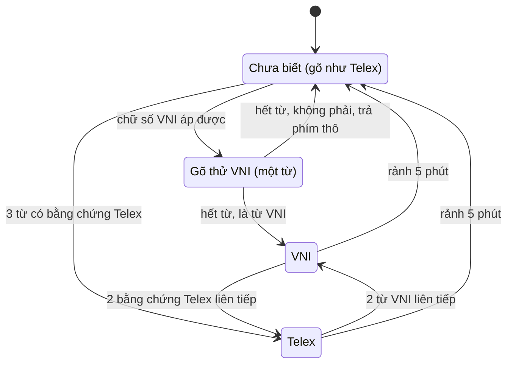
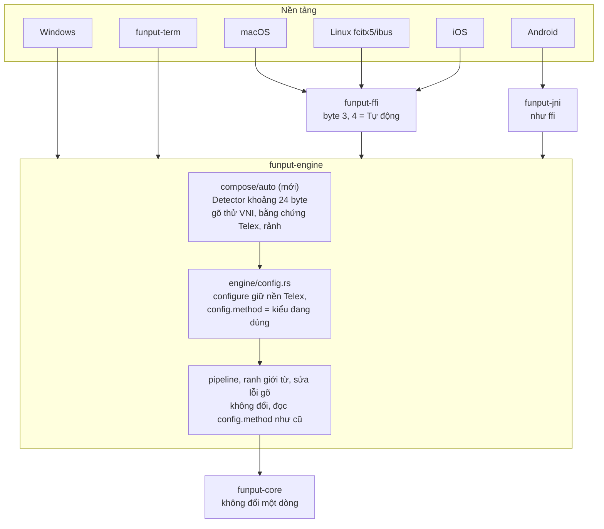

# Kiểu gõ Tự động: nhận biết Telex hay VNI theo phiên

## Trạng thái

**Để dành, chờ nhu cầu.** Thiết kế đã xong nhưng chưa lên lịch hiện thực.

Lý do để dành:

- Lợi ích hẹp: chỉ giúp nhiều người gõ khác kiểu dùng chung một tài khoản trên một máy. Mỗi người một
  tài khoản hệ điều hành thì cài đặt đã tách riêng sẵn.
- Chi phí không nhỏ: module nhận biết trong engine, luật `configure` hai chiều, nối config, FFI, JNI và
  giao diện, thêm một cấu hình phải chạy trong bộ diff, và mọi luật gõ viết sau phải tính tới nó.
- Vẫn còn ca chốt nhầm (`lan2`, `bai1`) cho một tính năng chỉ là nên có.

Việc rẻ hơn nên làm trước: hiện rõ kiểu gõ đang dùng trên biểu tượng thanh menu hoặc khay hệ thống, kèm
phím tắt chuyển nhanh. Việc đó nằm ở nền tảng, không đụng engine.

Làm lại khi có tín hiệu thật: có issue hoặc người dùng yêu cầu, hoặc Funput nhắm tới môi trường dùng
chung như trường học, phòng máy. Khi đó bắt đầu từ PR 1 ở mục
[Kế hoạch triển khai](#kế-hoạch-triển-khai-theo-pr). Chỗ nào hiện thực lệch khỏi bản viết này thì sửa lại
ngay trong PR đó và đánh dấu **Đã đổi khi hiện thực**.

Đây là tính năng **nên có**, không phải tính năng chính. Mọi quyết định bên dưới ưu tiên một điều:
người không bật Tự động không thấy bất kỳ thay đổi nào, và người bật Tự động gõ y như kiểu gõ cố định
sau khi Funput đã nhận ra kiểu gõ.

## Tóm tắt

Nhiều người dùng chung một máy (máy gia đình, máy văn phòng, phòng máy), người gõ Telex, người gõ
VNI. Kiểu gõ **Tự động** cho Funput tự nhận ra kiểu gõ của người đang ngồi gõ, **nhớ nó cho cả phiên**,
và từ đó xử lý y hệt kiểu gõ cố định tương ứng. Không ai phải vào cài đặt đổi kiểu gõ.

- Khi chưa biết, Funput gõ như Telex và chỉ quan sát chữ số.
- Gặp một chữ số làm VNI bỏ dấu được (`vie6` thành `viê`) thì **gõ thử** phần còn lại của từ theo VNI.
  Phán ở cuối từ: ra một từ VNI thật (`việt`) thì chốt VNI. Không ra (`tuan1990`, `nam2024`) thì trả từ
  về phím thô và coi như chưa thấy gì.
- Đã nhận ra rồi thì engine đặt `config.method` sang kiểu đó, mọi luật gõ chạy đúng đường của kiểu cố
  định. Không luật nào trong engine phải biết Tự động tồn tại.
- Phiên kết thúc khi không ai gõ trong 5 phút, hoặc khi bằng chứng ngược chiều lặp lại liên tiếp
  (người khác ngồi vào máy).

Toàn bộ logic nằm trong `funput-engine`. `funput-core` không đổi một dòng nào. 5 nền tảng chỉ thêm một
lựa chọn trong cài đặt.

**Mục tiêu**

- Người gõ Telex và người gõ VNI dùng chung một cấu hình mà không phải đổi kiểu gõ.
- **Không tụt hậu với kiểu gõ cố định:** Tự động tắt thì Telex, Telex nâng cao và VNI giữ nguyên từng
  byte so với `main`.
- **Tự động mà không gõ chữ số thì giống hệt Telex**, trên toàn bộ phiên chứ không chỉ một từ.
- **Đã chốt thì giống hệt kiểu cố định:** từ phím chốt trở đi, kết quả bằng kiểu cố định gõ cùng chuỗi
  phím.
- Không cấp phát thêm trên luồng phím nóng. `Session` tăng khoảng 24 byte, không dùng thêm heap.

**Phi mục tiêu**

- Không cho một người gõ lẫn Telex và VNI trong cùng một câu. Bản thiết kế khoá theo từng từ trước đây
  đã bị bỏ vì quá phức tạp so với nhu cầu thật.
- Không sửa lại những từ đã gõ xong trước khi Funput nhận ra kiểu gõ.
- Không học thói quen gõ, không lưu gì về văn bản đã gõ, không lưu kiểu đã nhận ra xuống đĩa.
- Không đoán kiểu gõ theo ứng dụng hay theo tài khoản hệ điều hành.

## Đặc tả hành vi

Engine giữ một trạng thái nhận biết cho cả phiên, sống qua các ranh giới từ.



Ở mọi trạng thái, bật lại Tự động trong cài đặt hoặc host gọi `Engine::reset_auto_method()` cũng đưa về
Chưa biết.

**Chưa biết** gõ đúng như nền Telex đã cấu hình (Telex hoặc Telex nâng cao). Khác biệt duy nhất là
chữ số giữa một từ còn thô có thể mở **gõ thử VNI** cho riêng từ đó. Người gõ Telex không gõ chữ số
dính chữ thì không thấy gì khác ngay từ phím đầu tiên.

**Gõ thử VNI** chỉ có ở trạng thái Chưa biết và chỉ kéo dài một từ. Nó cần thiết vì người gõ VNI phải
thấy `việt` ngay ở từ đầu tiên, không thể đợi hết từ mới bỏ dấu. Cái giá là người gõ Telex lỡ gõ
`tuan1990` sẽ thấy `tuán` nháy lên ở một phím, rồi phím `9` kế tiếp tự trả về thô. Đó cũng là điều VNI
cố định làm với chuỗi này.

**Telex** và **VNI** là kiểu cố định thật sự: `session.config.method` mang giá trị đó, và mọi luật
(ranh giới từ, khôi phục tiếng Anh, collision, sửa lỗi gõ, gõ tắt) chạy đúng như khi người dùng chọn
kiểu đó trong cài đặt.

### Bằng chứng VNI

Bằng chứng VNI là **một từ trọn vẹn**, phán ở ranh giới từ, không phải một phím. Phán ở một phím là
sai: `tuan1` ra `tuán` trông hợp lệ, nhưng phím `9` tiếp theo làm chính VNI cố định bỏ dấu và trả về
`tuan1990` thô.

**Mở gõ thử (tại phím chữ số, chỉ ở trạng thái Chưa biết).** Chữ số đầu từ, chữ số bàn phím số và
`500k` không tới được đây, nên không đổi gì. Mở gõ thử khi đủ ba điều kiện:

1. Từ đang gõ vẫn còn thô: `keys == buffer`, chưa có lần huỷ dấu nào (`literal` chưa bật), chưa bị lật
   (`restore_override` rỗng). Nghĩa là Telex chưa biến đổi chữ nào trong từ.
2. Từ đã có ít nhất 2 ký tự trước chữ số. Chặn `U23`, `a1` (`phòng a1`).
3. Áp chữ số đó theo VNI lên buffer cho kết quả `TransformKind::Applied`. Chặn `h2o`, `mp3` (không có
   nguyên âm để bỏ dấu).

Điều kiện 1 gần như luôn đúng với người gõ VNI. Âm cuối tiếng Việt chỉ là `c ch m n ng nh p t`, không
có `s f r x j w`, và người gõ VNI không gõ `aa`, `dd`. Vì vậy trước chữ số đầu tiên, từ VNI không chứa
phím bỏ dấu Telex nào. Cũng nhờ điều kiện này mà mở gõ thử không phải ghép lại gì: buffer đang là phím
thô, đúng như VNI cố định sẽ có ở cùng chỗ.

**Phán ở ranh giới từ.** Một từ là **từ VNI** khi đủ cả ba điều kiện:

1. VNI không bỏ cuộc: buffer cuối cùng khác `keys`. Loại `tuan1990`, `covid19`, `h264`, `a1b2`. VNI cố
   định tự trả các chuỗi này về thô.
2. Buffer là âm tiết hoàn chỉnh (`is_complete_syllable`).
3. Chữ số trông như người gõ VNI thật: không có quá 2 chữ số liền nhau, và chỉ có một chữ số thanh
   (`1`–`5`). Loại `nam2024` (VNI cố định ra `nãm`), `phong201` (ra `phóng`), `U23` (ra `Ủ`), `ngay12`.
   Giữ được `vie65t`, vì `6` là chữ số hình chữ và chỉ `5` là chữ số thanh.

Từ đang gõ thử mà không phải từ VNI thì ranh giới commit **phím thô**, giống như Telex cố định gõ cùng
chuỗi đó (Telex để chữ số nguyên dạng). Trạng thái quay về Chưa biết, không đếm gì.

Ở trạng thái **Telex**, engine không gõ thử, vì Telex đã chốt phải giống hệt Telex cố định. Từ có chữ
số mà Telex để nguyên thô thì được phát lại theo VNI ở ranh giới để xét ba điều kiện trên, chỉ để đếm.
Chữ trên màn hình không đổi.

Phần còn lại người gõ Telex có thể vướng là các chuỗi vừa là từ VNI vừa không phải ý họ, như `lan2`
(ra `làn`), `tang2`, `bai1`. Ở Chưa biết, gõ những chuỗi này làm từ đầu tiên sẽ chốt nhầm VNI. Phép
đo ở PR 2 đếm tần suất của ca này.

### Bằng chứng Telex

Xét tại ranh giới từ. Một từ là bằng chứng Telex khi đọc theo Telex nó là âm tiết tiếng Việt hoàn
chỉnh (`is_complete_syllable`), có **cả** một dấu thanh **lẫn** một biến đổi hình chữ (`â ă ê ô ơ ư
đ`). Ví dụ `vieejt` thành `việt`, `dduowcj` thành `được`, `nguwowif` thành `người`.

Đòi cả hai loại dấu là để chặn chữ tiếng Anh. Rất nhiều chữ tiếng Anh đọc theo Telex vẫn ra âm tiết hợp
lệ, như `see` ra `sê`, `now` ra `nơ`, `box` ra `bõ`, `bar` ra `bả`, nhưng gần như không chữ nào vừa có
nguyên âm đôi hoặc `w` vừa có phím thanh.

- Ở trạng thái **Chưa biết**, đọc thẳng buffer vừa ghép (đang gõ theo Telex), không tốn thêm phép tính
  nào ngoài lần kiểm tra âm tiết.
- Ở trạng thái **VNI**, chỉ phát lại khi từ không có chữ số và VNI để nguyên nó (`keys == buffer`).
  Trước khi phát lại còn lọc nhanh: `keys` phải có một cặp `aa ee oo dd` hoặc một chữ `w`, cộng một chữ
  trong `s f r x j`. Đa số từ của người gõ VNI có chữ số nên bị loại ngay ở bước này.
- Ở trạng thái **Telex**, không xét.

### Ngưỡng và độ trễ

Ngưỡng lệch về phía an toàn cho người đang gõ, và nghiêm hơn khi phải đảo kiểu đã chốt.

| Chuyển | Ngưỡng | Lý do |
| --- | --- | --- |
| Chưa biết sang VNI | 1 từ VNI (qua gõ thử) | người gõ VNI cần được nhận ra ngay ở từ đầu |
| Chưa biết sang Telex | 3 từ có bằng chứng Telex, không xen từ VNI | về hành vi gõ thì không đổi gì. Chốt chỉ để tắt gõ thử và bật vùng đệm chống đảo nhầm bên dưới |
| Telex sang VNI | 2 từ VNI liên tiếp | người gõ Telex đôi khi gõ dính `lan2`. Một lần không đủ để đảo |
| VNI sang Telex | 2 bằng chứng Telex liên tiếp | như trên, cho người gõ VNI gặp chữ tiếng Anh hiếm như `rows` |

"Liên tiếp" nghĩa là giữa hai bằng chứng không có từ nào mang dấu theo kiểu đang chốt. Ở trạng thái
Telex, từ nào có biến đổi Telex (`buffer != keys` sau ranh giới) thì xoá bộ đếm ngược chiều. Ở trạng
thái VNI, từ nào có chữ số đã biến đổi chữ thì xoá bộ đếm.

**Rảnh 5 phút** đo từ lúc bắt đầu từ trước đó tới lúc bắt đầu từ mới. Sau khi rảnh thì về Chưa biết và
xoá mọi bộ đếm. Với người gõ Telex quay lại máy, việc về Chưa biết không đổi gì. Với người gõ VNI, họ
được nhận ra lại ngay ở từ đầu tiên có chữ số.

### Ví dụ

| Tình huống | Diễn biến | Màn hình |
| --- | --- | --- |
| Mở máy, gõ `vie65t` | `6` mở gõ thử, hết từ là từ VNI, chốt VNI | `việt` |
| Mở máy, gõ `vieejt` | Chưa biết gõ như Telex | `việt` |
| Mở máy, gõ `tuan1990` | `1` mở gõ thử (`tuán` nháy một phím), `9` làm VNI trả về thô, hết từ không phải từ VNI | `tuan1990`, vẫn Chưa biết |
| Mở máy, gõ `nam2024` | gõ thử ra `nãm`, hết từ có 4 chữ số liền nhau, trả phím thô | `nam2024`, vẫn Chưa biết |
| Mở máy, gõ `U23`, `a1` | 1 chữ, không mở gõ thử | `U23`, `a1` |
| Mở máy, gõ `iphone15` | gõ thử, VNI tự trả về thô | `iphone15` |
| Mở máy, gõ `lan2` | gõ thử ra `làn`, là từ VNI, chốt VNI | `làn`. Ca chốt nhầm còn lại, xem Rủi ro |
| Đang VNI, người Telex ngồi vào, gõ `vieejt dduowcj` | 2 bằng chứng Telex liên tiếp, chuyển Telex sau từ thứ hai | `vieejt dduowcj`, từ thứ ba trở đi gõ đúng |
| Đang Telex, người VNI ngồi vào, gõ `vie65t tie61ng` | 2 từ VNI liên tiếp (phát lại ở ranh giới), chuyển VNI sau từ thứ hai | `vie65t tie61ng`, từ thứ ba trở đi gõ đúng |
| Người VNI ngồi vào sau khi máy rảnh 5 phút | Đã về Chưa biết | gõ đúng ngay từ đầu tiên có chữ số |
| Người Telex đang gõ, viết `lan2` | Đang Telex, mới 1 từ VNI | `lan2` |

### Ca khó

| Tình huống | Hành vi |
| --- | --- |
| Mở gõ thử giữa một từ | không phải ghép lại gì. Điều kiện 1 bảo đảm buffer đang là phím thô, đúng như VNI cố định sẽ có |
| Chốt hoặc huỷ gõ thử, đổi kiểu đã chốt | chỉ xảy ra ở ranh giới từ, ngay trước `clear()`, nên không có từ dở dang mang hai kiểu |
| Backspace trong lúc gõ thử | xoá như VNI cố định. Xoá hết từ (buffer rỗng) thì huỷ gõ thử, về Chưa biết |
| Từ gõ thử bị bung gõ tắt ở ranh giới | gõ tắt thắng như hiện nay, gõ thử bị huỷ, không đếm |
| `Engine::adopt` mở lại từ cũ | gõ theo kiểu đang chốt, như kiểu cố định |
| `Engine::configure` gọi lại với cùng cài đặt | giữ trạng thái nhận biết (xem mục Cấu hình) |
| Bàn phím iOS dựng lại controller mỗi lần đổi app | trạng thái về Chưa biết. Chấp nhận được, vì Chưa biết gõ như Telex và người gõ VNI được nhận ra ngay ở từ đầu tiên có chữ số |
| Phím Telex/VNI trên bàn phím iOS và Android (`set_method`) | người dùng tự chọn kiểu cố định, nên tắt Tự động |

## Kiến trúc

Nhận biết là trạng thái của phiên gõ, nên nó thuộc về `funput-engine`. Khi đã chốt, nó chỉ làm một việc
là đặt `session.config.method`. Đây là lý do thiết kế này nhẹ: mọi chỗ đang đọc `config.method` (pipeline,
ranh giới từ, collision, doubled, sửa lỗi gõ) tiếp tục đọc đúng chỗ đó và nhận được kiểu cố định thật.



| Tầng | Thay đổi |
| --- | --- |
| `funput-core` | Không đổi |
| `funput-engine` | Module mới `compose/auto/`. Thêm `Session::auto` và `EngineConfig::auto_method`. Ba điểm móc: mở gõ thử trong `compose_key`, xét từ ở ranh giới, đo rảnh lúc bắt đầu từ. `configure` và `set_method` hiểu cờ mới |
| `funput-config` | Trường `auto_method: bool` (serde default `false`) đặt cạnh `method` |
| `funput-ffi` / `funput-jni` | Byte kiểu gõ nhận thêm `3` = Tự động (nền Telex) và `4` = Tự động (nền Telex nâng cao). Thêm getter trạng thái nhận biết để hiện lên giao diện |
| 5 nền tảng | Thêm lựa chọn "Tự động". Tuỳ chọn: hiện kiểu đang dùng, gọi `reset_auto_method` khi mở khoá màn hình |

**Ba điểm móc, không điểm nào nằm trên đường chạy khi Tự động tắt**

| Điểm móc | Chỗ | Chạy khi nào |
| --- | --- | --- |
| Mở gõ thử | [process.rs](../../crates/funput-engine/src/engine/process.rs) `compose_key`, ngay trước `session.push_key` | cờ bật, phím là chữ số ASCII, trạng thái Chưa biết, chưa gõ thử |
| Xét từ | [boundary/mod.rs](../../crates/funput-engine/src/compose/boundary/mod.rs) `boundary_result` (gõ thử) và `on_word_boundary` (đếm) | cờ bật. Phát lại chỉ khi từ qua bộ lọc rẻ |
| Đo rảnh | `compose_key`, nhánh `keys.is_empty()` đang gọi `glue.start_word()` | cờ bật, một lần mỗi từ |

**Vì sao dùng cờ chứ không thêm `InputMethod::Auto`**

1. `Method::from_core` trong `funput-config` có `unreachable!` cho biến thể lạ. Thêm biến thể mà quên
   nối ở đâu là panic lúc chạy.
2. Serde đọc giá trị enum lạ là lỗi. File cấu hình có `"method": "auto"` chuyển sang máy chạy bản cũ
   có thể hỏng cả file. Một trường bool lạ thì bản cũ bỏ qua và gõ theo `method`.
3. `funput-core` và mọi phép so sánh `== InputMethod::Telex` trong engine chỉ cần biết ba kiểu cố định.
   Với thiết kế này, `config.method` luôn là một trong ba kiểu đó.

## Mô hình dữ liệu

```rust
// crates/funput-engine/src/compose/auto/detector.rs

/// What the auto typing method has concluded about whoever is typing.
#[derive(Debug, Clone, Copy, PartialEq, Eq, Default)]
#[repr(u8)]
pub enum DetectedMethod {
    /// Nothing seen yet: compose with the Telex base, probe digits as VNI.
    #[default]
    Undecided,
    Telex,
    Vni,
}

/// Session-wide detection state. Survives `Session::clear`; only idleness,
/// `reset_auto_method` and switching the setting reset it.
#[derive(Debug, Clone, PartialEq, Eq, Default)]
pub(crate) struct Detector {
    pub(crate) state: DetectedMethod,
    /// The user's Telex flavour (`Telex` or `TelexAdvanced`), restored whenever
    /// the state is not `Vni`.
    pub(crate) base: InputMethod,
    /// Undecided only: the live word is being composed as VNI on trial,
    /// opened by a digit and settled at the word boundary.
    pub(crate) trial: bool,
    /// Undecided: words with Telex evidence seen so far (locks at 3).
    pub(crate) telex_words: u8,
    /// Locked: consecutive evidence for the other method (flips at 2).
    pub(crate) contrary: u8,
    /// When the previous word started; the idle reset compares against it.
    pub(crate) last_word: Option<Instant>,
}
```

```rust
// EngineConfig (model/config.rs)
/// "Tự động": recognise whether the person typing uses Telex or VNI and keep
/// it for the session. `method` then names the Telex base; while the flag is
/// on, the engine itself writes the method in use into `method`.
pub auto_method: bool,
```

| Trường | Kích thước | Vòng đời |
| --- | --- | --- |
| `Session::auto: Detector` | khoảng 24 byte (`Instant` là 8 byte trên macOS và Windows, 16 byte trên Linux) | sống qua `clear()`. Reset khi rảnh, khi bật lại cờ, khi `reset_auto_method` |
| `EngineConfig::auto_method: bool` | 1 byte | cấu hình |

Không có bảng dữ liệu nào mới. Bằng chứng chỉ dùng lại bộ phân loại VNI/Telex và bộ kiểm tra âm tiết đã
có trong `funput-core`.

Một test `size_of::<Session>()` ghim kích thước, để các PR sau không âm thầm làm nó phình ra.

**Đọc đồng hồ:** `Instant::now()` chỉ được gọi lúc bắt đầu từ và chỉ khi cờ bật, tức một lần mỗi từ.
Engine đã dùng `Instant` ở [correction/mod.rs](../../crates/funput-engine/src/correction/mod.rs) nên
không thêm phụ thuộc nào. Để test không phụ thuộc thời gian thật, logic nhận một `now: Instant` do
engine truyền vào. Test tự dựng mốc thời gian bằng `Instant + Duration`.

## Luồng xử lý

### Mở gõ thử

```rust
// compose/auto/trial.rs, called from compose_key before push_key
pub(crate) fn before_digit(session: &mut Session, key: char) {
    let auto = &session.auto;
    if !session.config.auto_method
        || !key.is_ascii_digit()
        || auto.state != DetectedMethod::Undecided
        || auto.trial
        || !opens_trial(session, key)
    {
        return;
    }
    session.auto.trial = true;
    session.config.method = InputMethod::Vni; // this word only, see settle_trial
}

fn opens_trial(session: &Session, key: char) -> bool {
    session.keys == session.buffer
        && !session.literal.is_active()
        && session.restore_override.is_none()
        && session.keys.chars().nth(1).is_some()
        && apply_with(&session.buffer, key, session.config.compose_options_for(InputMethod::Vni)).kind
            == TransformKind::Applied
}
```

Sau `before_digit`, `compose_key` chạy tiếp như cũ. `pipeline::process` đọc `config.method == Vni` và áp
chữ số, rồi mọi phím còn lại của từ, đúng như VNI cố định. Phép thử bỏ đi một `TransformResult`, nghĩa
là thêm một `String` ngắn, chỉ ở chữ số giữa từ khi đang Chưa biết.

`EngineConfig::compose_options()` tách thành `compose_options_for(method)`. Hàm cũ gọi hàm mới với
`self.method`, nên mọi chỗ gọi khác không đổi.

### Phán từ VNI

Một hàm thuần dùng chung cho cả gõ thử lẫn phát lại ở trạng thái Telex:

```rust
// compose/auto/vni_word.rs
/// Whether `composed` (VNI's rendering of `keys`) is a word a VNI typist meant.
pub(crate) fn is_vni_word(rules: SyllableRules, keys: &str, composed: &str) -> bool {
    composed != keys                       // VNI did not back out (tuan1990)
        && digits_look_typed(keys)         // ≤ 2 in a row, one tone digit (nam2024, U23)
        && rules.is_complete_syllable(composed)
}
```

`digits_look_typed` chỉ quét `keys` một lượt, không cấp phát. `is_complete_syllable` chỉ chạy khi hai
điều kiện rẻ đã qua.

### Xét từ ở ranh giới

`boundary_result` gọi `auto::settle_trial` ngay sau nhánh gõ tắt, trước khôi phục tiếng Anh. Gõ tắt vẫn
thắng như hiện nay. Gõ thử bị huỷ thì trả phím thô bằng chính `replace_word` mà khôi phục tiếng Anh
đang dùng, nên không có đường xuất chữ mới nào.

```rust
// compose/auto/boundary.rs, inside boundary_result after the gõ tắt branch
pub(crate) fn settle_trial(session: &mut Session, boundary_key: char) -> Option<ImeResult> {
    if !session.auto.trial {
        return None;
    }
    session.auto.trial = false;
    if is_vni_word(session.config.syllable_rules, &session.keys, &session.buffer) {
        switch_to(session, DetectedMethod::Vni);
        return None; // commit exactly as fixed VNI would
    }
    session.config.method = session.auto.base;
    (session.buffer != session.keys).then(|| replace_word(session, &session.keys, boundary_key))
}

// compose/auto/boundary.rs, from on_word_boundary for every other word
pub(crate) fn at_boundary(session: &mut Session) {
    if !session.config.auto_method {
        return;
    }
    match session.auto.state {
        DetectedMethod::Undecided => count_telex_word(session),   // reads buffer
        DetectedMethod::Vni => count_contrary_telex(session),     // replays keys as Telex if prefiltered
        DetectedMethod::Telex => count_contrary_vni(session),     // replays keys as VNI if they hold a digit
    }
}
```

Phát lại dùng `apply_with` từng phím của `keys` trên một `String` cục bộ, theo kiểu gõ bên kia. Không
chạy luật ranh giới, khôi phục tiếng Anh hay sửa lỗi gõ. Từ đó vẫn được commit đúng như kiểu đang chốt.
Không sửa chữ trên màn hình.

Backspace xoá hết từ đang gõ thử thì `resync_after_backspace` huỷ gõ thử và trả `config.method` về nền
Telex, để từ gõ lại sau đó bắt đầu như mới.

### Đo rảnh

```rust
// compose/auto/idle.rs, called where compose_key starts a word
pub(crate) const IDLE_RESET: Duration = Duration::from_secs(5 * 60);

pub(crate) fn on_word_start(session: &mut Session, now: Instant) {
    if !session.config.auto_method {
        return;
    }
    let idle = session.auto.last_word.is_some_and(|then| now - then >= IDLE_RESET);
    session.auto.last_word = Some(now);
    if idle {
        switch_to(session, DetectedMethod::Undecided);
    }
}
```

`switch_to` đặt `state`, xoá `trial`, `telex_words` và `contrary`, rồi ghi `config.method`: `Vni` cho VNI, còn
lại là `base`. Nó **không** đi qua `configure`, vì `configure` xoá từ đang gõ khi kiểu gõ đổi.

## Cấu hình, giao thức và tương thích ngược

Khi cờ bật, `EngineConfig::method` mang hai nghĩa tuỳ chiều. Đi vào (host gửi cấu hình) thì đó là nền
Telex. Đi ra (`Engine::config()`) thì đó là kiểu đang dùng. Hai luật trong `configure` giữ cho việc này
an toàn:

1. Cấu hình vào có `auto_method` bật và `method` là `Telex` hoặc `TelexAdvanced`: cập nhật `base`. Nếu
   `method` là `Vni` thì giữ `base` cũ. Cách này để `update_config` (sao chép cấu hình đang có, sửa một
   trường, gửi lại) không bao giờ làm mất nền Telex.
2. `method` được thay bằng kiểu đang dùng trước khi so sánh `method_changed`. Host gửi lại cùng cài đặt
   thì không xoá từ đang gõ, không mất trạng thái nhận biết.

Cờ chuyển từ tắt sang bật thì trạng thái về Chưa biết. Cờ chuyển sang tắt thì `method` là đúng giá trị
host gửi, như hiện nay.

| Tầng | Biểu diễn | Bản cũ đọc giá trị mới |
| --- | --- | --- |
| `Engine` API | `configure` như trên. `set_method(m)` tắt Tự động rồi đặt `m`. Thêm `reset_auto_method()` và `auto_method_state() -> Option<DetectedMethod>` (`None` khi cờ tắt) | không áp dụng |
| `funput-config` (file cài đặt) | `"auto_method": true` với `#[serde(default)]`. `method` giữ nền Telex | bỏ qua trường lạ và gõ theo `method`. Crate không dùng `deny_unknown_fields` |
| Tài liệu chuyển cấu hình ([CONFIG_FORMAT.md](../../platforms/CONFIG_FORMAT.md)) | khoá `auto_method`. ID kiểu gõ giữ nguyên `telex` / `telex_advanced` / `vni` | như trên |
| `funput-ffi` | byte `3` = Tự động nền Telex, `4` = Tự động nền Telex nâng cao. `decode_method` trả về `(InputMethod, bool)`. Getter kiểu gõ trả `3`/`4` khi cờ bật, không trả kiểu đang dùng, để host lưu lại cài đặt không bị đổi. Thêm `funput_engine_auto_method_state` | `decode_method` hiện đã quy giá trị lạ về Telex |
| `funput-jni` | cùng bảng giá trị, khớp `EngineConfiguration` bên Kotlin | đã quy giá trị lạ về Telex |
| Nhập cấu hình UniKey | UniKey không có Tự động, không đổi | không áp dụng |

**Không có di chuyển dữ liệu:** cài đặt có sẵn không có `auto_method` nên đọc ra `false`. Người dùng
hiện tại không thấy gì thay đổi.

**Phím tắt xoay vòng kiểu gõ** (`funput-term` và các nền tảng có phím tắt): Telex, VNI, Tự động, rồi
quay lại Telex.

## Việc trên 5 nền tảng

Nền tảng không chứa logic nhận biết nào và không phải sửa đường xử lý Backspace. Mỗi nền tảng chỉ thêm
một lựa chọn trong cài đặt. Hai việc còn lại là tuỳ chọn.

| Nền tảng | Cài đặt | Hiện kiểu đang dùng (tuỳ chọn) | Reset khi mở khoá (tuỳ chọn) |
| --- | --- | --- | --- |
| macOS | bộ chọn kiểu gõ | menu thanh trạng thái, ví dụ "Tự động (VNI)" | thông báo mở khoá màn hình của hệ thống |
| Windows | Control Center | nhãn trên biểu tượng khay | sự kiện mở khoá phiên |
| Linux fcitx5/ibus | trang Gõ chữ trong [typing.rs](../../platforms/linux/settings-gtk/src/settings_window/typing.rs) | nhãn IME. Sửa một lần trong `common/compose/` | không cần, đã có rảnh 5 phút |
| iOS | KeyboardConfiguration, ghi qua App Group | không cần | không cần, controller dựng lại mỗi lần đổi app |
| Android | trang Gõ chữ trong settings hub | không cần | không cần |
| funput-term | schema cấu hình | dòng trạng thái | không cần |

**Đề xuất:** chỉ hiện Tự động trên máy tính (macOS, Windows, Linux) ở bản đầu. Máy dùng chung chủ yếu
là máy tính. Điện thoại thường là đồ cá nhân, và trên iOS và Android người dùng đã có phím Telex/VNI ngay
trên bàn phím. Engine vẫn hỗ trợ đầy đủ để bật cho di động sau này mà không phải sửa Rust.

## Hiệu năng và bộ nhớ

| Đường chạy | Thêm khi Tự động tắt | Thêm khi Tự động bật | Cấp phát thêm |
| --- | --- | --- | --- |
| Phím chữ cái | 1 kiểm tra bool | như bên trái | 0 |
| Phím đầu từ | 1 kiểm tra bool | 1 lần đọc đồng hồ | 0 |
| Chữ số giữa từ, Chưa biết | 1 kiểm tra bool | so `keys == buffer` rồi 1 lần `apply_with` theo VNI để mở gõ thử | 1 `String` ngắn, chỉ khi qua được kiểm tra rẻ |
| Ranh giới của từ gõ thử | 1 kiểm tra bool | quét chữ số trong `keys`, rồi 1 lần `is_complete_syllable` | 1 |
| Ranh giới từ, trạng thái Chưa biết | 1 kiểm tra bool | 1 lần `is_complete_syllable`, chỉ khi buffer có cả dấu thanh lẫn dấu hình chữ | 1, trong vài từ đầu phiên |
| Ranh giới từ, trạng thái VNI | 1 kiểm tra bool | lọc nhanh trên `keys`, phát lại hiếm khi xảy ra | vài `String` ngắn mỗi lần phát lại |
| Ranh giới từ, trạng thái Telex | 1 kiểm tra bool | 1 so sánh chuỗi. Từ có chữ số thì phát lại theo VNI | 0, trừ từ có chữ số |

Sau khi chốt Telex, đường chạy gần như trùng Telex cố định. Chi phí chỉ còn ở chữ số giữa từ, vốn rất
hiếm khi gõ tiếng Việt bằng Telex.

**Bộ nhớ:** `Session` tăng khoảng 24 byte, `EngineConfig` tăng 1 byte. Không có heap thường trực, không
có bảng tĩnh. `funput-core` không đổi nên kích thước binary và ngân sách bộ nhớ bàn phím iOS không bị
ảnh hưởng.

**Cổng chặn trong CI**

- Ngân sách cấp phát mỗi phím (hiện là 2 lần, 24 byte) chạy thêm cấu hình `auto_method = true` trên
  chuỗi không có chữ số. Con số không được tăng.
- Bench độ trễ [latency.rs](../../crates/funput-ffi/benches/latency.rs) thêm biến thể Tự động. Chênh lệch
  so với Telex phải nằm trong nhiễu đo.
- Test `size_of::<Session>()`.
- Cổng tối đa 150 dòng mỗi file. `compose/auto/` chia sẵn thành `detector.rs`, `probe.rs`,
  `boundary.rs`, `idle.rs`, `mod.rs` và thư mục test riêng.

## Kiểm thử

Bảo đảm "không ảnh hưởng chức năng chính" bằng bốn bất biến kiểm bằng máy, cộng một phép đo để quyết
định có ship hay không.

| # | Bất biến | Cách kiểm |
| --- | --- | --- |
| I0 | Tự động tắt: kết quả trùng từng byte với `main` ở Telex, Telex nâng cao và VNI | bộ diff 70k chuỗi phím so với worktree baseline (`funput dev run`) |
| I1 | Tự động bật, phiên không có chữ số: trùng từng byte với nền Telex tương ứng | cùng bộ diff, lọc bỏ chuỗi có chữ số, chạy cả phiên liền mạch chứ không reset giữa các từ |
| I2 | Từ gõ thử được chốt: kết quả bằng VNI cố định gõ cùng chuỗi phím. Từ gõ thử bị huỷ: chữ commit bằng Telex cố định gõ cùng chuỗi phím (Telex để nguyên thô mọi chuỗi có chữ số dính chữ, đã kiểm bằng `funput dev run`) | property test. Điều kiện 1 khi mở gõ thử là thứ làm vế đầu đúng |
| I3 | `configure` gọi lại với cùng cài đặt không đổi trạng thái nhận biết, không xoá từ đang gõ. `update_config` không làm mất nền Telex | unit test, gồm vòng đi về qua FFI byte `3`/`4` |

**Unit test** (`compose/auto/tests/`): mỗi dòng trong bảng Ví dụ và bảng Ca khó là một test. Thêm test
cho mọi cạnh của sơ đồ trạng thái, cho bộ đếm bị xoá khi xen từ cùng chiều, và cho rảnh đúng 5 phút
(dùng `Instant` dựng sẵn).

**Phép đo quyết định:** chạy một kho văn bản tiếng Anh, code và chuỗi có số (username, mã đơn,
`U23`, `iphone15`, `covid19`, `tuan1990`) qua Tự động, mô phỏng hai người dùng:

- Người gõ Telex: đếm số lần bị chuyển nhầm sang VNI.
- Người gõ VNI: đếm số lần bị chuyển nhầm sang Telex, và số từ gõ sai trước khi được nhận ra.

Theo quy tắc không tụt hậu tiếng Anh của dự án, người gõ Telex dùng Tự động không được thấy chữ tiếng
Anh nào khác Telex cố định. Các con số chuyển nhầm được ghi vào tài liệu này để chốt ngưỡng.

**Nền tảng:** chỉ có thay đổi cài đặt, nên mỗi nền tảng thử tay theo một checklist ngắn: chọn Tự động,
gõ VNI, gõ Telex, khởi động lại, kiểm tra cài đặt cũ vẫn giữ.

## Kế hoạch triển khai theo PR

1. **`feat(engine): auto typing method detected per session`.** Thêm `compose/auto/`,
   `EngineConfig::auto_method`, luật trong `configure` và `set_method`, `reset_auto_method`,
   `auto_method_state`. Kèm unit test, I0 đến I3 và các cổng ngân sách cấp phát, bench, kích thước
   `Session`. Tiêu chí xong: I0 và I1 sạch trên bộ diff 70k.
2. **Điểm dừng đo.** Chạy phép đo chuyển nhầm trên bản PR 1, ghi kết quả vào đây. Ngưỡng có vấn đề thì
   chỉnh trước khi đi tiếp.
3. **`feat(config): auto typing method in settings and wire protocols`.** Gồm `funput-config`,
   `CONFIG_FORMAT.md`, byte `3`/`4` ở FFI và JNI, getter trạng thái, phím xoay vòng của `funput-term`.
   Phụ thuộc PR 1.
4. **PR nền tảng, độc lập với nhau, sau PR 3:** `feat(macos)`, `feat(windows)`, `feat(linux)`. iOS và
   Android chỉ làm khi quyết định hiện Tự động trên di động.

Rủi ro tập trung ở PR 1, và PR này được I0 bảo vệ: Tự động tắt thì mọi điểm móc trả về ngay ở lần kiểm
tra bool đầu tiên.

## Rủi ro và câu hỏi mở

| Rủi ro | Giảm nhẹ | Nếu xảy ra |
| --- | --- | --- |
| Người gõ Telex vừa mở máy gõ dính `lan2`, `tang2`, `bai1` làm từ đầu tiên, bị chốt nhầm VNI | phán ở cuối từ đã loại `tuan1990`, `nam2024`, `U23`. Ca còn lại được đếm ở PR 2 | thấy `làn`. Hai từ Telex có dấu liên tiếp sau đó đưa về Telex |
| Người gõ Telex thấy `tuán` nháy một phím khi gõ `tuan1990` | chỉ ở trạng thái Chưa biết, tức vài từ đầu phiên | chữ cuối cùng đúng như Telex cố định |
| Người gõ VNI gặp hai chữ tiếng Anh hiếm liền nhau (`rows sees`) | đòi cả dấu thanh lẫn dấu hình chữ, 2 lần liên tiếp | chuyển sang Telex. Chữ số VNI kế tiếp bắt đầu đếm để đưa về |
| Người thứ hai ngồi vào trong vòng 5 phút | bằng chứng ngược chiều 2 lần liên tiếp | 1 đến 2 từ đầu gõ sai, sau đó đúng |
| Host lưu lại `config().method` làm cài đặt | getter FFI và JNI trả `3`/`4`. Tài liệu API ghi rõ `config().method` là kiểu đang dùng | cài đặt bị đổi sang VNI cố định. Test I3 chặn ở tầng cầu nối |
| Luật mới sau này đọc `base` thay vì `config.method` | `base` là `pub(crate)` trong `compose/auto/`, không lộ ra ngoài module | không áp dụng |

**Câu hỏi mở**

- [ ] Thời gian rảnh 5 phút có hợp lý không, hay nên dài hơn (ví dụ 10 phút)?
- [ ] Có hiện Tự động trên iOS và Android ở bản đầu không?
- [ ] Có cần hiện kiểu đang dùng trên menu hoặc khay hệ thống ngay từ bản đầu không?
- [ ] Giao diện có cho chọn Tự động nền Telex nâng cao (byte `4`), hay chỉ nền Telex?
- [ ] Tên trên giao diện: "Tự động" hay "Tự nhận Telex hoặc VNI"?
- [ ] Khi chuyển sang Telex ở ranh giới từ, có nên sửa lại luôn từ vừa gõ (`dduowcj` thành `được`)
      không? Bản này chọn không, để ranh giới từ giữ nguyên đường chạy của VNI cố định.
