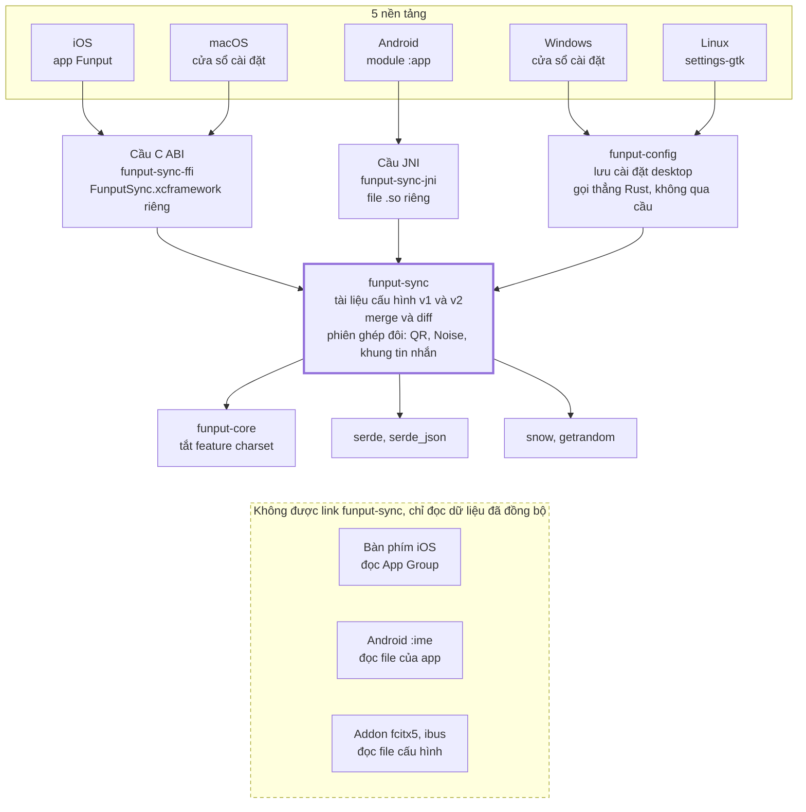
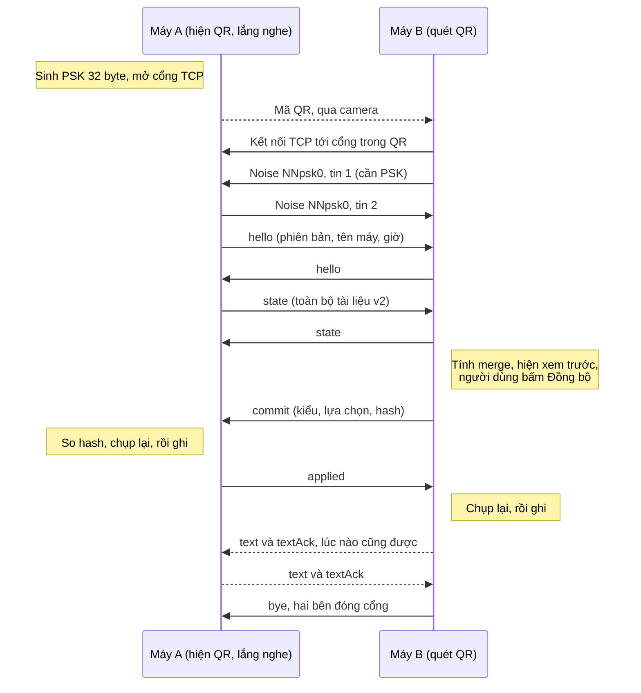

# Đồng bộ cục bộ giữa các thiết bị

> **Trạng thái: đã chốt thiết kế, chưa có code.** Người duyệt chốt các quyết định ngày 06/11/2026.

Nguồn: issue #633 (Epic). Liên quan: #150 (Clipboard Manager), #552 (Từ điển cá nhân), [shortcut-file-sync.md](shortcut-file-sync.md) (nhập, xuất bảng gõ tắt dạng txt), [CONFIG_FORMAT.md](../../platforms/CONFIG_FORMAT.md).

## Tóm tắt

Funput đồng bộ **cài đặt gõ và bảng gõ tắt** giữa hai thiết bị bất kỳ trong 5 nền tảng (iOS, Android, macOS, Windows, Linux), **không qua server và không cần tài khoản**. Hai máy ghép đôi bằng mã QR, rồi truyền thẳng qua mạng LAN có mã hoá. Nếu không dùng được QR hoặc LAN thì rơi về Export/Import file.

Tính năng giao theo 4 đợt, mỗi đợt tự dùng được:

1. **Nền móng:** gom định dạng `app.funput.config` về một bản Rust duy nhất, nâng lên schema v2, và đưa Export/Import file lên iOS và Android.
2. **Ghép đôi QR + LAN:** đồng bộ trực tiếp giữa desktop với điện thoại và giữa hai điện thoại.
3. **Gửi đoạn văn bản:** gửi một đoạn chữ từ máy này sang máy kia. Trên điện thoại, đoạn chữ hiện thành chip trên bàn phím, chạm vào là chèn, không đi qua clipboard.
4. **Từ điển cá nhân:** đồng bộ từ tự thêm và từ đã chặn giữa hai điện thoại.

Tài liệu này viết cho người duyệt đọc trước, và cho coding agent làm theo sau khi duyệt. Các quyết định người duyệt đã chốt nằm ở mục **Quyết định đã chốt** cuối tài liệu.

## Phạm vi và nguyên tắc

Bản này chỉ đồng bộ những gì người dùng **tự tay tạo ra**, và chỉ truyền khi người dùng **chủ động bấm**.

### Trong phạm vi

- Đồng bộ cài đặt gõ dùng chung (`preferences`) và bảng gõ tắt (`shortcuts`).
- Export/Import file trên cả 5 nền tảng.
- Ghép đôi bằng QR và truyền qua LAN cho các cặp desktop với mobile, mobile với mobile.
- Gửi một đoạn văn bản giữa hai thiết bị đã ghép đôi.

### Ngoài phạm vi (có chủ đích)

| Không làm | Lý do |
| --- | --- |
| Server Funput, tài khoản, đồng bộ qua Internet | Trái với yêu cầu riêng tư và không phụ thuộc. Chi phí vận hành và pháp lý lớn. |
| Đồng bộ nền, tự động theo lịch | Một bộ gõ tự mở kết nối mạng sẽ làm mất lòng tin. iOS cũng không cho chạy nền kiểu này. |
| Gửi file | Đã có LocalSend. Chi phí chạy nền, quyền truy cập file và bề mặt tấn công lớn hơn nhiều. |
| Dữ liệu tự học (trigram, lịch sử gợi ý, JournalChain) | Sinh ra từ nội dung người dùng gõ. Xem nguyên tắc 2. |
| Từ điển cá nhân (#552) | Không thuộc 3 đợt đầu. Làm ở đợt 4: chỉ từ tự thêm và từ đã chặn, giữa hai điện thoại. |
| Theme của iOS và Android | Định dạng riêng, để sau. |
| Chèn thẳng đoạn văn vào ô đang gõ trên desktop | Cần thêm kênh liên lạc giữa cửa sổ cài đặt và bộ gõ (Linux là hai tiến trình). Bản đầu chỉ cho vào clipboard. |
| Ghép đôi desktop với desktop qua mạng | Hai máy tính không quét QR của nhau được. Bản đầu dùng file. |

### Nguyên tắc bắt buộc

Mọi PR của tính năng này phải giữ đúng các nguyên tắc dưới đây. Reviewer từ chối PR vi phạm.

1. **Không có bên thứ ba.** Dữ liệu chỉ đi thẳng giữa hai thiết bị của người dùng, hoặc qua file do chính họ mang đi.
2. **Không đồng bộ dữ liệu sinh ra từ nội dung gõ.** Chỉ đồng bộ thứ người dùng tự nhập hoặc tự bật tắt. Nguyên tắc này được ghi vào `CONFIG_FORMAT.md`.
3. **Chỉ mở mạng khi người dùng đang ở màn hình đồng bộ.** Rời màn hình, xong việc, hoặc hết 2 phút thì đóng cổng và huỷ khoá.
4. **Không đưa code mạng vào tiến trình bàn phím iOS** và vào addon fcitx5/ibus.
5. **Import không bao giờ làm mất dữ liệu im lặng.** Mọi thay đổi được xem trước và người dùng xác nhận.
6. **Không tự đọc clipboard.** Gửi đoạn văn lấy từ ô nhập người dùng gõ hoặc dán vào, không tự lấy từ clipboard (giữ quy tắc của iOS).

## Hiện trạng code

Định dạng `app.funput.config` v1 đã đủ tốt để Import, nhưng đang được cài đặt **3 lần**, chưa có trên mobile, và thiếu những gì đồng bộ cần. Số liệu lấy từ nhánh `main` tại commit `fc6d5897`.

| Nơi | Cách cài đặt | Ghi chú |
| --- | --- | --- |
| `crates/funput-config/src/transfer/` | Rust, bản chuẩn | Windows gọi trực tiếp. Phụ thuộc `funput-core` với feature `charset` (do phần import UniKey cần). |
| `platforms/linux/settings-gtk/src/config_transfer/` | Rust, **bản copy** | Crate này đã phụ thuộc `funput-config` nhưng vẫn tự khai báo lại `ConfigDocument`. |
| `platforms/macos/Funput/Model/ConfigDocument.swift` | Swift, **bản copy** | Bản đầu tiên, các bản kia theo sau. |
| iOS, Android | **Chưa có** | `funput-ffi` và `funput-jni` không phụ thuộc `funput-config`. |

### Những điểm ảnh hưởng tới thiết kế

- **Gõ tắt chưa có id chung.** iOS (`FunputShared/Shortcuts/TextShortcut.swift`) và Android (`shortcut-store/.../TextShortcut.kt`) đều có `id: UUID`. Rust desktop (`funput-config/src/settings/model.rs`) chỉ có `trigger` và `expansion`. Khi export thì v1 bỏ UUID đi.
- **Import v1 chỉ gộp, không xoá.** Đúng cho Import thủ công, nhưng khi đồng bộ thì một gõ tắt đã xoá trên máy A sẽ quay lại từ máy B.
- **`funput-ffi` cố ý không mang bảng charset** vào bàn phím iOS và Android (có CI kiểm tra). Vì vậy không được nối thẳng `funput-config` hiện tại vào mobile.
- **iOS:** một `FunputCore.xcframework` dùng chung cho app và extension. App Group `group.app.funput.funput`. Bản iOS tối thiểu là 16.0.
- **Android:** module `:app` khai báo `INTERNET` (cho tab tin tức), module `:ime` gỡ quyền này khỏi manifest của chính nó. `minSdk` là 26. Gõ tắt nằm trong module `:shortcut-store`.

## Dữ liệu và schema v2

Schema v2 giữ nguyên `schema: "app.funput.config"` và các trường của v1. Nó chỉ **thêm** trường mới, nên bản Funput cũ đọc file v2 vẫn ra đúng cài đặt và gõ tắt còn sống. Mỗi lần đồng bộ, hai máy gửi cho nhau **toàn bộ trạng thái**, không gửi phần chênh lệch, vì dữ liệu chỉ cỡ vài chục KB.

### Trường mới

| Trường | Kiểu | Ý nghĩa |
| --- | --- | --- |
| `version` | `2` | Bản cũ vẫn đọc được, theo quy tắc "phiên bản mới hơn thì đọc phần hiểu được" đã có. |
| `source.deviceId` | UUID | Sinh một lần khi cài, giữ vĩnh viễn. Dùng để phân xử khi hai bản sửa có cùng thời điểm. |
| `source.deviceName` | chuỗi | Tên hiển thị, ví dụ "MacBook của Nam". Người dùng sửa được. |
| `preferencesUpdatedAt` | map tên → thời điểm | Thời điểm sửa của từng cài đặt. Nằm riêng để `preferences` vẫn giữ đúng hình dạng v1. |
| `shortcuts[].id` | UUID | Danh tính của gõ tắt. iOS và Android đã có, desktop cần thêm. |
| `shortcuts[].updatedAt` | thời điểm | Lần sửa cuối. |
| `shortcutTombstones[]` | `{ id, trigger, deletedAt }` | Gõ tắt đã xoá. Nằm riêng để bản v1 không hiểu nhầm thành gõ tắt còn sống. |

Thời điểm viết theo ISO-8601 UTC, đến mili giây, ví dụ `2026-11-05T08:30:12.345Z`. Thiếu thời điểm thì coi là "không rõ" (giá trị 0).

**Chỗ dành sẵn cho đợt 4:** khoá `dictionary` gồm `added[]` (`word`, `updatedAt`), `blocked[]` (`word`, `updatedAt`) và `removed[]` (`word`, `removedAt`). PR 2 định nghĩa khoá này và đọc qua mà không áp dụng. Chỉ chứa từ người dùng tự thêm hoặc tự chặn, không bao giờ chứa từ tự học. Desktop không có từ điển nên giữ nguyên khoá khi gộp, không xoá.

```json
{
  "schema": "app.funput.config",
  "version": 2,
  "exportedAt": "2026-11-05T08:30:12.345Z",
  "source": { "platform": "ios", "appVersion": "1.2026.45",
              "deviceId": "6f1c…", "deviceName": "iPhone của Nam" },
  "preferences": { "inputMethod": "telex", "toneStyle": "modern" },
  "preferencesUpdatedAt": { "inputMethod": "2026-11-01T02:00:00.000Z" },
  "shortcuts": [
    { "id": "9b2e…", "trigger": "vn", "expansion": "Việt Nam",
      "updatedAt": "2026-10-30T09:12:00.000Z" }
  ],
  "shortcutTombstones": [
    { "id": "41ad…", "trigger": "hcm", "deletedAt": "2026-11-02T10:00:00.000Z" }
  ]
}
```

### Quy tắc gộp khi đồng bộ

Cùng một hàm `merge(local, remote)` chạy trên cả hai máy và phải ra **cùng một kết quả**. Hàm này không phụ thuộc thứ tự (gộp A với B bằng gộp B với A) và chạy lại nhiều lần vẫn ra như cũ.

1. **Cài đặt:** từng trường, bản có `updatedAt` mới hơn thắng. Bằng nhau thì `deviceId` lớn hơn (so chuỗi) thắng.
2. **Gõ tắt cùng `id`:** bản mới hơn thắng, phân xử như trên.
3. **Tombstone:** thắng một gõ tắt cùng `id` nếu `deletedAt` ≥ `updatedAt`. Ngược lại, như khi sửa sau khi xoá ở máy kia, thì gõ tắt sống lại.
4. **Khác `id` nhưng trùng `trigger`** (hai máy tự tạo cùng một gõ tắt): giữ bản mới hơn, bản kia thành tombstone. Nếu cả hai đều không rõ thời điểm và khác nội dung, đưa vào danh sách **cần người dùng chọn** trong màn hình xem trước, mặc định giữ bản trên máy mình.
5. **Tombstone giữ 180 ngày** rồi bỏ. Một máy không đồng bộ quá 180 ngày có thể làm sống lại gõ tắt đã xoá. Chấp nhận được, ghi rõ trong tài liệu.
6. **Lệch đồng hồ:** lúc bắt tay, hai máy gửi giờ hiện tại của mình. Bên nhận cộng độ lệch vào mọi thời điểm của bên kia trước khi gộp. Không áp dụng cho Import file, vì khi đó không đo được độ lệch.

Bất biến sau khi gộp: trong các gõ tắt còn sống, không có hai mục trùng `trigger`.

### Import file giữ hành vi cũ cho v1

File v1 không có `id` và thời điểm, nên Import file v1 giữ nguyên quy tắc hiện tại: khớp theo `trigger`, bản nhập thắng, không xoá gì. Import file v2 dùng hàm `merge` ở trên, nhưng **chỉ một chiều**: máy nhập thay đổi, file không đổi.

### Nâng cấp dữ liệu cũ trên desktop

Lần đầu chạy bản mới, mỗi gõ tắt chưa có `id` được cấp một UUID mới và `updatedAt` để "không rõ". Từ đó về sau, mọi lần thêm, sửa, xoá đều ghi thời điểm. Xoá thì ghi tombstone. iOS và Android cũng phải thêm `updatedAt` và tombstone vào kho gõ tắt của mình.

Giới hạn: tài liệu tối đa 1 MB và 10.000 gõ tắt. Vượt quá thì từ chối cả tài liệu với thông báo rõ ràng.

## Kiến trúc

Mọi logic nằm trong một crate Rust mới là `funput-sync`. Các nền tảng chỉ viết giao diện, camera, và phần chuyển đổi giữa kho dữ liệu của mình với tài liệu JSON.



Bàn phím iOS, module `:ime` của Android và addon fcitx5, ibus không link `funput-sync`. Chúng chỉ đọc kết quả đã ghi xuống, như cách đang đọc cấu hình hiện nay.

### Cấu trúc crate `funput-sync`

| Thư mục | Việc |
| --- | --- |
| `document/` | Kiểu dữ liệu v1 và v2, đọc, ghi, kiểm tra giới hạn |
| `merge/` | Hàm `merge` và ba kiểu đồng bộ (gộp, đẩy, kéo) |
| `diff/` | So hai tài liệu, ra danh sách thêm, sửa, xoá và mục cần chọn |
| `session/` | Nội dung QR, bắt tay Noise, khung tin nhắn, máy trạng thái, giới hạn thời gian |
| `qr/` | Sinh ma trận QR từ chuỗi (crate `qrcode`). Nền tảng tự vẽ ô vuông, không cần thư viện QR riêng. |

### API qua cầu (C ABI và JNI giống nhau)

Mọi tham số và kết quả là chuỗi JSON UTF-8. Chuỗi do Rust trả về được giải phóng bằng `funput_sync_string_free`. Không truyền callback qua cầu, nền tảng tự hỏi sự kiện.

| Hàm | Vào | Ra |
| --- | --- | --- |
| `funput_sync_import_preview` | tài liệu máy mình, nội dung file | danh sách thay đổi, mục cần chọn |
| `funput_sync_import_apply` | như trên, kèm lựa chọn | tài liệu mới để ghi |
| `funput_sync_export` | tài liệu máy mình | nội dung file v2 |
| `funput_sync_session_listen` | tài liệu máy mình, tên máy | mã phiên, chuỗi QR, ma trận QR |
| `funput_sync_session_connect` | chuỗi QR đã quét, tài liệu máy mình, tên máy | mã phiên |
| `funput_sync_session_poll` | mã phiên | sự kiện kế tiếp hoặc rỗng |
| `funput_sync_session_confirm` | mã phiên, kiểu đồng bộ, lựa chọn | không |
| `funput_sync_session_send_text` | mã phiên, đoạn văn | không |
| `funput_sync_session_close` | mã phiên | không |

Sự kiện trả về từ `poll`: `connected` (tên máy kia), `preview` (thay đổi cho cả hai máy), `apply` (tài liệu nền tảng cần ghi), `applied`, `text` (đoạn văn nhận được), `error` (mã lỗi), `closed`. Sau khi ghi xong tài liệu từ sự kiện `apply`, nền tảng gọi thêm hàm `funput_sync_session_report_applied` (mã phiên, thành công hay lỗi) để phiên gửi `applied` cho máy kia.

## Giao thức ghép đôi và truyền

Một phiên gồm: quét QR, bắt tay Noise có PSK, trao đổi trạng thái, rồi ghi theo lượt. **Máy A ghi trước, máy B chỉ ghi khi A báo `applied`**, nên đứt kết nối ở bất kỳ đâu cũng không để hai máy lệch nhau mà không biết.



### Nội dung QR

QR là một URL `funput://`. Nhờ vậy, quét bằng camera của hệ thống cũng mở thẳng app Funput vào đúng màn hình.

```text
funput://pair?v=1&h=192.168.1.20,10.0.0.5&p=53817&k=<PSK base64url, 43 ký tự>
```

| Tham số | Ý nghĩa |
| --- | --- |
| `v` | Phiên bản giao thức, hiện là `1` |
| `h` | Tối đa 4 địa chỉ IPv4 riêng (10/8, 172.16/12, 192.168/16) của máy A. Bản đầu chưa hỗ trợ IPv6. |
| `p` | Cổng TCP do hệ điều hành cấp (bind cổng 0) |
| `k` | PSK 32 byte |

Tên thiết bị không nằm trong QR mà đi trong tin `hello`, để QR nhỏ và dễ quét.

### Khung tin nhắn

- Bắt tay theo mẫu Noise `NNpsk0_25519_ChaChaPoly_BLAKE2s`, mỗi tin bắt tay có 2 byte độ dài đứng trước.
- Sau bắt tay, mỗi tin ứng dụng là JSON UTF-8, có 4 byte độ dài (big-endian) đứng trước, tối đa 1 MB.
- Dòng byte đó được cắt thành các gói Noise tối đa 65.535 byte (giới hạn của Noise), mỗi gói có 2 byte độ dài đứng trước.

### Các loại tin

| `type` | Chiều | Nội dung |
| --- | --- | --- |
| `hello` | hai chiều | `protocol`, `deviceId`, `deviceName`, `platform`, `appVersion`, `now` |
| `state` | hai chiều | Tài liệu v2 đầy đủ của máy gửi |
| `commit` | B → A | `mode` (`merge`, `push`, `pull`), `choices` cho các mục cần chọn, `resultHash` |
| `applied` | A → B | `ok`, và `error` nếu ghi lỗi |
| `text` | hai chiều | `id`, `text`, `sentAt` |
| `textAck` | hai chiều | `id` |
| `error` | hai chiều | `code`, không kèm nội dung người dùng |
| `bye` | hai chiều | Kết thúc phiên |

`resultHash` là BLAKE2s của kết quả gộp ở dạng JSON chuẩn hoá (khoá sắp xếp, gõ tắt sắp theo `id`). Máy A tự tính lại với cùng lựa chọn. Khác hash thì dừng, không ghi gì.

### Thời gian và phiên bản

| Mốc | Giá trị |
| --- | --- |
| Mã QR còn hiệu lực | 2 phút, hoặc đến khi có một kết nối |
| Bắt tay phải xong trong | 10 giây |
| Phiên không hoạt động thì đóng sau | 5 phút |
| Máy B thử mỗi địa chỉ trong | 3 giây |

Hai bên báo `protocol` trong `hello`. Bản mới phải nói chuyện được với bản cũ hơn một bậc. Không tương thích thì gửi `error` với mã `version` và đóng phiên.

## Gửi đoạn văn bản

Sau khi ghép đôi, người dùng gửi được nhiều đoạn văn qua lại trong cùng phiên. Trên điện thoại, đoạn văn nhận được **hiện thành chip trên thanh gợi ý của bàn phím**, chạm vào là chèn bằng `insertText`. Cách này không đi qua `UIPasteboard`, nên iOS không hiện hộp thoại xin dán.

### Desktop sang điện thoại

1. Trên desktop, người dùng gõ hoặc dán vào ô "Gửi đoạn văn" trong cửa sổ đồng bộ, rồi bấm Gửi.
2. App Funput trên điện thoại (đang mở ở màn hình đồng bộ) nhận và cất vào hộp nhận.
   - iOS: file `received-snippets.json` trong App Group, bảo vệ bằng `NSFileProtectionCompleteUntilFirstUserAuthentication`.
   - Android: file trong bộ nhớ riêng của app.
3. Người dùng chuyển sang app cần gõ. Bàn phím đọc hộp nhận khi hiện lên và hiện chip "Từ MacBook của Nam: …".
4. Chạm chip thì chèn và xoá đoạn đó khỏi hộp nhận. Bấm nút đóng trên chip thì chỉ xoá.

### Điện thoại sang desktop

1. Trên điện thoại, người dùng gõ hoặc dán vào ô "Gửi đoạn văn" trong màn hình đồng bộ. Dán do người dùng tự làm nên không vi phạm quy tắc không tự đọc clipboard.
2. Desktop nhận, hiện đoạn văn trong cửa sổ đồng bộ kèm nút **Sao chép**, và bắn một thông báo hệ thống.
3. Mặc định **không tự ghi đè clipboard**. Đã chốt ở mục Quyết định.

### Giới hạn và vệ sinh dữ liệu

| Mục | Giá trị |
| --- | --- |
| Độ dài tối đa một đoạn | 64 KB UTF-8 |
| Số đoạn trong hộp nhận | 5, đoạn cũ nhất bị đẩy ra |
| Thời gian sống trong hộp nhận | 30 phút, sau đó tự xoá |
| Chip trên bàn phím | Không hiện trong ô mật khẩu và ô bị bàn phím coi là nhạy cảm |
| Ghi log | Không bao giờ ghi nội dung đoạn văn, chỉ ghi độ dài |

### Vì sao nhận phải ở trong app

Bàn phím iOS không mở được kết nối mạng nếu chưa bật Full Access, và nguyên tắc 4 cũng cấm đưa code mạng vào đó. Trên Android, bàn phím về kỹ thuật nhận trực tiếp được, nhưng bản đầu vẫn làm giống iOS để hai nền tảng cùng một luồng.

## Chi tiết từng nền tảng

Cả 5 nền tảng dùng chung lõi Rust. Phần viết riêng cho từng nền tảng chỉ gồm giao diện, camera và quyền truy cập.

|  | Code đặt ở đâu | Hiện QR | Quét QR | Quyền và khai báo | Chỗ vướng |
| --- | --- | --- | --- | --- | --- |
| **iOS / iPadOS** | Target app `Funput`, **không** link vào `Keyboard` | Có | `DataScannerViewController` (iOS 16+, máy A12 trở lên), máy cũ hơn dùng `AVCaptureMetadataOutput` | `NSCameraUsageDescription`, `NSLocalNetworkUsageDescription` | App phải ở màn hình trước lúc truyền. iOS treo app sau vài giây ở nền và kết nối chết theo. |
| **Android** | Module `:app`, không đặt trong `:ime` | Có | Google Code Scanner (`play-services-code-scanner`), không cần quyền CAMERA. Máy không có Play Services thì rơi về dùng tệp. | `INTERNET` đã có ở `:app` | Máy không có GMS (một số HyperOS, Huawei). |
| **macOS** | Cửa sổ cài đặt, nằm trong tiến trình bộ gõ | Có | Không | `NSLocalNetworkUsageDescription` (macOS 15+). Tường lửa nếu bật sẽ hỏi nhận kết nối đến. | Code nằm chung binary bộ gõ nhưng không chạy khi cửa sổ đóng. |
| **Windows** | Phần giao diện cài đặt (`platforms/windows/src/ui`) | Có | Không | Windows Defender Firewall hỏi lần đầu mở cổng | Mạng đặt là *Public* thì chặn kết nối đến. Bản Scoop không có quyền admin để tự thêm luật. |
| **Linux** | `platforms/linux/settings-gtk`, **không** đặt trong addon fcitx5/ibus | Có | Không | Không cần | firewalld hoặc ufw do người dùng tự bật có thể chặn cổng. |

### Vai trò trong từng cặp thiết bị

| Cặp | Máy hiện QR và lắng nghe | Máy quét và kết nối | Bản đầu |
| --- | --- | --- | --- |
| Desktop với điện thoại | Desktop | Điện thoại | Có |
| Điện thoại với điện thoại | Máy bấm "Hiện mã" | Máy bấm "Quét mã" | Có |
| Desktop với desktop | Không áp dụng | Không áp dụng | Dùng Export/Import file |

Máy nào hiện QR thì máy đó lắng nghe. Sau khi bắt tay xong, hai bên ngang hàng, dữ liệu đi được cả hai chiều.

### Ghi chú riêng cho iOS

- Thư viện Rust cho phần truyền phải là **một xcframework riêng** (ví dụ `FunputTransfer.xcframework`) chỉ gắn vào target app. Không được thêm vào `FunputCore.xcframework`, vì framework này dùng chung với bàn phím.
- Bàn phím chỉ đọc hộp nhận đoạn văn và cài đặt trong App Group, như nó đang đọc cấu hình hiện nay.
- Không dùng Bonjour ở bản đầu, nên chưa cần `NSBonjourServices`.

### Ghi chú riêng cho Android

- Thư viện `.so` cho phần truyền là một file riêng, chỉ `System.loadLibrary` khi mở màn hình đồng bộ.
- Kho gõ tắt trong `:shortcut-store` cần thêm `updatedAt` và tombstone. Đây là thay đổi định dạng lưu trữ, phải có bước nâng cấp và test.

## Trải nghiệm người dùng

Người dùng đi qua tối đa 4 bước: mở màn hình, quét mã, xem trước, xác nhận. Mọi thay đổi đều có nút **Hoàn tác**.

### Luồng chính: desktop với điện thoại

1. **Desktop:** Cài đặt → Đồng bộ thiết bị. Cửa sổ hiện QR, tên máy và đồng hồ đếm ngược 2 phút.
2. **Điện thoại:** app Funput → Đồng bộ thiết bị → Quét mã. Quét xong thì hai máy cùng hiện "Đã kết nối với …".
3. **Điện thoại** hiện màn hình xem trước cho **cả hai máy**: mỗi máy sẽ thêm, sửa, xoá bao nhiêu gõ tắt và đổi những cài đặt nào. Mục trùng cần chọn được liệt kê riêng.
4. Người dùng bấm **Đồng bộ**. Hai máy cùng áp dụng và hiện tóm tắt kèm nút Hoàn tác.
5. Phiên vẫn mở để gửi đoạn văn. Đóng cửa sổ hoặc rời màn hình là kết thúc phiên.

### Ba kiểu đồng bộ

| Kiểu | Khi nào dùng | Điều xảy ra |
| --- | --- | --- |
| **Gộp hai chiều** (mặc định) | Dùng thường xuyên | Chạy hàm `merge`, hai máy ra cùng một kết quả. |
| **Chép từ máy này sang máy kia** | Cài Funput trên máy mới | Máy kia thay toàn bộ cài đặt dùng chung và gõ tắt bằng bản của máy này. |
| **Chép từ máy kia về máy này** | Ngược lại | Như trên, theo chiều ngược. |

Phần riêng của từng hệ điều hành (`platform.<os>`, ví dụ phím tắt, ghi nhớ theo app) **không bao giờ** bị chép đè trong cả ba kiểu.

### Hoàn tác

Trước khi áp dụng, mỗi máy lưu một bản chụp trạng thái cũ. Nút Hoàn tác khôi phục bản chụp trên **máy đang bấm**, không đụng máy kia. Bản chụp giữ đến lần đồng bộ sau, tối đa 7 ngày.

### Chuỗi giao diện (tiếng Việt)

Viết câu tự nhiên, không dùng dấu chấm giữa và gạch ngang dài, theo quy ước của dự án.

| Chỗ | Chuỗi |
| --- | --- |
| Tên mục | Đồng bộ thiết bị |
| Mô tả dưới QR | Quét mã này bằng app Funput trên điện thoại. Hai máy cần dùng chung một mạng Wi-Fi. |
| Cam kết riêng tư | Funput chỉ mở kết nối khi bạn đang ở màn hình này. Dữ liệu đi thẳng giữa hai máy, không qua máy chủ nào. |
| Hết thời gian | Mã đã hết hạn. Bấm Tạo mã mới để thử lại. |
| Không kết nối được | Không tìm thấy máy kia. Hãy kiểm tra hai máy cùng mạng Wi-Fi, hoặc dùng Xuất và Nhập tệp. |
| Xem trước | Máy này sẽ thêm 3 gõ tắt và đổi kiểu gõ sang Telex. MacBook của Nam sẽ thêm 12 gõ tắt. |
| Cần chọn | Hai máy có nội dung khác nhau cho gõ tắt "hn". Bạn muốn giữ bản nào? |
| Xong | Đã đồng bộ với MacBook của Nam. |
| Chip trên bàn phím | Từ MacBook của Nam: … |

## Bảo mật và mô hình đe doạ

Nền tảng bảo mật là **khoá dùng một lần nằm trong QR**, truyền qua kênh mà kẻ tấn công trên mạng không thấy được (camera nhìn màn hình). Ai không có khoá đó thì không bắt tay được và không đọc được gì.

### Kẻ tấn công và cách chặn

| Kẻ tấn công | Mối đe doạ | Cách chặn |
| --- | --- | --- |
| Người cùng Wi-Fi nghe lén | Đọc gõ tắt, đoạn văn | Mọi gói tin sau bắt tay được mã hoá bằng ChaCha20-Poly1305. |
| Người cùng Wi-Fi giả làm máy kia | Đẩy gõ tắt độc vào, ví dụ biến `stk` thành số tài khoản của họ | Không có PSK trong QR thì bắt tay thất bại. Màn hình xem trước cũng cho người dùng thấy từng gõ tắt sẽ thêm. |
| Người quét trộm mã QR trên màn hình | Kết nối trước máy thật | Mỗi mã chỉ nhận **một** kết nối rồi đóng cổng. Hai máy hiện tên của nhau, người dùng thấy ngay nếu sai máy. |
| Dò cổng, gửi rác | Làm treo hoặc tràn bộ nhớ | Khung tin nhắn tối đa 1 MB, bắt tay phải xong trong 10 giây, mỗi phiên một kết nối. |
| File Import độc | Tài liệu khổng lồ, JSON lồng sâu, chuỗi lạ | Giới hạn 1 MB và 10.000 gõ tắt, kiểm tra schema, không thực thi gì từ nội dung. |
| Đọc trộm hộp nhận đoạn văn | Đoạn văn nằm trên đĩa | Tự xoá sau 30 phút, xoá ngay khi chèn, không ghi log nội dung. |

### Lựa chọn mã hoá

- **Noise Protocol, mẫu `NNpsk0`**, bộ `25519_ChaChaPoly_BLAKE2s`, qua crate `snow` với phần mã hoá viết thuần Rust. Mẫu `NN` cho mỗi phiên một cặp khoá tạm, `psk0` buộc hai bên phải cùng giữ PSK từ QR.
- **Không dùng TLS.** TLS cần chứng chỉ và kéo theo `rustls` cùng `ring`, nặng hơn nhiều mà không thêm được gì khi đã có PSK.
- PSK dài 32 byte, sinh bằng nguồn ngẫu nhiên của hệ điều hành (`getrandom`). Xoá khỏi bộ nhớ khi phiên kết thúc (`zeroize`).
- Không lưu khoá nào xuống đĩa. Mỗi lần đồng bộ là một lần quét mã mới.

### Những gì cố ý không chống

- Người đã cầm được máy đã mở khoá của người dùng. Họ vốn đã đọc được mọi thứ.
- Phân tích lưu lượng (biết hai máy vừa trao đổi bao nhiêu byte). Không đáng để đệm dữ liệu.

## Đường lui và xử lý lỗi

Mọi lỗi kết nối đều kết thúc bằng một lời khuyên cụ thể, và **luôn có nút Xuất và Nhập tệp** ngay trên màn hình lỗi. Không có lỗi nào để lại dữ liệu nửa vời: hai máy chỉ ghi sau khi cả hai đã nhận đủ kết quả gộp.

| Tình huống | Cách nhận ra | Hiển thị cho người dùng |
| --- | --- | --- |
| Windows chặn kết nối đến (mạng *Public*) | Điện thoại kết nối quá 10 giây không được. Desktop đọc kiểu mạng bằng `INetworkListManager` và cảnh báo trước. | Mạng này đang đặt là Công cộng nên Windows chặn kết nối. Hãy đổi sang Riêng tư hoặc dùng tệp. |
| Wi-Fi cách ly các máy (quán cà phê, công ty) | Kết nối hết giờ dù cùng dải mạng | Hai máy không thấy nhau trên mạng này. Hãy dùng tệp. |
| Hai máy khác mạng | Địa chỉ trong QR không cùng dải với địa chỉ của điện thoại | Hai máy đang ở hai mạng khác nhau. |
| Desktop có nhiều địa chỉ (Ethernet, Wi-Fi, VPN) | Biết trước khi tạo QR | QR chứa tối đa 4 địa chỉ LAN riêng (bỏ qua VPN và loopback). Điện thoại thử lần lượt. |
| Người dùng từ chối quyền camera hoặc Local Network | Hệ điều hành báo lỗi quyền | Giải thích vì sao cần quyền, nút mở Cài đặt hệ thống, và nút dùng tệp. |
| Mã hết hạn hoặc đã dùng | Bắt tay thất bại | Mã đã hết hạn. Bấm Tạo mã mới. |
| Hai bản Funput khác phiên bản giao thức | Tin `hello` báo phiên bản không hỗ trợ | Funput trên máy kia cần cập nhật. |
| Đứt kết nối giữa chừng (điện thoại khoá màn hình, đổi app) | Mất socket | Chưa có gì thay đổi. Hãy mở lại và quét mã mới. |
| Một máy ghi thành công, máy kia lỗi khi ghi | Máy kia không gửi `applied` | Báo rõ máy nào đã đổi. Máy đã đổi vẫn có nút Hoàn tác. |

### Desktop với desktop

Bản đầu dùng Export/Import file v2. Đợt sau có thể thêm tìm máy bằng mDNS cùng mã PIN 6 số trao đổi theo kiểu PAKE (crate `spake2`). Cách đó cũng là đường lui cho Windows khi không lắng nghe được: đảo vai để điện thoại lắng nghe, desktop kết nối ra.

## Kế hoạch chia PR

Tổng cộng 16 PR chia 4 đợt. **Đợt 1 phải merge xong trước khi bắt đầu đợt 2**, vì mọi thứ sau đó dựa trên schema v2 và hàm `merge`. Trong cùng một đợt, các PR có cùng số phụ thuộc chạy song song được.

Quy ước: tiêu đề PR theo Conventional Commits (`type(scope): subject` viết thường), mô tả PR viết tiếng Việt, nhánh tách từ `main`. Code và comment viết tiếng Anh. Mỗi file Rust tối đa 150 dòng, theo cổng LOC hiện có.

### Đợt 1: Nền móng

| # | Tiêu đề PR | Nội dung | Phụ thuộc |
| --- | --- | --- | --- |
| 1 | `refactor(sync): extract the config document into funput-sync` | Tạo crate `funput-sync` chỉ phụ thuộc `funput-core` (không bật `charset`), `serde`, `serde_json`. Chuyển `ConfigDocument` và phần ánh xạ sang đó. `funput-config` dùng lại. Linux `settings-gtk` bỏ bản copy. Hành vi không đổi. | Không |
| 2 | `feat(sync): schema v2 and a deterministic merge` | Thêm các trường v2, hàm `merge`, hàm `diff` cho màn hình xem trước. Cập nhật `CONFIG_FORMAT.md` và ghi nguyên tắc không đồng bộ dữ liệu tự học. | 1 |
| 3 | `feat(sync-ffi): json boundary for merge and diff` | Crate `funput-sync-ffi` (C ABI, ra `FunputSync.xcframework`) và `funput-sync-jni` (ra `libfunput_sync.so`). Biên giới là chuỗi JSON vào, JSON ra. | 2 |
| 4 | `feat(config): shortcut ids, timestamps and tombstones on desktop` | Model Rust của desktop thêm `id`, `updatedAt`, tombstone, kèm bước nâng cấp dữ liệu cũ. Windows và Linux xuất, nhập v2. | 2 |
| 5 | `feat(macos): adopt funput-sync for export and import` | Bỏ `ConfigDocument.swift`, gọi qua `funput-sync-ffi`. Kho gõ tắt macOS thêm thời điểm và tombstone. | 3 |
| 6 | `feat(ios): export and import settings as a file` | Kho gõ tắt trong `FunputShared` thêm thời điểm và tombstone. Màn hình Xuất, Nhập kèm xem trước và Hoàn tác. | 3 |
| 7 | `feat(android): export and import settings as a file` | Như PR 6, cho `:shortcut-store` và `:app`. | 3 |

### Đợt 2: Ghép đôi QR và truyền qua LAN

| # | Tiêu đề PR | Nội dung | Phụ thuộc |
| --- | --- | --- | --- |
| 8 | `feat(sync): pairing session over noise` | Phiên truyền trong Rust: nội dung QR, bắt tay Noise, khung tin nhắn, máy trạng thái, giới hạn thời gian. Chỉ dùng `std::net` và một thread, **không dùng tokio**. Test hai đầu chạy trên loopback. | Đợt 1 |
| 9 | `feat(sync-ffi): expose the pairing session` | Thêm API phiên vào `funput-sync-ffi` và `funput-sync-jni`, kiểu hỏi sự kiện (polling), không dùng callback qua FFI. | 8 |
| 10 | `feat(macos): device sync window` | Hiện QR, trạng thái, tóm tắt, Hoàn tác. | 9 |
| 11 | `feat(windows): device sync window` | Như trên, thêm cảnh báo mạng *Public*. | 9 |
| 12 | `feat(linux): device sync page in settings-gtk` | Như trên. | 9 |
| 13 | `feat(ios): scan to sync` | Quét QR, hiện QR (cho cặp điện thoại), xem trước cho cả hai máy. | 9 |
| 14 | `feat(android): scan to sync` | Như PR 13. | 9 |

### Đợt 3: Gửi đoạn văn bản

| # | Tiêu đề PR | Nội dung | Phụ thuộc |
| --- | --- | --- | --- |
| 15 | `feat(sync): send text snippets between paired devices` | Tin `text` trong giao thức, hộp nhận trên mobile, chip trên bàn phím iOS và Android, ô gửi và danh sách nhận trên desktop. Nếu quá lớn thì tách theo nền tảng. | Đợt 2 |

### Đợt 4: Từ điển cá nhân

| # | Tiêu đề PR | Nội dung | Phụ thuộc |
| --- | --- | --- | --- |
| 16 | `feat(sync): personal dictionary between phones` | Đọc và ghi khoá `dictionary` của schema v2 từ `funput-suggestions` (từ `Origin::Added` và danh sách chặn). Áp dụng qua đường edit hiện có (Add, Forget, Block, Unblock) để giữ journal. iOS và Android hiện mục này trong xem trước. | Đợt 2 |

### Việc của coding agent ở mỗi PR

- [ ] Đọc lại mục Nguyên tắc bắt buộc trước khi viết code.
- [ ] Chạy test của nền tảng bị đụng tới, kèm test Rust của workspace.
- [ ] Ghi trong mô tả PR những gì chưa kiểm tra được trên máy thật.
- [ ] Gặp vấn đề chưa có trong mục Quyết định đã chốt thì dừng lại và hỏi.

## Kiểm thử và tiêu chí nghiệm thu

Phần lõi (schema, `merge`, giao thức) được test tự động bằng Rust. Phần mạng thật giữa hai thiết bị chỉ kiểm tra bằng tay được, theo bảng ở cuối mục.

### Test tự động

| Tầng | Kiểm tra gì | Cách làm |
| --- | --- | --- |
| `merge` | Không phụ thuộc thứ tự, chạy lại vẫn như cũ, không còn hai gõ tắt sống trùng `trigger` | Test thuộc tính với dữ liệu sinh ngẫu nhiên (`proptest`) |
| `merge` | Các tình huống mẫu: xoá ở A sửa ở B, trùng trigger khác id, tombstone quá 180 ngày, lệch đồng hồ | Test bảng |
| Tương thích | File v1 cũ nhập vào bản mới ra đúng như trước. File v2 nhập vào bản v1 không làm sống lại gõ tắt đã xoá. | File mẫu cố định trong `tests/fixtures` |
| Ba nền tảng desktop | Cùng một file cho cùng một kết quả | Một bộ file mẫu dùng chung |
| Giao thức | Bắt tay đúng và sai PSK, khung quá 1 MB, hết giờ, kết nối thứ hai bị từ chối, đứt giữa chừng không ghi gì | Hai đầu trên loopback |
| Giao thức | Dữ liệu rác không làm sập | Fuzz bộ đọc khung và bộ đọc JSON (`cargo fuzz`), chạy cục bộ |
| Bàn phím iOS | Binary của extension không chứa ký hiệu nào của `funput_sync` | Thêm bước kiểm tra trong CI, giống cách đang kiểm tra `charset` |
| Bàn phím Android | Module `:ime` không nạp `libfunput_sync.so` | Test hoặc kiểm tra tĩnh |

### Kiểm tra bằng tay trước khi phát hành đợt 2

| Cặp | Mạng | Kết quả mong đợi |
| --- | --- | --- |
| macOS với iPhone | Wi-Fi nhà | Đồng bộ xong dưới 10 giây tính từ lúc quét |
| Windows với Android | Wi-Fi nhà, mạng *Private* | Như trên |
| Windows với Android | Mạng *Public* | Hiện đúng cảnh báo và nút dùng tệp |
| Linux (Ubuntu) với iPhone | Wi-Fi nhà | Như trên |
| iPhone với Android | Wi-Fi nhà | Như trên |
| Một cặp bất kỳ | Wi-Fi có cách ly máy | Hiện đúng lời khuyên dùng tệp |
| Một cặp bất kỳ | Khoá màn hình điện thoại giữa chừng | Không máy nào thay đổi |

### Tiêu chí nghiệm thu

- [ ] Đợt 1: một file xuất từ bất kỳ nền tảng nào nhập được vào cả 4 nền tảng còn lại và cho cùng bảng gõ tắt.
- [ ] Đợt 1: chỉ còn một bản cài đặt định dạng, nằm trong `funput-sync`.
- [ ] Đợt 2: cả 7 dòng trong bảng kiểm tra bằng tay đều đạt.
- [ ] Đợt 2: đóng màn hình đồng bộ thì không còn cổng nào mở (kiểm tra bằng `lsof` hoặc `netstat`).
- [ ] Đợt 2: dung lượng thêm vào mỗi app dưới 1 MB, đo bằng `cargo bloat` và kích thước gói cài đặt. Bàn phím iOS không tăng byte nào.
- [ ] Đợt 3: đoạn văn gửi từ desktop chèn được vào Ghi chú trên iPhone mà không hiện hộp thoại xin dán.

## Quyết định đã chốt

Cả 8 câu hỏi mở đã được người duyệt chốt ngày 06/11/2026. 7 câu theo đúng đề xuất; riêng câu 5 đã được hỏi lại vì tài liệu ghi sai là #649 chưa merge. Coding agent làm theo bảng này, không tự đổi.

| # | Câu hỏi | Quyết định | Lý do |
| --- | --- | --- | --- |
| 1 | Máy Android không có Play Services quét QR bằng gì? | Không quét, rơi về dùng tệp | Nhúng ZXing thêm khoảng 0,5 MB và phải xin quyền CAMERA cho một nhóm máy nhỏ |
| 2 | Desktop nhận đoạn văn thì tự ghi vào clipboard hay có nút Sao chép? | Nút Sao chép, không tự ghi đè | Ghi đè clipboard mà không hỏi có thể làm mất thứ người dùng đang giữ |
| 3 | Có ghi nhớ thiết bị đã ghép đôi không? | Không, mỗi lần quét mã mới | Ghi nhớ cần lưu khoá lâu dài và tìm máy qua mDNS |
| 4 | Bàn phím Android có nhận đoạn văn trực tiếp không? | Không, làm giống iOS | Một luồng chung, ít code hơn, không đưa code mạng vào bàn phím |
| 5 | Từ điển cá nhân vào đợt nào? | Đợt 4 riêng: chỉ từ tự thêm và từ đã chặn, giữa hai điện thoại | #649 và #650 đã merge ngày 31/10. Từ điển chỉ có trên mobile và đã tách sẵn từ tự thêm (`Origin::Added`) với từ tự học. PR 2 giữ sẵn chỗ trong schema v2. |
| 6 | Tên thiết bị lấy từ đâu? | Tên hệ thống, cho sửa | iOS chỉ trả về "iPhone" nên gợi ý người dùng đặt tên lần đầu |
| 7 | Mã QR sống bao lâu, hộp nhận giữ bao lâu? | 2 phút và 30 phút | Đủ cho một lần thao tác, không để dữ liệu nằm lâu |
| 8 | Tên crate mới | `funput-sync`, `funput-sync-ffi`, `funput-sync-jni` | Theo cách đặt tên hiện có |

### Cần coding agent xác minh trước khi làm

- Hiện nay mỗi nền tảng có cho phép hai gõ tắt trùng `trigger` không? Quy tắc gộp giả định là không. Nếu có, cần quyết định cách xử lý trước PR 2.
- macOS và Windows đang link `funput-ffi` theo kiểu nào, để chọn cách đưa `funput-sync-ffi` vào cho gọn (link chung hay riêng).
- Bước CI đang kiểm tra `charset` không lọt vào bàn phím nằm ở đâu, để làm tương tự cho `funput_sync`.
