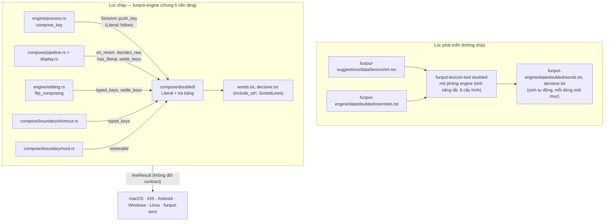

# Khôi phục phím lặp cho từ tiếng Anh

## Trạng thái

**Giai đoạn 1 và 2 đã hiện thực**: quyết định ở dấu cách (§5.2) và giữa từ (§5.3). Số đo và các điểm
lệch khỏi thiết kế nằm ở [§15](#15-kết-quả-giai-đoạn-1) và [§16](#16-kết-quả-giai-đoạn-2). Các chỗ sửa
sau hai vòng code review nằm ở [§17](#17-sửa-sau-review). Vòng 1: Flip đọc chuỗi phím đã gõ, bảng quét
cả khi tắt eager restore, gõ tắt, chữ số. Vòng 2: phủ quyết tần suất chỉ áp cho thói quen gõ lặp, và
phần đầu quyết định hỏi điều thói quen gõ lặp muốn gõ (`meant`). Giai đoạn 1b, 3 và 4 vẫn là thiết kế
(§12).
Nguồn: [issue #611](https://github.com/Funput/Funput/issues/611) — "Tự động hủy dấu khi gõ tiếp từ
và không nuốt phím. Tiện lợi khi gõ song ngữ."

| Thành phần | Ở đâu |
|---|---|
| Logic | `crates/funput-engine/src/compose/doubled/` (`mod.rs`, `literal.rs`, `lookup.rs`); chọn dạng hiển thị ở `compose/pipeline/display.rs` |
| Trạng thái, công tắc | `Session.literal` (kiểu `Literal`), `EngineConfig.restore_doubled_keys` (mặc định bật, chỉ Rust) |
| Bảng từ | `crates/funput-engine/data/doubled/words.txt` (3 244 từ, 31 889 byte), `decisive.txt` (480 phần đầu, 3 207 byte), `overrides.txt`. Mục dài nhất 18 chữ |
| Bộ sinh | `funput-lexicon-tool doubled` (`crates/funput-lexicon-tool/src/doubled/`, luật thói quen gõ lặp ở `habit.rs`) |
| Test | `compose/doubled/tests.rs`, `tests/restore/doubled/`, `funput-lexicon-tool/tests/doubled_table.rs` |

Tài liệu này viết đủ chi tiết để lập kế hoạch hiện thực mà không cần đọc lại điều tra: mọi điểm
nối đều ghi rõ file, hàm và thứ tự gọi. Các điểm đã quyết và còn mở nằm ở
[§13](#13-câu-hỏi-cần-quyết-định).

### Tóm tắt đề xuất

- Toàn bộ tính năng nằm trong `funput-engine`, nên **cả 5 nền tảng nhận cùng lúc mà không phải sửa
  shell, FFI hay JNI** ở giai đoạn 1–2.
- Khi gõ phím lặp, dấu vẫn bị hủy như hôm nay (`pá` + `s` → `pas`), nhưng engine **giữ lại chuỗi phím
  gốc** (`pass`) thay vì xoá nó đi.
- Engine tra chuỗi phím gốc trong một **bảng từ tiếng Anh nhỏ (~32 KB) nhúng sẵn**. Bảng được sinh tự
  động từ `en.tsv` có sẵn, nên không phụ thuộc `funput-suggestions` lúc chạy.
- Có hai thời điểm quyết định. **Giữa từ**: đổi sang chuỗi phím gốc ngay khi dạng rút gọn không thể là
  từ tiếng Anh nào nữa. Khảo sát ban đầu ước khoảng 95% số ca; luật đã hiện thực đo được 73% số từ
  quyết định trước khi gõ xong và 15% ở đúng chữ cuối (§16.1). **Ở dấu cách**: dành cho các ca còn lại.
- Có **bất biến an toàn**: từ không có lần hủy dấu nào thì hành vi y hệt hôm nay, nên tiếng Việt không
  bị đụng tới.
- Flip và gõ tắt đọc **chuỗi phím đã gõ**, nên phím bị nuốt luôn lấy lại được bằng một lần Flip
  (`pass` + Flip → `pass`), kể cả với từ không có trong bảng.

## 1. Vấn đề

### 1.1. Hiện trạng

Kiểm chứng bằng `funput dev run -m telex` (cấu hình mặc định: bật khôi phục tiếng Anh và khôi phục sớm),
ngày 21/10/2026:

| Gõ | Hôm nay | Người dùng muốn |
|---|---|---|
| `password ` | `pasword ` | `password ` |
| `correct ` | `corect ` | `correct ` |
| `pass ` | `pas ` | `pass ` |
| `office ` | `ofice ` | `office ` |
| `coffee ` | `cofee ` | `coffee ` |
| `issue ` | `isue ` | `issue ` |
| `seemed ` | `semed ` | `seemed ` |
| `Password ` | `Pasword ` | `Password ` |

Có những từ không bị lỗi (`access`, `class`, `process`, `success`). Lý do là eager restore đã trả chúng
về phím thô **trước khi** tới phím lặp (`acc` đã là ngõ cụt), nên phím lặp không còn là lệnh hủy dấu.

### 1.2. Nguyên nhân

Khi một phím dấu được gõ lại trên chính dấu nó vừa đặt, core trả `TransformKind::Reverted`. Engine
khi đó **ghi đè chuỗi phím thô bằng buffer** (`crates/funput-engine/src/compose/pipeline.rs`):

```rust
    // A revert is itself a restore to raw, so keep `keys` in sync — otherwise a
    // later word boundary sees `keys != buffer` and re-restores the stale original
    // keystrokes (e.g. `mixx` revert → `mix`, then Space → wrongly `mixx`).
    if result.kind == TransformKind::Reverted {
        session.keys.clear();
        session.keys.push_str(&session.buffer);
    }
```

Từ lúc này, phím `s` thứ hai không còn nằm ở đâu trong engine. English restore ở ranh giới từ và
phím Flip đều đọc `keys`, nên cả hai đều không lấy lại được nó.

### 1.3. Vì sao engine làm vậy, và vì sao không được bỏ đi

Đó là thói quen gõ của UniKey mà người dùng Việt đã quen: **gõ lặp phím dấu để lấy lại chữ Latin**.
Hành vi này đang được ghim bằng test:

- `revert_then_space_keeps_reverted_word` (`tests/restore/english.rs`): `mixx ` → `mix `, VNI `a11 ` → `a1 `.
- Danh sách kiểm tra tay của [extra-onsets.md](extra-onsets.md): `fasst ` → `fast `.
- Gõ hằng ngày: `tesst ` → `test ` (vì `test` → `tét`), `iss ` → `is `, `lasst ` → `last `, `off ` → `of `.

Tại phím lặp, engine **không thể biết** người dùng muốn `pas…` hay `pass…`: `iss` thì muốn `is`, nhưng
`issu…` lại muốn `issue`. Thông tin để phân biệt chỉ xuất hiện ở các phím **sau** phím lặp.

### 1.4. Vì sao không chặn sớm từ phím dấu đầu tiên

Có một hướng khác: nhận ra `pá` "không phải tiếng Việt" ngay từ phím dấu đầu tiên. Hướng này không
khả thi. `p` là âm đầu hợp lệ (`pin`, `pô`, Pác Bó, Pá Khoang), và khi đo 724 từ bị nuốt phím lặp thì
**709 từ** tại phím dấu đầu tiên là âm tiết tiếng Việt hoàn toàn hợp lệ: `of` → `ò` (office),
`is` → `í` (issue), `dif` → `dì` (different), `cor` → `cỏ` (correct). Phím lặp là tín hiệu đầu tiên
cho thấy người dùng không gõ tiếng Việt.

## 2. Số liệu

Đo trên 25 979 từ chữ thường của `crates/funput-suggestions/data/lexicon/en.tsv`, mỗi từ gõ kèm dấu
cách, Telex, cấu hình mặc định:

| Nhóm | Số từ | Thuộc phạm vi tài liệu này |
|---|---|---|
| Tổng số từ ra sai | 1 477 | |
| Mất một chữ vì phím dấu lặp (`ss`, `ff`, `rr`, `xx`, `jj`) | 724 | Có |
| … trong đó dạng rút gọn **không** phải từ tiếng Anh (sửa được, không mơ hồ) | 708 | Có |
| … trong đó cả hai dạng đều là từ tiếng Anh (mơ hồ) | ~25 | Có, xem §5.5 |
| Mất một chữ vì lặp nguyên âm hoặc `dd` (`seemed` → `semed`, `daddy` → `dady`) | vài chục | Có, bộ sinh bảng tự bắt (§6.4) |
| Từ tiếng Anh trùng âm tiết tiếng Việt hợp lệ, không có phím lặp (`is` → `í`, `been` → `bên`, `terms` → `tém`) | ~700 | **Không** |

Quyết định giữa từ (§5.3), đo trên 699 từ sửa được:

- **663 từ (95%)** quyết định được trước khi gõ xong, khi người dùng còn trung bình **3,3 chữ** nữa.
  Ví dụ: `password` quyết định ở `passw`, `correct` ở `correc`, `office` ở `offi`, `possible` ở `possib`.
- 36 từ chỉ quyết định được ở dấu cách, vì dạng rút gọn vẫn là phần đầu của một từ khác cho tới
  chữ cuối.

Thói quen gõ lặp kiểu UniKey **không bị ảnh hưởng** vì chuỗi phím gốc của chúng không có trong bảng:
`tesst`, `mixx`, `ass`, `offf`, `lasst`, `fixx` đều không có trong `en.tsv`. `iss`
có (dạng `ISS`), nhưng `is` phổ biến hơn nên phủ quyết tần suất (§5.5) loại nó khỏi bảng.

**Đo sau giai đoạn 1 và hai vòng sửa sau review:** số từ hỏng giảm từ **1 477 xuống 587** và không từ
nào mới bị hỏng. Không còn từ nào hỏng vì nuốt phím lặp ngoài 10 cặp mơ hồ được giữ có chủ đích. Chi
tiết ở [§15](#15-kết-quả-giai-đoạn-1) (giai đoạn 1: 597) và [§17](#17-sửa-sau-review). Tắt eager
restore thì số từ hỏng giảm từ 4 038 xuống 1 243, cũng không từ nào mới bị hỏng.

## 3. Mục tiêu và ràng buộc

Theo thứ tự ưu tiên:

1. **Không đổi tiếng Việt.** Từ không có lần hủy dấu bằng phím lặp thì cho ra kết quả y hệt hôm nay.
   Đây là bất biến cứng, được giữ bằng proptest (§11.2).
2. **Không phá thói quen gõ lặp.** `mixx`, `tesst`, `iss`, `fasst`, `off` giữ nguyên kết quả cũ.
3. **Một lõi cho cả 5 nền tảng.** Logic và dữ liệu nằm trong Rust (`funput-engine`). Giai đoạn 1–2
   không sửa shell, FFI hay JNI.
4. **Không làm chậm luồng gõ.** Mỗi phím của từ không có hủy dấu chỉ tốn hai phép `is_empty()` (§10).
   Ngân sách cấp phát (`alloc_budget`) và benchmark criterion giữ nguyên.
5. **Có lối thoát.** Người dùng lấy lại được dạng kia bằng Flip, và trên di động bằng Backspace (§8).

### Không thuộc phạm vi

- Từ tiếng Anh thành âm tiết tiếng Việt hợp lệ mà không có phím lặp (`been` → `bên`, `too` → `tô`,
  `terms` → `tém`). Không có tín hiệu nào để phân biệt, và người gõ tiếng Việt cũng đổi dấu theo cách
  đó (`cars` → `cá` là đổi hỏi sang sắc).
- VNI. Phím dấu là chữ số nên từ tiếng Anh không đi qua đường hủy dấu.
- Đề xuất gốc của issue, "bất kỳ ký tự nào sau nguyên âm có dấu thì hủy dấu": đọc theo nghĩa đen thì
  phá cả `má` + `t` → `mát`. Ý đúng của issue là phím lặp, và chính tài liệu này giải quyết ý đó.

## 4. Các phương án đã cân nhắc

| Phương án | Ý tưởng | Chạy ở đâu | Đánh giá |
|---|---|---|---|
| A. Luôn giữ cả hai phím | `pá` + `s` → `pass` ngay | 5 nền tảng | Phá thói quen UniKey (`tesst`, `iss`, `mixx`). Chỉ hợp làm tuỳ chọn tắt sẵn |
| B. Đoán không cần từ điển | Còn gõ tiếp sau phím lặp thì giữ cả hai phím | 5 nền tảng | `tesst` → `tesst`, `lasst` → `lasst`: sai đúng nhóm người dùng hiện có |
| C. Hỏi từ điển của nền tảng | Dùng lại giao thức hai bước của typo-correction | Chỉ iOS, Android | Máy tính không có từ điển. Phải sửa 5 shell. Không quyết định giữa từ được |
| **D. Bảng nhúng trong engine** | Tra chuỗi phím gốc trong bảng sinh sẵn | **5 nền tảng** | **Đề xuất.** Tất định, không sửa shell, quyết định được giữa từ |

Typo-correction chọn giao thức hai bước (C) vì việc **xếp hạng** cần kho từ người dùng đã học, và kho
này chỉ có trên di động. Bài toán ở đây khác: câu hỏi "`password` có phải từ tiếng Anh không" là một
**dữ kiện tĩnh**, giống bảng âm tiết đã nhúng trong core. Đưa câu hỏi ra ngoài engine chỉ thêm độ trễ
và thêm việc cho từng nền tảng. Phương án C vẫn có thể ghép thêm về sau trên di động, để bổ sung từ
người dùng đã học (§12, giai đoạn 4).

## 5. Hành vi

### 5.1. Ba dạng của một từ

Trong một từ có hủy dấu, engine giữ ba chuỗi:

| Tên | Trường | Ví dụ khi gõ `pass` | Ý nghĩa |
|---|---|---|---|
| Dạng tiếng Việt | `vn_form` | `pas` | Dạng core ghép được, dùng cho Flip |
| Đích khôi phục | `keys` | `pas` | Như hôm nay: phím thô sau khi hủy dấu đã nuốt phím lặp. English restore ở ranh giới từ trả về dạng này |
| **Chuỗi phím gốc** | `literal` (**mới**, kiểu `Literal`) | `pass` | Mọi phím đã gõ, kể cả phím bị nuốt. Rỗng cho tới lần hủy dấu đầu tiên |

`keys` là **đích khôi phục**: English restore trả về nó, và `verify_alignment` của typo-correction đếm
nó. Sau một lần hủy dấu, nó là dạng rút gọn, đúng điều thói quen gõ lặp cần (`tesst` → `test`). Khi
màn hình đã hiện `literal` (quyết định giữa từ, hoặc Flip sang phím thô), `doubled::settle_keys` đặt
`keys = literal`, nên ranh giới từ không còn gì để khôi phục.

`literal` là **chuỗi phím đã gõ**. Flip và gõ tắt đọc nó qua `doubled::typed_keys`: là `literal` khi từ
đã có hủy dấu và tính năng đang bật, ngược lại là `keys`. Nhờ vậy phím bị nuốt luôn lấy lại được bằng
Flip, kể cả với từ không có trong bảng (`passwd` khi tắt eager restore, §8.1). Mọi phím vào từ đi qua
`Session::push_key`, hàm đẩy phím vào `keys` và cho `literal` đi theo, nên hai chuỗi không lệch nhau.

### 5.2. Quyết định ở ranh giới từ

Khi gặp phím ranh giới (dấu cách, dấu câu, Enter), engine thay phần đang hiển thị bằng
`literal + phím ranh giới` nếu **đủ tất cả** các điều kiện sau:

| Điều kiện | Kiểm ở đâu |
|---|---|
| Không có gõ tắt khớp | `boundary/shortcut.rs` chạy trước, như hôm nay (thứ tự khớp trigger ở §5.7) |
| Bật `smart_restore` ("Tự khôi phục tiếng Anh") và `restore_doubled_keys` | `EngineConfig`, qua `doubled::active` |
| Method thuộc họ Telex | `method.is_telex_family()`, cũng trong `active` |
| Từ có ít nhất một lần hủy dấu | `session.literal.is_active()`. `doubled::has_literal` gộp điều kiện này với `active` |
| Người dùng chưa Flip từ này | `session.restore_override.is_none()` |
| Màn hình chưa hiển thị đúng `literal` | `session.buffer != literal` |
| `literal` bỏ chữ số ở cuối (so không phân biệt hoa thường) có trong bảng | `WORDS.contains(literal.trim_end_matches(chữ số ASCII))` |

Chữ số dính ở cuối là một con số, không thuộc từ: `pass1` tra `pass` trong bảng. Chuỗi trả về vẫn là
`literal` nguyên văn, kể cả chữ số (`pass1 ` → `pass1 `). `off1 ` vẫn ra `of1 `, vì `off` không có
trong bảng.

Kết quả trả về là `ImeResult::send(buffer.chars().count(), literal + boundary)`, qua helper
`replace_word` dùng chung với English restore. Đây đúng là dạng English restore đang trả, nên mọi
shell đã xử lý được.

### 5.3. Quyết định giữa từ

Mỗi phím gõ khi `literal` đang hoạt động, engine hỏi: **`literal` hiện tại có phải "phần đầu quyết định"
không?** Phần đầu quyết định của một từ trong bảng là phần đầu ngắn nhất thoả cả hai điều kiện sau, ở
**mọi** cấu hình bật eager restore đã có lần hủy dấu tính tới phần đầu đó:

- **màn hình không còn là phần đầu của bất kỳ từ tiếng Anh nào** trong `en.tsv` (so chữ thường), và
  **điều thói quen gõ lặp muốn gõ cũng không**. Điều đó là `meant`: chuỗi phím đã gõ, bỏ đi mỗi phím
  hủy dấu lặp lại đúng phím ngay trước nó (`passw` → `pasw`). Màn hình có chữ tiếng Việt thì không mở
  đầu từ nào (`necess` hiện `nêcs`), nhưng người gõ `ss` để lấy một chữ `s` thường thì muốn `neces`, và
  `neces` mở đầu `necessary`;
- và phần đầu đó **không** là phần đầu của một từ bị loại có chủ đích, tức từ có hủy dấu mà không nằm
  trong bảng (`off`, `hiss`, `marry`, hoặc dòng `-word` của tệp ghi đè). Nhờ điều kiện này, quyết định
  giữa từ không bao giờ đè lên quyết định tần suất của §5.5.

Tính chất này chỉ phụ thuộc vào phần đầu, vì engine tất định, nên một danh sách dùng chung là đúng cho
mọi từ có cùng phần đầu. Bộ sinh quét tám cấu hình (§6.4), nhưng phần đầu quyết định chỉ tính trên bốn
cấu hình bật eager restore, vì chỉ ở đó engine đổi giữa từ. Bốn cấu hình đó là đủ: phụ âm đầu mở rộng
chỉ ảnh hưởng chữ đầu từ, nên một từ bắt đầu bằng `f` gõ khi chỉ bật `F` hành xử như khi bật `ZFWJ`, và
một từ không bắt đầu bằng f/j/w/z hành xử như `STANDARD`.

`keys` không thay được `meant`: sau một lần hủy dấu, pipeline chép màn hình vào `keys` (§1.2), nên
`keys` của `necess` cũng là `nêcs`. Vòng 1 của review hỏi `keys`, và phép kiểm đó không chặn được phần
đầu nào (§17).

Hệ quả của `meant`: khi phím vừa gõ là phím lặp vừa hủy dấu, và tới đó không có lần hủy dấu bằng phím
lặp nào khác, `meant` là phần đầu bỏ phím cuối, tức vẫn mở đầu chính từ đang gõ. Phím quyết định vì
vậy đến sau phím lặp ít nhất một phím (`necessa`, không phải `necess`), và từ kết thúc bằng phím lặp
(`tariff`, `harass`, `profess`) chờ dấu cách.

Phím hủy dấu cũng có thể chính là phím quyết định: `basis` gõ ra `bái`, rồi `s` hủy dấu, và vì `bais`
không mở đầu từ nào nên `basis` hiện ra ngay ở phím đó. Phím `s` này đi sau `i`, không lặp phím
trước nó, nên `meant` vẫn là `basis` và chỉ màn hình được hỏi. Để làm được vậy, `on_revert` chạy
**trước** khi pipeline chọn dạng hiển thị (§7.2).

- `password`: ở `pass`, dạng rút gọn `pas` vẫn là phần đầu của `past` và `pastor`, nên chưa quyết. Tới
  `passw`, không từ nào bắt đầu bằng `pasw`, nên đây là phần đầu quyết định. Engine đổi màn hình sang
  `passw`, rồi `ord` nối vào bình thường.
- `correct`: `core` vẫn là phần đầu của `core` và `cored`. Tới `correc`, dạng rút gọn `corec` không còn
  khớp từ nào, nên engine quyết định ở `correc`.
- `necessary`: ở `necess`, màn hình `nêcs` không mở đầu từ nào, nhưng `meant` là `neces`, mở đầu
  `necessary`, nên chưa quyết. Tới `necessa`, màn hình là `nêcsa` và `meant` là `necesa`, không chuỗi
  nào mở đầu từ nào, nên engine quyết định ở `necessa`.
- `tesst`: dạng rút gọn `test` luôn là phần đầu của từ thật (`test`, `testing`), nên **không bao giờ**
  quyết định giữa từ. Tới dấu cách, `tesst` không có trong bảng, nên giữ `test`. Đúng ý người gõ.

Danh sách phần đầu quyết định được tính **offline** lúc sinh bảng (§6.4). Lúc chạy, engine chỉ tra
xem `literal` có nằm trong danh sách đó không. Vì `literal` dài thêm đúng một ký tự mỗi phím, phép so
khớp chính xác bắt được đúng phím quyết định.

Quyết định giữa từ đi chung công tắc với eager restore: `smart_restore && eager_restore &&
restore_doubled_keys`. Tắt eager restore thì chỉ còn quyết định ở dấu cách (§5.2).

Sau khi quyết định, `buffer`, `keys` và `literal` bằng nhau: `displayed` trả `Shown::Literal`, và chỉ ở
nhánh đó `process` gọi `settle_keys` để đặt `keys = literal`. Các phím sau đi qua pipeline như mọi từ
đã được eager restore (`text`): core có thể thử đặt dấu, nhưng `is_dead_end` trả về phím thô **ngay
trong cùng phím đó**, nên màn hình không nhấp nháy.

Flip sau khi quyết định hành xử như với mọi từ đã được khôi phục tiếng Anh: lật sang dạng ghép tiếng
Việt (`passw` → `păs`, vì core ghép `w` thành dấu trăng), lật lần nữa thì về lại phím thô. Trước khi
quyết định, phím thô mà Flip hiện là chuỗi phím đã gõ (`doubled::typed_keys`), nên Flip đưa phím bị
nuốt về: `pass` + Flip → `pass`, Flip lần nữa → `pas`. Lật về **dạng rút gọn** chỉ được khi nó trùng
`vn_form` như ở đây; với `passw` thì `vn_form` là `păs`, nên muốn có `pasw` vẫn phải chờ Flip ba trạng
thái của giai đoạn 3 (§8.1).

### 5.4. Ví dụ (đích của bảng test)

| Gõ | Hôm nay | Sau tính năng | Quyết định ở |
|---|---|---|---|
| `password ` | `pasword ` | `password ` | `passw` |
| `correct ` | `corect ` | `correct ` | `correc` |
| `office ` | `ofice ` | `office ` | `offi` |
| `different ` | `diferent ` | `different ` | `diffe` |
| `coffee ` | `cofee ` | `coffee ` | `coffe` |
| `pass ` | `pas ` | `pass ` | dấu cách |
| `boss ` | `bos ` | `boss ` | dấu cách |
| `Password ` | `Pasword ` | `Password ` | `Passw` |
| `PASSWORD ` | `PASWORD ` | `PASSWORD ` | `PASSW` |
| `session ` | `sesion ` | `session ` | `sessi` |
| `necessary ` | `nêcsary ` | `necessary ` | `necessa` (một phím sau phím lặp, §5.3) |
| `tariff ` | `taif ` | `tariff ` | dấu cách (từ kết thúc bằng phím lặp) |
| `basis ` | `bais ` | `basis ` | `basis` (chính phím hủy dấu) |
| `seemed ` | `semed ` | `seemed ` | `seemed` (chữ cuối) |
| `pass1 ` | `pas1 ` | `pass1 ` | dấu cách (tra bảng bỏ chữ số cuối) |
| `off1 ` | `of1 ` | `of1 ` | không đổi |
| `class ` (tắt eager restore) | `clas ` | `class ` | dấu cách |
| `doses ` | `does ` | `doses ` | dấu cách (phím mất không đứng cạnh phím đôi, §5.5) |
| `casts ` | `cats ` | `casts ` | dấu cách (như trên) |
| `markers ` (tắt eager restore) | `makers ` | `markers ` | dấu cách (như trên) |
| `pass` + Flip + `word ` | `pasword ` | `password ` | Flip |
| `mixx ` | `mix ` | `mix ` | không đổi |
| `tesst ` | `test ` | `test ` | không đổi |
| `iss ` | `is ` | `is ` | không đổi |
| `off ` | `of ` | `of ` | không đổi (cặp mơ hồ, §5.5) |
| `offf ` | `off ` | `off ` | không đổi |
| `ww ` (Telex nâng cao) | `w ` | `w ` | không đổi (cách gõ chữ `w` thường, §5.5) |
| `passte ` | `paste ` | `paste ` | không đổi (`passte` không phải từ) |
| `mas ` | `má ` | `má ` | không đổi (không có hủy dấu) |
| VNI `a11 ` | `a1 ` | `a1 ` | không đổi (VNI) |

### 5.5. Cặp mơ hồ

Khoảng 25 từ mà **cả hai dạng đều là từ tiếng Anh**, ví dụ: `off`/`of`, `pass`/`pas`, `mass`/`mas`,
`hiss`/`his`, `losses`/`loses`, `dessert`/`desert`.

**Đã quyết:** bộ sinh bảng loại khỏi bảng một từ khi dạng rút gọn **vừa là thói quen gõ lặp, vừa phổ
biến hơn** (`vetoes` trong `doubled/mod.rs`):

- **Thói quen gõ lặp** (`habit::collapses_doubled_keys`): dạng rút gọn là từ gốc bỏ đi một phím ở một
  hoặc vài cặp phím đôi đứng cạnh nhau (`off` → `of`, `possess` → `poses`). Thói quen này chỉ bỏ được
  phím lặp lại đúng phím trước nó. Hủy dấu làm mất một phím ở chỗ khác thì không ai gõ như vậy để lấy
  từ ngắn hơn: `markers` → `makers` (chữ `r` sau `ma` thành dấu, chữ `r` thứ hai hủy dấu đó), `casts` →
  `cats`, `doses` → `does`.
- **Phổ biến hơn**: dạng rút gọn có thứ hạng nhỏ hơn trong `en.tsv`, **hoặc là một chữ cái**. `en.tsv`
  không xếp hạng từ ngắn hơn `MIN_LEN` (2 chữ), nên chữ cái đơn được tính riêng.

Như vậy:

- `pass` (hạng 1 349) với `pas` (hạng 10 383): `pass` ở lại bảng, nên `pass ` → `pass `. Đây đúng ví dụ
  trong issue.
- `off` (hạng 153) với `of` (hạng 1): `off` bị loại, nên `off ` → `of ` như cũ. Muốn gõ `off` thì gõ `offf`.
- `hiss`/`his`: giữ dạng rút gọn, đúng với từ phổ biến hơn. Ngược lại `losses` (hạng 3 013) thắng
  `loses` (hạng 9 036) và ở lại bảng.
- `doses`/`does`, `casts`/`cats`, `markers`/`makers`: dạng rút gọn phổ biến hơn, nhưng phím mất không
  đứng cạnh phím đôi của nó, nên đó không phải thói quen gõ lặp. Từ gốc ở lại bảng: `doses ` → `doses `,
  `casts ` → `casts `.
- `ww` → `w` (Telex nâng cao, nơi `w` một mình là `ư`): `ww` là cách gõ một chữ `w` thường, và `w` là
  một chữ cái, nên `ww` bị loại: `ww ` → `w ` như cũ.

Các cặp còn giữ dạng rút gọn, đo trên `en.tsv` (§17): `off`/`of`, `marry`/`mary`,
`dessert(s)`/`desert(s)`, `err`/`er`, `hiss`/`his`, `lass`/`las`, `corral`/`coral`, `posse`/`pose`,
`barre`/`bare`. Tắt eager restore thì có thêm `starring`/`staring`, `scarred`/`scared`,
`starred`/`stared`.

Ngoài ra có tệp ghi đè viết tay (§6.4) để sửa vài ca mà tần suất trả lời sai, mỗi dòng kèm lý do.

### 5.6. Chữ hoa

Bảng lưu chữ thường ASCII. Phép tra so từng byte sau khi đổi về chữ thường, không cấp phát. Chuỗi trả
về là `literal` **nguyên văn**, nên giữ đúng kiểu chữ người dùng đã gõ: `Password`, `PASSWORD`.
Auto-capitalize vẫn chạy đúng vì `keys` và `literal` đều nhận cùng `raw_key` đã được viết hoa.

### 5.7. Tương tác với tính năng khác

| Tính năng | Hành vi |
|---|---|
| Gõ tắt | Ưu tiên hơn, như với English restore. Trigger khớp lần lượt chuỗi phím đã gõ (`doubled::typed_keys`), rồi `keys`, rồi `buffer`. Trigger `pass` nổ ở `pass `, `office` nổ ở `office `, dù bật hay tắt eager restore; trigger `pas` vẫn nổ ở `pass ` |
| Flip | Dạng phím thô của Flip là chuỗi phím đã gõ (`typed_keys`): `pass` + Flip → `pass`. Khi Flip hiện `literal`, `settle_keys` đặt `keys = literal`, và các phím sau vẫn hiện `literal` (`ForceRaw`). Flip đã chọn (`restore_override` khác `None`) thì quyết định ở dấu cách và giữa từ đứng ngoài. Flip ba trạng thái vẫn là giai đoạn 3 (§8.1) |
| Typo correction | Khôi phục ở dấu cách thì correction không park ứng viên cho từ đó (`drop_preview`, rồi trả kết quả trước `offer`). Khôi phục giữa từ thì từ đã là phím thô, và correction đối xử với nó như mọi từ tiếng Anh đã eager restore hôm nay. Phiên nháp phát lại ứng viên (`correction/generate/replay.rs`) gõ qua `push_key`, và `prepare` tắt hẳn `restore_doubled_keys` cùng các bước khôi phục khác |
| Eager restore tắt | Chỉ còn quyết định ở dấu cách. Khi tắt, phím lặp rơi vào dấu đã ghép (`clá` + `s` → `clas`) chứ không rơi vào phím thô, nên nhiều từ bị nuốt phím hơn (`class`, `order`, `process`). Bộ sinh quét cả khi tắt (§6.4), nên bảng có cả những từ này |
| Smart restore tắt | Tính năng tắt hoàn toàn, y hệt hôm nay |
| Phụ âm đầu mở rộng | Không tương tác. `ferry` khi bật `f` (hôm nay ra `fery`, theo [extra-onsets.md](extra-onsets.md)) cũng được sửa |
| Telex nâng cao | Áp dụng, cùng bảng (§6.4). `ww ` vẫn ra `w `, cách gõ chữ `w` thường (§5.5) |
| VNI | Không áp dụng (`is_telex_family`) |
| Chế độ tiếng Anh | Không áp dụng (không có hủy dấu) |
| `adopt` | `clear()` xoá `literal`. `keys` của từ được mở lại dựng từ chữ trên màn hình, nên không có chuỗi phím gốc. `on_revert` chỉ bắt đầu `literal` khi `keys` là ASCII, nên một lần hủy dấu trên từ mở lại có dấu không bắt đầu nó |
| Backspace giữa từ | `resync_after_backspace` xoá `literal` và dựng lại `keys` từ màn hình (`â`, không phải `aa`). Sửa giữa từ là chỉnh tay, tính năng đứng ngoài từ đó: lần hủy dấu sau đó chỉ bắt đầu `literal` khi `keys` là ASCII. Nếu không, Flip và gõ tắt nhận một chuỗi không ai gõ (`aao` + Backspace + `a` + Flip từng hiện `âa`) |

## 6. Kiến trúc



Ở giai đoạn 1–2, các shell chỉ thấy `ImeResult::send` theo đúng hai dạng đang có. Thứ nhất là sửa
trong từ, giống eager restore `tẽt` → `text`. Thứ hai là thay cả từ kèm phím ranh giới, giống English
restore `cảd ` → `card `.

### 6.1. Tầng và file

| Tầng | Thay đổi |
|---|---|
| `crates/funput-engine/src/compose/doubled/mod.rs` (mới) | `on_revert`, `has_literal`, `typed_keys`, `settle_keys`, `restorable`, `decides_raw`: toàn bộ logic, thuần, có unit test |
| `crates/funput-engine/src/compose/doubled/literal.rs` (mới) | Kiểu `Literal` bọc một `String`: `new`, `start`, `follow`, `reset`, `is_active`, `as_str`. `CAPACITY = 32` (§6.2) |
| `crates/funput-engine/data/doubled/words.txt`, `decisive.txt` (mới, sinh tự động) | `WORDS` và `DECISIVE`: mỗi dòng một mục, đã sắp xếp |
| `crates/funput-engine/src/compose/doubled/lookup.rs` (mới) | `SortedLines`: tìm nhị phân trên văn bản nhúng, không phân biệt hoa thường ASCII, không cấp phát |
| `crates/funput-engine/src/model/session.rs` | Trường `literal: Literal`. Trong code chạy thật, mọi phím gõ vào `keys` đều đi qua `push_key`, hàm cho `literal` đi theo. `clear()` và `resync_after_backspace()` gọi `literal.reset()` |
| `crates/funput-engine/src/model/config.rs` | `restore_doubled_keys: bool`, mặc định `true`, chỉ có trong Rust (§6.5) |
| `crates/funput-engine/src/engine/process.rs` | `compose_key` và nhánh chế độ tiếng Anh (`process_key_english`) gọi `session.push_key` thay cho `keys.push` |
| `crates/funput-engine/src/engine/editing.rs` | `flip_composing` đưa `doubled::typed_keys` cho `flip::flip`. Lật sang `ForceRaw` trên từ có `literal` thì gọi `settle_keys` |
| `crates/funput-engine/src/compose/pipeline.rs` | Gọi `on_revert` trước khi chọn dạng hiển thị và trước khi ghi đè `keys`. Gọi `settle_keys` chỉ khi dạng hiển thị là `Shown::Literal` |
| `crates/funput-engine/src/compose/pipeline/display.rs` (mới) | `displayed()` trả `enum Shown { Composed(String), Keys, Literal }`: nhánh `ForceRaw` hiện `literal` khi `has_literal`, nhánh `decides_raw`, rồi eager restore (`is_dead_end`). Tách khỏi `pipeline.rs` để file đó giữ dưới 150 dòng |
| `crates/funput-engine/src/compose/boundary/mod.rs` | Hỏi `restorable` sau gõ tắt, trước `judge`/correction. English restore và tính năng này dùng chung helper `replace_word` |
| `crates/funput-engine/src/compose/boundary/shortcut.rs` | Trigger khớp `typed_keys`, rồi `keys`, rồi `buffer` (§5.7) |
| `crates/funput-engine/src/correction/generate/replay.rs` | Phát lại bằng `push_key`. `prepare` tắt `restore_doubled_keys` |
| `crates/funput-engine/data/doubled/overrides.txt` (mới) | Ghi đè viết tay: `+word` thêm, `-word` loại, kèm lý do |
| `crates/funput-lexicon-tool/src/doubled/` (mới: `mod.rs`, `scan.rs`, `habit.rs`, `overrides.rs`, `decisive.rs`) | Lệnh `doubled --out DIR`: sinh `words.txt` và `decisive.txt` từ một lần quét. `scan::SETUPS` có 8 `Setup` (§6.4) |
| `crates/funput-lexicon-tool/src/doubled/habit.rs` (mới, vòng 2 của review) | Thói quen gõ lặp: `collapses_doubled_keys(word, form)` (dạng rút gọn chỉ bỏ phím ở các cặp phím đôi đứng cạnh nhau, §5.5) và `meant(typed, reverting)` (chuỗi phím đã gõ bỏ mỗi phím hủy dấu lặp lại phím trước nó, §5.3) |
| `crates/funput-desktop/src/shell/config/mod.rs` | Chưa có cài đặt riêng: lấy `EngineConfig::default().restore_doubled_keys` thay vì viết lại giá trị mặc định |
| `crates/funput-cli/src/dev/coverage/` | Thêm chế độ đo độ phủ tiếng Anh (§11.3). Giai đoạn 1b, **chưa làm** |

`funput-engine` **vẫn chỉ phụ thuộc `funput-core`**. Bảng là mã nguồn được sinh, không phải dependency.

### 6.2. Trạng thái: `Session.literal`

```rust
// compose/doubled/literal.rs
/// Every key typed since the word boundary, including the ones a revert swallowed
/// (`pass` while `keys` holds `pas`).
///
/// Inactive (empty) until the word's first revert, so a word without one never
/// touches it: [`Literal::follow`] does nothing until [`Literal::start`] has run.
pub(crate) struct Literal(String);

// model/session.rs
/// Every key since the word boundary, once the word has had a revert. Per-word —
/// reset by `clear()` and by Backspace.
pub(crate) literal: Literal,
```

`Literal` là newtype, nên chỉ các hàm của nó chạm được vào chuỗi bên trong: `start(keys)`,
`follow(key)`, `reset()`, `is_active()`, `as_str()`. Không còn chỗ nào tự `push` vào `literal`.

Vòng đời:

1. **Kích hoạt lười.** Lần `Reverted` đầu tiên trong từ: `on_revert` gọi `literal.start(&keys)` khi
   tính năng bật và `keys` là ASCII. Lúc này `keys` vẫn còn phím lặp, vì `compose_key` đã đẩy nó vào
   trước khi gọi pipeline. Sau Backspace hoặc `adopt`, `keys` được dựng từ màn hình (`â` thay cho
   `aa`, §5.7). Chuỗi đó không phải phím đã gõ, và điều kiện ASCII giữ từ như vậy đứng ngoài tính năng.
2. **Đi theo phím.** `Session::push_key` đẩy mỗi phím vào `keys` rồi gọi `literal.follow(key)`, và
   `follow` chỉ ghi khi `literal` đang hoạt động. Nếu cùng từ có thêm lần hủy dấu nữa, `start` thấy
   `literal` đã hoạt động và không chép lại.
3. **Kết thúc.** `clear()` (ranh giới từ, đổi focus, `adopt`) và `resync_after_backspace()` gọi
   `literal.reset()`.
4. **Không cấp phát khi gõ.** `Literal::new` cấp sẵn 32 byte (`literal::CAPACITY`, bằng `MAX_LEN` của
   `funput-lexicon-tool`, nên bộ sinh không nhận từ nào dài hơn), và `reset()` giữ nguyên dung lượng.
   Unit test `the_shipped_lists_are_sorted_lowercase_and_newline_terminated` (qua helper
   `assert_well_formed`) giữ mọi mục của hai bảng không dài hơn `CAPACITY`; mục dài nhất hiện
   nay là 18 chữ (`characteristically`, `disproportionately`). Vì vậy lần hủy dấu trên đường gõ phím
   không cấp phát. `alloc_budget` bắt được đúng chỗ này: chuỗi Telex nâng cao `WWindowws` có hai
   lần hủy dấu, và nếu không cấp sẵn thì nó tốn thêm 2 lần cấp phát so với chuỗi đối chứng.

Ba hàm của `doubled` đọc trạng thái này cho phần còn lại của engine:

| Hàm | Trả về / làm gì |
|---|---|
| `has_literal(session)` | `literal.is_active()` và tính năng đang bật (`active`). Mọi quyết định dùng `literal` đều hỏi hàm này trước, nên tắt công tắc giữa từ thì `literal` bị bỏ qua |
| `typed_keys(session)` | `literal` khi `has_literal`, ngược lại `keys`. Flip và gõ tắt đọc hàm này |
| `settle_keys(session)` | Đặt `keys = literal`. Gọi khi màn hình vừa hiện `literal` (pipeline ở nhánh `Shown::Literal`, Flip sang `ForceRaw`) |

`size_of::<Engine>()` tăng 24 byte (152 → 176); `Literal` bọc một `String` nên không đổi kích thước.
Assert ở `tests/methods/telex_advanced.rs` (`layout_stays_compact`) đã cập nhật.

### 6.3. Bảng dữ liệu

`words.txt` do bộ sinh viết ra: mỗi dòng một từ chữ thường ASCII, sắp theo thứ tự byte, dòng nào
cũng kết thúc bằng `\n`, không có comment. Diff khi làm mới bảng đọc như một danh sách từ.

```rust
/// English words a Telex revert would shorten, lowercase, sorted.
static WORDS: SortedLines = SortedLines::new(include_str!("../../../data/doubled/words.txt"));
```

- **Vì sao là `.txt` chứ không phải `.rs` sinh tự động:** `scripts/check-loc.sh` giới hạn mỗi file
  nguồn 150 dòng, mà một mảng `&str` 3 244 phần tử vượt xa giới hạn đó. Văn bản nhúng cũng nhỏ
  hơn: không tốn 16 byte con trỏ và độ dài cho mỗi từ.
- **Kích thước thực tế:** 3 244 từ, **31 889 byte** trong `.rodata`, không tốn heap. Bảng từng có
  1 054 từ (9,4 KB) khi bộ sinh chỉ quét các cấu hình bật eager restore; quét thêm cấu hình tắt eager
  restore thêm 2 173 từ và không bớt từ nào. Vòng 2 của review thêm 18 từ mà phím mất không đứng cạnh
  phím đôi của nó (`markers`, `casts`, `doses`) và bỏ `ww` (§5.5, §17).
- **Tra cứu (`lookup.rs`, `SortedLines::contains`):** tìm nhị phân trên vị trí byte; mỗi lần thử lùi
  về đầu dòng, rồi so dòng đó với từ cần tìm sau khi hạ chữ thường từng byte. Không có chỉ mục dựng
  lúc khởi động, không `OnceLock`, không cấp phát. Từ chứa ký tự không phải ASCII bị từ chối ngay.
- Bất biến của tệp (đã sắp xếp, không trùng, chữ thường, có `\n` cuối) được unit test giữ, vì tìm
  nhị phân chỉ đúng khi các bất biến này đúng. Cùng test đó giữ mọi mục không dài hơn
  `literal::CAPACITY` (32); mục dài nhất hiện nay 18 chữ.
- `decisive.txt` (giai đoạn 2) cùng định dạng và dùng lại `SortedLines`: 480 phần đầu, 3 207 byte.

### 6.4. Bộ sinh bảng: `funput-lexicon-tool doubled`

Bảng được sinh bằng cách **cho chính engine gõ từng từ**, với `restore_doubled_keys = false`. Nhờ vậy
bảng luôn khớp hành vi thật của core, kể cả những đường hủy dấu khó đoán bằng regex (`seemed`,
`daddy`, `ươ` + `w`).

Hiện thực gồm:

- `scan.rs`: `Setup` (method, luật âm tiết, `eager`) và `SETUPS`; `typed()` gõ một từ dưới một
  `Setup` và trả từng bước `Step` (đã có hủy dấu chưa, buffer, keys, `meant`); `shortened()` dựng trên nó.
- `habit.rs`: thói quen gõ lặp, `collapses_doubled_keys` (§5.5) và `meant` (§5.3).
- `mod.rs`: thứ hạng, phủ quyết tần suất (`verdict`, `vetoes`), ghi đè, ghi hai tệp.
- `decisive.rs`: luật của §5.3 (`shortest`, `begins_a_word`).

Bộ sinh quét **tám cấu hình** (`scan::SETUPS`): Telex và Telex nâng cao, có và không có phụ âm đầu mở
rộng z/f/w/j, bật và tắt eager restore. `ferry` chỉ mất chữ `r` khi `f` được nhận làm âm đầu. `class`
chỉ mất chữ `s` khi tắt eager restore: khi bật, `clá` là ngõ cụt nên màn hình đã hiện `clas` trước khi
tới `s` thứ hai, và phím đó không còn hủy dấu gì. `words.txt` lấy từ cả tám cấu hình; `decisive.txt`
chỉ tính trên bốn cấu hình bật eager restore, vì engine chỉ đổi giữa từ khi eager restore bật (§5.3).
CLI là `doubled [--overrides FILE] --out DIR`; cả hai tệp ra từ **một lần quét**, nên không thể lệch
nhau. Mã giả dưới đây viết gộp theo từng cấu hình; code thật tính phần đầu quyết định trên bốn cấu hình
bật eager restore cùng lúc, như luật §5.3, và chặn mọi phần đầu mở đầu một từ bị loại.

```text
for each word W in en.tsv (2 to 32 ASCII letters), for each setup (method × onsets × eager):
    engine = Engine::new() with that setup, restore_doubled_keys = false
    typed = ""; reverting = []; decisive = None
    for c in W:
        appended = engine.keys() + c
        engine.process_char(c)
        if engine.keys() != "" && engine.keys() != appended:   # a revert rewrote the keys
            reverting.push(typed.len())
        typed.push(c)
        meant = typed minus each reverting key equal to the key before it  # habit::meant
        if setup.eager && reverting != [] && decisive is None
           && !is_prefix_of_any_english_word(lower(engine.buffer()))
           && (meant == typed || !is_prefix_of_any_english_word(meant)):
            decisive = typed.len()
    if reverting == []: skip                                           # not damaged
    shortened = lower(engine.keys())
    if collapses_doubled_keys(W, shortened)                            # the doubled-key habit
       && (shortened.len() < MIN_LEN || rank(shortened) < rank(W)):    # one letter, or more common
        skip
    WORDS += lower(W)
    if decisive: DECISIVE += lower(W[..decisive])
apply overrides (+word / -word); sort; dedupe; write words.txt
```

- Phát hiện hủy dấu chỉ dùng API công khai: sau một phím, `keys()` bị viết lại chứ không chỉ nối thêm
  phím đó. So độ dài thì không đủ: `tomorrow` có `tômr` + `o` → `tomro`, hủy dấu mà `keys` vẫn dài thêm.
  Không cần thêm API.
- `collapses_doubled_keys` chỉ cho bỏ **một** phím ở mỗi cụm phím lặp, vì mỗi lần hủy dấu nuốt một phím:
  `sss` → `ss` là thói quen, `sss` → `s` thì không.
- Phủ quyết tần suất (`vetoes`) chỉ áp cho thói quen gõ lặp: `collapses_doubled_keys` đòi dạng rút gọn
  chỉ thiếu phím ở các cặp phím đôi đứng cạnh nhau. `markers` → `makers` mất một `r` đứng riêng, nên
  `markers` ở lại bảng dù `makers` phổ biến hơn. Khi thói quen gõ lặp cho ra một chữ cái (`ww` → `w`),
  dạng đó ngắn hơn `MIN_LEN` nên `en.tsv` không xếp hạng nó, và nó luôn phủ quyết (§5.5).
- `meant` (trường `Step.meant`, tính bằng `habit::meant`): chuỗi phím đã gõ bỏ mỗi phím hủy dấu lặp
  lại đúng phím trước nó. `begins_a_word` chỉ hỏi nó khi nó khác phần đầu, tức khi có phím lặp đã hủy
  dấu; không có thì phần đầu hiển nhiên mở đầu chính từ đang xét. Trước vòng 2, chỗ này hỏi `keys`, mà
  sau một lần hủy dấu `keys` chính là màn hình (§5.3).
- Các cấu hình: một từ vào `WORDS` khi có ít nhất một cấu hình rút gọn nó, và không cấu hình nào rút
  gọn nó thành dạng bị phủ quyết. Phần đầu quyết định là phần đầu ngắn nhất mà mọi cấu hình bật eager
  restore **đã hủy dấu tới đó** đều quyết được (§5.3), nên khi các cấu hình này quyết ở những chỗ khác
  nhau thì kết quả là chỗ muộn hơn, an toàn hơn. Cấu hình chưa hủy dấu tới phần đầu đó không chặn nó:
  ở cấu hình ấy `literal` bắt đầu muộn hơn và đã dài hơn mục trong `decisive.txt`, nên không bao giờ
  khớp, và từ chờ tới dấu cách.
- `funput-lexicon-tool` thêm dependency `funput-engine`. Crate này không link vào binary nào được ship
  (theo README của nó), nên điều này không ảnh hưởng sản phẩm.
- `refresh.sh` chạy thêm `doubled` ở cuối, để mỗi lần làm mới `en.tsv` thì bảng cũng được làm mới
  trong cùng PR.
- Có test kiểm tra độ mới (`tests/doubled_table.rs`): sinh lại rồi so với `words.txt` và
  `decisive.txt` đã commit, khác nhau thì báo lỗi kèm lệnh sinh lại. Test đặt trong
  `funput-lexicon-tool`. Nhờ vậy bảng không thể lệch khỏi luật gõ khi core thay đổi.

**Vì sao đặt bộ sinh ở `funput-lexicon-tool` chứ không ở `funput-cli`:** đây là công việc dữ liệu chạy
tay khi từ điển thay đổi, đúng vai trò của crate đó. `funput-cli dev` dành cho debug và đo đạc.

### 6.5. Cấu hình

```rust
/// Give a word back the key a doubled tone key swallowed when its raw keys spell
/// an English word (`password`, not `pasword`). Part of `smart_restore`, so it
/// does nothing while that is off. On by default; Rust-only for now.
pub restore_doubled_keys: bool, // default: true
```

Phần giữa từ còn cần `eager_restore` (§5.3).

- Giai đoạn 1–2 **không có công tắc trên UI** và **không có setter FFI/JNI**. Tính năng là một phần của
  "Tự khôi phục tiếng Anh": tắt mục đó là tắt luôn tính năng này.
- Trường Rust tồn tại vì ba lý do: bộ sinh bảng cần tắt nó (§6.4), proptest cần so bật với tắt (§11.2),
  và Windows (link thẳng Rust) có sẵn đường để thêm công tắc khi cần.
- Shell máy tính (`funput-desktop`) chưa có cài đặt riêng, nên đặt
  `restore_doubled_keys: EngineConfig::default().restore_doubled_keys` thay vì viết lại `true`. Đổi mặc
  định trong engine thì shell đổi theo.
- Phiên nháp phát lại ứng viên của typo-correction (`correction/generate/replay.rs::prepare`) tắt
  trường này một cách tường minh, cùng `smart_restore` và `eager_restore`.
- Nếu sau này cần công tắc riêng: thêm `funput_set_restore_doubled_keys(engine, bool)` theo mẫu
  `funput_set_extra_onsets`, không nới `FunputConfig` by-value.

## 7. Luồng xử lý chi tiết

### 7.1. Mỗi phím (`engine/process.rs::compose_key`)

```rust
self.session.push_key(raw_key); // `keys`, and `literal` only while it is active
correction::drop_preview(&mut self.session);
correction::note_key(&mut self.session, raw_key, touch);
let result = pipeline::process(&mut self.session, compose_key, key, capitalize_shortcut);
correction::verify_alignment(&mut self.session);

// model/session.rs
pub(crate) fn push_key(&mut self, key: char) {
    self.keys.push(key);
    self.literal.follow(key);
}
```

Chế độ tiếng Anh (`process_key_english`) và phát lại của correction (`replay`) cũng gọi `push_key`.

### 7.2. Pipeline (`compose/pipeline.rs::process`)

Đúng như code đã hiện thực (rút gọn):

```rust
// process(): on_revert runs while `keys` still holds the doubled key, and before the
// display is chosen, so the reverting key itself can be the decisive one.
if result.kind == TransformKind::Reverted {
    doubled::on_revert(session);
}
let shown = displayed(session, composed, result.kind, key);
let literal_shown = matches!(shown, Shown::Literal);
let new_buffer = match shown {
    Shown::Composed(text) => text,
    Shown::Keys => session.keys.clone(),
    Shown::Literal => session.literal.as_str().to_owned(),
};
// ... diff + pass-through exactly as before ...
session.buffer = new_buffer;
if result.kind == TransformKind::Reverted {
    session.keys.clear();
    session.keys.push_str(&session.buffer);
}
if literal_shown {
    doubled::settle_keys(session); // keys = literal, now that the literal is on screen
}

// compose/pipeline/display.rs
fn displayed(session: &Session, composed: String, kind: TransformKind, key: char) -> Shown {
    match session.restore_override {
        Some(RestoreOverride::ForceVietnamese) => Shown::Composed(composed),
        Some(RestoreOverride::ForceRaw) if doubled::has_literal(session) => Shown::Literal,
        Some(RestoreOverride::ForceRaw) => Shown::Keys,
        None if doubled::decides_raw(session, &composed) => Shown::Literal,
        None if /* eager English restore, unchanged */ => Shown::Keys,
        None => Shown::Composed(composed),
    }
}
```

`Shown` cho `process` biết `keys` phải theo dạng nào. Chỉ nhánh `Literal` gọi `settle_keys`, nên từ
không có hủy dấu không tốn thêm phép kiểm nào ở cuối phím (trước bản sửa sau review, `sync_keys` chạy
ở mọi phím).

`decides_raw` kiểm theo thứ tự rẻ trước: `has_literal` (`literal.is_active()` rồi `active`), rồi
`eager_restore`, rồi `composed != literal`; cuối cùng mới `DECISIVE.contains(literal)`. Phím quyết định
trả `Send(0, "sw")` cho `pas` + `w`, cùng dạng với eager restore `tẽt` → `text`.

### 7.3. Ranh giới từ (`compose/boundary/mod.rs::boundary_result`)

```rust
fn boundary_result(session: &mut Session, boundary_key: char) -> ImeResult {
    if let Some(expansion) = shortcut::expansion(session, boundary_key) {
        return expansion;
    }
    if doubled::restorable(session) {
        // The word is English, so typo correction must not park a repair for it.
        correction::drop_preview(session);
        return replace_word(session, session.literal.as_str(), boundary_key);
    }
    let verdict = judge(session);
    correction::offer(session, boundary_key, &verdict);
    // ... English restore exactly as today ...
}

// compose/doubled/mod.rs
pub(crate) fn restorable(session: &Session) -> bool {
    let literal = session.literal.as_str();
    has_literal(session)
        && session.restore_override.is_none()
        && session.buffer != literal
        && WORDS.contains(literal.trim_end_matches(|key: char| key.is_ascii_digit()))
}
```

Gõ tắt (`shortcut::expansion`) chạy trước và khớp trigger theo thứ tự `typed_keys`, `keys`, `buffer`,
bỏ qua chuỗi đã thử (§5.7).

Đặt **trước** `judge` vì hai lý do. Một là `judge` có thể cấp phát (`is_complete_syllable`), và với
từ này phép kiểm đó là thừa. Hai là typo-correction không được park ứng viên cho một chữ sắp bị thay.

## 8. Lối thoát (giai đoạn 3)

### 8.1. Flip ba trạng thái

Trước tính năng, sau khi hủy dấu thì `vn_form == keys == "pas"`, nên `flip()` trả `None`: phím Flip
không làm gì cả.

**Đã có (sửa sau review, §17):** dạng phím thô của Flip là chuỗi phím đã gõ. `flip_composing` đưa
`doubled::typed_keys` cho `flip()` thay cho `keys`, nên khi `literal` hoạt động thì `vn_form` (`pas`)
khác dạng phím thô (`pass`) và Flip có việc để làm:

- `pass` + Flip → `pass`, ghim `ForceRaw`. `settle_keys` đặt `keys = pass`, và các phím sau vẫn hiện
  `literal` (`pass` + Flip + `word ` → `password `).
- Flip lần nữa → `vn_form`, ghim `ForceVietnamese`. Ở đây `vn_form` là `pas`, trùng dạng rút gọn, nên
  dấu cách giữ `pas ` (`pass` + Flip + Flip + ` ` → `pas `).
- Tắt eager restore: `passwor` + Flip + `d ` → `password `, và từ không có trong bảng cũng lấy lại được
  phím (`passwd` + Flip + ` ` → `passwd `, không Flip thì ra `paswd `).

Như vậy dạng rút gọn chỉ tới được khi nó trùng `vn_form`. Sau quyết định giữa từ (`passw`), `vn_form`
là `păs`, nên Flip chỉ lật giữa `passw` và `păs` (§5.3); `pasw` thì chưa tới được.

**Giai đoạn 3 (thiết kế):** khi `literal` hoạt động, Flip luân phiên qua các dạng **khác nhau** theo
thứ tự:

```text
displayed form → next distinct form in [literal, keys, vn_form] → … (skip empty and duplicates)
```

- Màn hình `password` (đã tự khôi phục): Flip → `pasword`, Flip lần nữa → `password`.
- Màn hình hiện dạng rút gọn của một chuỗi bảng không có (`tesst` → `test`): Flip → `tesst`. Bước này
  **đã có** từ bản sửa sau review (Flip hiện `literal`, xem trên).

Mỗi lần Flip ghim lựa chọn bằng `RestoreOverride`. Cần thêm biến thể `ForceLiteral` cạnh `ForceRaw` và
`ForceVietnamese`. Pipeline hiển thị `literal` khi gặp `ForceLiteral`, và khi đó `ForceRaw` quay về
hiện `keys` (dạng rút gọn). Hôm nay `ForceRaw` trên từ có `literal` hiện `literal`, nên dạng rút gọn
chỉ ghim được qua `ForceVietnamese`, khi nó trùng `vn_form` (`pas` ở trên).

### 8.2. Backspace ngay sau khi khôi phục ở dấu cách

Theo đúng mẫu của typo-correction ([typo-correction.md §3.3](typo-correction.md#33-hoàn-tác)):
Backspace ngay sau khi khôi phục thì trả lại dạng rút gọn kèm phím ranh giới, và không khôi phục lại
từ đó ở lần gặp kế tiếp (dấu này dùng một lần).

**Đề xuất kiến trúc:** đưa ô "hoàn tác phép sửa vừa làm ở ranh giới từ" từ `CorrectionState.last` lên
`Session` (ví dụ `boundary_undo: Option<Box<BoundaryUndo>>`), dùng chung cho typo-correction và tính
năng này. Lý do:

- iOS và Android đã gọi `has_correction_undo()` → `on_backspace()` và đã hiện chip `↩ …` từ
  `correction_undo_text()`. Mở rộng nghĩa hai hàm này (hoặc thêm `has_boundary_undo()` /
  `boundary_undo_text()` rồi cho hai hàm cũ gọi sang) giúp di động **có hoàn tác mà không sửa shell**.
- Hôm nay ô này chỉ tồn tại khi bật `typo_correction` (`Option<Box<CorrectionState>>`). Tách ra thì
  tính năng này không phụ thuộc vào việc bật typo-correction.

**Máy tính:** `funput-desktop`, Linux và funput-term chỉ gọi `on_backspace` khi đang soạn, và để phím
Backspace vật lý đi qua. Muốn hoàn tác thì shell phải hỏi engine trước khi cho phím đi qua, rồi nuốt
phím và inject. Phần này để sau. Trên máy tính, Flip (§8.1) là lối thoát chính khi từ còn đang soạn.

## 9. Nền tảng

| Nền tảng | Đường tới engine | Giai đoạn 1–2 | Giai đoạn 3 |
|---|---|---|---|
| macOS | FFI, IMKit (có chế độ ghi thẳng vào tài liệu) | Không sửa | Flip: không sửa. Hoàn tác: để sau |
| iOS | FFI, `FunputCore.xcframework` | Không sửa | Flip: không sửa. Hoàn tác: không sửa nếu mở rộng `has_correction_undo` |
| Android | JNI | Không sửa | Như iOS |
| Windows | Link thẳng Rust (`funput-desktop`) | Không sửa | Flip: không sửa. Hoàn tác: để sau |
| Linux (Fcitx5, IBus) | FFI | Không sửa | Như Windows |
| `funput-term` | Link thẳng Rust | Không sửa | Không áp dụng |

"Không sửa" có cơ sở: cả hai `ImeResult` mà tính năng sinh ra (sửa trong từ, thay cả từ kèm ranh giới)
đều đang được eager restore và English restore dùng hằng ngày trên mọi shell. Việc cần làm trên từng
nền tảng là **kiểm tra tay** (§11.5), không phải viết code.

Có một lợi ích phụ trên di động: sau khi quyết định giữa từ, buffer là `passw`, nên thanh gợi ý tiếng
Anh ([english-lexicon-suggestion.md](english-lexicon-suggestion.md)) gợi ý được `password`. Hôm nay nó
chỉ nhận được `pasw`. Cần xác nhận khi kiểm tra tay.

## 10. Hiệu năng và bộ nhớ

| Hạng mục | Chi phí |
|---|---|
| Phím trong từ không có hủy dấu (gần như mọi phím) | Một `is_empty()` trong `Literal::follow` (qua `push_key`), một trong `decides_raw` (`has_literal`). `settle_keys` chỉ chạy ở nhánh `Shown::Literal`, nên không còn phép kiểm cuối mỗi phím như `sync_keys` cũ |
| Phím trong từ đã hủy dấu | Một `push` vào `literal`, một lần tìm nhị phân trên `DECISIVE` |
| Ranh giới từ không có hủy dấu | Một `is_empty()` trong `restorable`; thêm một trong `typed_keys` khi có bảng gõ tắt |
| Ranh giới từ có hủy dấu | Bỏ chữ số cuối (`trim_end_matches`, không cấp phát), một lần tìm nhị phân trên `WORDS`, bỏ qua `judge` nếu trúng |
| Cấp phát | Một lần 32 byte khi tạo `Session` (`Literal::new`, §6.2). Khi gõ: không có. Ở phím quyết định giữa từ và khi `ForceRaw` hiện `literal`: `literal.as_str().to_owned()`, giống `keys.clone()` của eager restore. Ở ranh giới từ được khôi phục: một chuỗi kết quả, như English restore |
| Bộ nhớ tĩnh | ~35,1 KB `.rodata` (`words.txt` 31 889 byte + `decisive.txt` 3 207 byte, §6.3) |
| `size_of::<Engine>()` | +24 byte (152 → 176) |

Cổng: `alloc_budget` (giữ ≤ 2,0 alloc/phím, câu mẫu tiếng Việt không có hủy dấu nên không đổi),
`alloc_budget_correction`, và criterion `process_char` trong ngưỡng 3% của `benchmarks/README.md`.

## 11. Kiểm thử và cổng gác

### 11.1. Unit test (`compose/doubled/`)

- `lookup`: không phân biệt hoa thường, từ không phải ASCII, chuỗi rỗng, danh sách một dòng, hai đầu
  danh sách.
- Bảng: `words.txt` đã sắp xếp, không trùng, chữ thường ASCII, có `\n` cuối, không mục nào dài hơn
  `literal::CAPACITY`; có `password`, `correct`, `pass`; không có `off`, `tesst`, `mix`, `ww`. `decisive.txt`
  có cùng bất biến, và mỗi phần đầu của nó mở đầu ít nhất một từ trong `words.txt`.
- `decides_raw` đúng ở `passw`, sai ở `pass`, sai khi tắt eager restore. Pipeline hiện `passw` và
  `keys` theo (`settle_keys`).
- `restorable` bỏ chữ số cuối: đúng với `pass1`, `boss23`, sai với `off1`.
- `typed_keys` là `literal` sau khi hủy dấu nuốt phím, là `keys` với từ không có hủy dấu và khi tắt
  công tắc.
- `Literal`: `follow` không ghi gì trước `start`, `start` lần hai bị bỏ qua, `reset` đưa về không hoạt
  động.
- Vòng đời `literal`: rỗng khi không hủy dấu, kích hoạt ở lần hủy dấu đầu, không chạy khi tắt công tắc
  hoặc với VNI, bị xoá bởi `clear()` và `resync_after_backspace()`. `keys` dựng từ màn hình sau
  Backspace (`â`) không bắt đầu `literal`.

18 unit test trong `compose/doubled/tests.rs`.

Bộ sinh có 22 unit test riêng (`funput-lexicon-tool/src/doubled/`):

- `habit.rs`: `collapses_doubled_keys` đúng với `off` → `of`, `ww` → `w`, `possess` → `poses`, `seemed`
  → `semed`, sai với `markers` → `makers`, `casts` → `cats`, `duress` → `dues`; `meant` bỏ phím lặp
  (`passw` → `pasw`) nhưng giữ phím hủy dấu không lặp (`basis`).
- `mod.rs`: `only_a_doubled_key_can_mean_the_shortened_word` (`markers` ở lại dù `makers` phổ biến
  hơn), `a_double_shortened_to_one_letter_is_the_habit` (`ww` bị loại), cùng các test cặp mơ hồ và từ
  bị loại chặn phần đầu của nó.
- `decisive.rs`: `a_vietnamese_screen_does_not_hide_what_a_doubled_key_meant` (`necess` hiện `nêcs`
  nhưng chưa quyết, vì `neces` còn mở đầu từ).
- `scan.rs`: từng bước có `meant` (`pass` → `pas`), các cấu hình phụ âm đầu và eager restore.

### 11.2. Integration test và bất biến

- `tests/restore/doubled/cases.rs`: bảng §5.4. Khi tắt eager restore, phím dấu cách của `password `,
  `pass `, `session ` thay cả từ trong một lần sửa. Chữ số dính ở cuối: `pass1 `, `boss23 `,
  `Password1 ` giữ đủ phím, `off1 ` vẫn ra `of1 `. Tắt eager restore: `class `, `order `, `process `,
  `cases `, `received ` được trả lại phím, và khi tắt tính năng thì cả năm từ đều bị nuốt phím. Phím
  mất không đứng cạnh phím đôi của nó cũng được trả lại (`a_key_lost_away_from_its_twin_comes_back`):
  `casts `, `nests `, `doses `, và `markers ` khi tắt eager restore. Telex nâng cao: `password ` được
  khôi phục, còn `ww ` vẫn ra `w `.
- `tests/restore/doubled/flip.rs` (sau review): `pass` + Flip hiện `pass` và `keys` theo; `pass` +
  Flip + `word ` → `password `; tắt eager restore thì màn hình hiện `passwor` ngay sau Flip (trước dấu
  cách), `passwor` + Flip + `d ` → `password `, Flip ngay
  trước dấu cách giữ `passwor `, và `passwd` (không có trong bảng) + Flip → `passwd`; Flip hai lần giữ
  `pas `; tắt tính năng thì Flip trên `pas` không làm gì.
- `tests/restore/doubled/midword.rs` (giai đoạn 2):
  - Phím quyết định trả `Send(0, "sw")`, và dấu cách sau đó không còn gì phải làm.
  - Mỗi từ đổi đúng ở phần đầu bộ sinh tính ra, kể cả `basis` (ngay phím hủy dấu).
  - Thói quen gõ lặp không đổi ở phím nào (`tesst`, `lasst`, `iss`, `mixx`, `off`, `offf`, `hiss`).
  - Tắt eager restore thì từ chờ tới dấu cách.
  - Flip lật qua lại như mọi từ đã khôi phục.
  - **Test vét toàn bộ:** mọi từ trong `words.txt`, ở cả 4 cấu hình (method × phụ âm đầu), cho chữ
    cuối giống hệt khi bật và khi tắt eager restore, tức là phủ cả tám cấu hình của bộ sinh.
- `tests/restore/doubled/toggles.rs`: tắt `smart_restore`, tắt `eager_restore`, tắt
  `restore_doubled_keys`, mỗi trường hợp một test. Trigger `pas` một mình vẫn nổ ở `pass ` (`pass ` →
  `Pasteur `, `a_shortcut_on_the_shortened_keys_still_fires`); có cả trigger `pas` lẫn `pass` thì
  trigger của chuỗi phím đã gõ thắng
  (`the_trigger_for_the_typed_keys_beats_the_one_for_the_shortened_keys`). Trigger `office` và `pass`
  nổ ở `office ` và `pass `, khi bật cũng như khi tắt eager restore. Flip trước phím lặp thì tính năng
  đứng ngoài.
- Giữ nguyên `revert_then_space_keeps_reverted_word`.
- **Proptest bất biến** (`tests/restore/doubled/invariant.rs`): kịch bản ghép từ các token (chữ, nhất
  là phím dấu `s`/`f`/`r`/`x`/`j` và cặp `ss`/`ff`/`rr`, chữ hoa `S`/`A`, chữ số, dấu cách, Backspace
  `<` và `<<<`, Flip `^`), nên một kịch bản có nhiều từ. Cho tới khi tính năng tắt thấy một lần hủy
  dấu, kết quả bật và tắt **giống hệt từng `ImeResult`** ở mọi bước, kể cả Backspace, Flip và phím
  ranh giới, ở cả Telex, Telex nâng cao và VNI, bật hoặc tắt eager restore, có hoặc không có phụ âm
  đầu `ZFWJ`. Một lần hủy dấu chỉ được tính khi `keys` cộng phím vừa gõ là ASCII (`appended.is_ascii()`),
  vì `literal` chỉ bắt đầu trên phím đã gõ (§5.7): từ có `keys` dựng từ màn hình (`â` + `a`) phải gõ y
  hệt như trước. Dấu cách, hoặc Backspace xoá hết từ ở cả hai engine, kết thúc từ, nên từ sau phải
  giống hệt lại từ phím đầu: một lần hủy dấu không được lan sang từ kế tiếp. Riêng VNI phải
  giống hệt ở mọi bước. Đây là bằng chứng cho ràng buộc số 1 của §3. `a_revert_does_not_reach_the_next_word`
  viết rõ ca này (`pass ` rồi `chao` + Flip + `f `). Hai ca proptest đã thu nhỏ được lưu
  trong `invariant.proptest-regressions` (`ass aa`, `aao<a^`) và chạy lại trước mọi ca mới; `aao<a^`
  là ca Flip hiện `âa` (§5.7, §17).
- **Differential tiếng Việt:** Viet74K sinh phím (Telex và VNI, như acceptance của extra-onsets) cho
  0 khác biệt so với `main`.

30 integration test trong `tests/restore/doubled/` (gồm proptest).

### 11.3. Đo độ phủ tiếng Anh: `funput dev coverage --english`

Lệnh mới tự động hoá phép đo đã làm tay ở §2: gõ mọi từ trong `en.tsv` kèm dấu cách, phân loại kết quả
sai thành *mất phím lặp*, *trùng âm tiết tiếng Việt* và *khác*. `--json` dùng cho CI. Đường cơ sở được
lưu ở `benchmarks/results/`. CI báo lỗi nếu số từ hỏng **tăng**, và đường cơ sở chỉ được hạ xuống.

### 11.4. Độ mới của bảng

`funput-lexicon-tool/tests/doubled_table.rs`: chạy chính binary `doubled` trên `en.tsv` + overrides
vào một thư mục tạm, rồi so byte-by-byte **cả hai** tệp với bản đã commit, sai thì in lệnh sinh lại.
Đổi core làm hành vi hủy dấu đổi theo thì test này đỏ, buộc phải sinh lại bảng trong cùng PR.

### 11.5. Kiểm tra tay (mỗi nền tảng)

Telex, cấu hình mặc định, trong một ô nhập thường (Notes / Notepad / gedit / Tin nhắn):

- `password ` → `password `, và màn hình đổi sang `passw` ngay ở phím `w` (không đợi dấu cách).
- `correct ` → `correct `, `pass ` → `pass `, `Password ` → `Password `.
- Thói quen cũ không đổi: `tesst ` → `test `, `mixx ` → `mix `, `iss ` → `is `, `off ` → `of `, và
  `ww ` → `w ` trong Telex nâng cao. Phím mất xa phím đôi được trả lại: `doses ` → `doses `.
- Tiếng Việt không đổi: `xins chaof `, `ddaayf ddur `, `hoir `.
- Tắt "Tự khôi phục tiếng Anh": `password ` → `pasword ` như cũ.
- Flip: `pass` + Flip → `pass`, Flip lần nữa → `pas`. Tắt eager restore: `class ` → `class `,
  `passwor` + Flip + `d ` → `password `.
- macOS có thêm chế độ ghi thẳng vào tài liệu (#607). Windows có cả hook lẫn TSF. Mỗi chế độ thử một
  lượt.
- iOS/Android: thanh gợi ý hiện `password` sau khi quyết định giữa từ. Ở giai đoạn 3: Backspace ngay
  sau dấu cách trả lại `pasword ` và chip `↩` hiện đúng.

## 12. Lộ trình

| Giai đoạn | Nội dung | PR đề xuất | Nền tảng phải sửa |
|---|---|---|---|
| 1 (**đã làm**) | `literal`, `restore_doubled_keys`, bộ sinh bảng, `words.txt`, quyết định ở dấu cách, test §11.1–11.2 và §11.4 | 2 commit: (a) engine + test, (b) bộ sinh + bảng | Không |
| 1b | `funput dev coverage --english` + đường cơ sở CI | 1 PR (có thể làm trước để đo) | Không |
| 2 (**đã làm**) | `decisive.txt`, quyết định giữa từ (§16) | 2 commit trên cùng PR: (a) engine + test, (b) bộ sinh | Không |
| 3 | Flip ba trạng thái (`ForceLiteral`), `boundary_undo` dùng chung. Flip đọc chuỗi phím đã gõ thì đã làm sau review (§8.1, §17) | 2 PR | Không trên di động. Máy tính chỉ có Flip |
| 4 (tuỳ chọn) | Di động bổ sung từ người dùng đã học vào bảng (`add_doubled_words`) | Sau khi có số liệu thực tế | iOS, Android |

**Giai đoạn 1 tự nó đã giải quyết issue #611.** Giai đoạn 2 và 3 nâng trải nghiệm.

## 13. Câu hỏi cần quyết định

1. **Cặp mơ hồ (`pass`/`pas`, `off`/`of`): xử lý thế nào?**
   *Đã quyết:* theo tần suất (§5.5), cộng tệp ghi đè. Cách này sửa được đúng ví dụ `pass` của issue mà
   vẫn giữ `off` → `of`. Từ vòng 2 của review, tần suất chỉ phủ quyết khi dạng rút gọn là thói quen gõ
   lặp, nên `doses` không còn nhường cho `does` (§17).
2. **Có cần công tắc riêng trên UI không?**
   *Đã quyết:* chưa cần ở bản đầu, đi chung "Tự khôi phục tiếng Anh". Chỉ có trường Rust
   `restore_doubled_keys`; thêm setter FFI về sau chỉ tốn một PR nhỏ.
3. **Quyết định giữa từ có bật mặc định không?**
   *Đã làm:* có, đi chung công tắc eager restore. Người tắt eager restore vốn đã chọn "đợi dấu cách".
4. **Thứ tự của Flip ba trạng thái.**
   *Đề xuất:* `literal` → `keys` → `vn_form`, như §8.1. Hôm nay Flip lật giữa `literal` và `vn_form`;
   `keys` chỉ tới được khi nó trùng `vn_form`.
5. **Hoàn tác bằng Backspace trên máy tính.**
   *Đề xuất:* để sau giai đoạn 3. Cần thiết kế chung với typo-correction cho máy tính
   ([typo-correction.md §10](typo-correction.md#10-desktop)).
6. **Nơi đặt tệp ghi đè.**
   *Đã quyết:* `crates/funput-engine/data/doubled/overrides.txt`, cạnh `words.txt` và crate dùng bảng.
7. **Có nhận cả từ viết hoa trong `en.tsv` (tên riêng như `Jessica`, `Mississippi`) không?**
   *Đã làm:* có. Bộ sinh hạ mọi từ về chữ thường, nên `jessica ` cũng được khôi phục, và chuyện đó vô
   hại.

## 14. Tài liệu cần cập nhật khi hiện thực

- ~~`crates/funput-engine/README.md` và `README.en.md`, mục "Khôi phục tiếng Anh"~~ — đã làm ở giai
  đoạn 1.
- ~~`docs/features/extra-onsets.md`, mục "Đánh đổi": dòng `ferry` → `fery`~~ — đã làm ở giai đoạn 1.
- ~~`docs/features/typo-correction.md` §3.1: thêm điều kiện "từ không được khôi phục phím lặp"~~ — đã
  làm ở giai đoạn 1. Nếu làm giai đoạn 3, cập nhật thêm §3.3 về ô hoàn tác dùng chung.
- ~~`crates/funput-engine/README.md`, `README.en.md` (Flip đọc chuỗi phím đã gõ) và
  `crates/funput-lexicon-tool/README.md` (tám cấu hình)~~ — đã làm sau review (§17).
- ~~`crates/funput-engine/README.md`, `README.en.md` và `crates/funput-lexicon-tool/README.md` (phủ quyết
  chỉ cho thói quen gõ lặp, phần đầu quyết định hỏi `meant`)~~ — đã làm sau vòng 2 của review (§17).
- Trang hướng dẫn "Tự khôi phục tiếng Anh" trên docs.funput.app: ví dụ `password`, Flip lấy lại phím bị
  nuốt cho từ không có trong bảng (`iss` + Flip → `iss`), và cách lấy lại `pas` bằng `pass` + Flip hai
  lần (Flip đầu hiện `pass`, §8.1).

## 15. Kết quả giai đoạn 1

Đo ngày 22/10/2026, Telex, cấu hình mặc định, trên 25 979 từ chữ thường của `en.tsv`, mỗi từ gõ
kèm dấu cách. "Trước" và "sau" dùng **cùng một bản build**, chỉ khác giá trị `restore_doubled_keys`.

### 15.1. Số đo

| Chỉ số | Trước | Sau |
|---|---|---|
| Từ tiếng Anh ra sai | 1 477 | **597** |
| Từ được sửa | — | **880** |
| Từ mới bị hỏng | — | **0** |

597 từ còn sai, phân loại bằng chính engine (có lần hủy dấu hay không):

| Nhóm | Số từ | Vì sao để nguyên |
|---|---|---|
| Không có lần hủy dấu nào: chữ tự ghép thành tiếng Việt hợp lệ (`is` → `í`, `this` → `thí`, `been` → `bên`, `too` → `tô`, `terms` → `tém`) | 577 | Ngoài phạm vi (§3). Không có tín hiệu nào, và sửa thì phá tiếng Việt thật (`há`, `bên`, `tô`) |
| Có hủy dấu, nhưng dạng rút gọn là từ tiếng Anh phổ biến hơn (§5.5) | 20 | Giữ có chủ đích theo quyết định §13.1 |

20 từ của nhóm thứ hai: `off`, `marry`, `doses`, `dessert`, `desserts`, `casts`, `nests`, `pests`,
`coasts`, `boasts`, `gasps`, `masts`, `err`, `curses`, `duress`, `hiss`, `lass`, `corral`, `posse`,
`barre`. Ví dụ `curses` đi qua đổi dấu hỏi sang sắc rồi mới hủy dấu, ra `cues`, và `cues` phổ biến
hơn `curses`. Muốn đổi ưu tiên cho từ nào thì thêm `+word` vào `overrides.txt` rồi sinh lại bảng.

**Sau vòng 2 của review (§17):** 10 trong 20 từ này được trả lại phím: `doses`, `casts`, `nests`,
`pests`, `coasts`, `boasts`, `gasps`, `masts`, `curses`, `duress`. Phím chúng mất không đứng cạnh phím
đôi của nó (`curses` → `cues` mất chữ `r` và chữ `s` đầu, không chữ nào đứng ngay sau chữ giống nó),
nên dạng rút gọn không phải thói quen gõ lặp và không được phủ quyết (§5.5). Nhóm thứ hai còn 10 từ,
tổng số từ còn sai là **587**.

Số từ được sửa (880) cao hơn ước tính ban đầu (~708, §2). Lý do: bộ sinh hỏi chính engine, nên bắt
được mọi đường hủy dấu chứ không chỉ các cặp `ss`/`ff`/`rr`/`xx`/`jj`. Ví dụ `seemed` (hủy mũ),
`daddy` (hủy `đ`), và các từ đổi dấu trước rồi mới hủy.

### 15.2. Chất lượng và tài nguyên

| Hạng mục | Kết quả |
|---|---|
| Test toàn workspace (`cargo test --workspace`) | 1 435 qua, 0 lỗi |
| Test riêng của tính năng | 11 unit test (`compose/doubled/tests.rs`), 13 integration test kể cả proptest bất biến (`tests/restore/doubled/`), 9 unit test của bộ sinh, 1 test độ mới của bảng (`doubled_table.rs`) |
| `cargo clippy --workspace --all-targets -D warnings`, `cargo fmt --check` | Sạch |
| `scripts/check-loc.sh` (150 dòng/file, 5 file/thư mục) | Đạt |
| `alloc_budget` | Không đổi: 1,1 alloc/phím với cấu hình mặc định; Full Telex 55 lần cấp phát, bằng chuỗi đối chứng |
| Criterion so với `main` (cùng máy, cùng toolchain, mỗi bản build một thư mục target riêng; đo lại ở giai đoạn 2, xem ghi chú bên dưới) | Từ −1,6% đến +1,8%. `paragraph/telex` −1,59%, `paragraph/vni` −0,93%, `w-permutation/deferred` +0,97%, `multi-intent/pending-w-first` +1,7–1,8% qua hai lần đo lại (lần đầu +4,56% là nhiễu). FFI `latency`: −1,64% và −0,44%. Tất cả trong ngưỡng 3% |
| Bảng từ | 1 054 từ, 9,4 KB |
| `size_of::<Engine>()` | 152 → 176 byte |

### 15.3. Khác với thiết kế ban đầu

- **Bảng là `words.txt` chứ không phải `table.rs` sinh tự động.** Một mảng `&str` 1 054 phần tử vượt
  giới hạn 150 dòng của `check-loc.sh`. Bảng văn bản cũng nhỏ hơn: 9,4 KB thay vì ~35 KB ước tính (§6.3).
- **Bộ sinh quét bốn cấu hình** (Telex và Telex nâng cao, mỗi method có và không có phụ âm đầu mở rộng),
  để `ferry` vẫn được sửa khi bật `f` (§6.4). Sau review là tám cấu hình, thêm eager restore tắt (§17).
- **Cấp sẵn 32 byte cho `literal` khi tạo `Session`.** `alloc_budget` bắt được chuỗi Telex nâng cao
  `WWindowws`: nó có hai lần hủy dấu và tốn thêm 2 lần cấp phát. Sau khi cấp sẵn, đường gõ phím không
  cấp phát (§6.2).
- **Phát hiện hủy dấu trong bộ sinh chỉ cần so độ dài `keys()` cuối cùng** với số phím đã gõ, vì chỉ
  hủy dấu mới làm `keys` ngắn đi. Không cần theo dõi từng phím như mã giả §6.4. (Giai đoạn 2 cần
  từng bước cho phần đầu quyết định, nên `scan::typed` nay theo dõi từng phím.)

### 15.4. Cách đo lại

Cho tới khi có `funput dev coverage --english` (giai đoạn 1b, §11.3):

```bash
awk -F'\t' '!/^#/ && $1 ~ /^[a-z]+$/ {print $1}' crates/funput-suggestions/data/lexicon/en.tsv > /tmp/en_words.txt
(sed 's/$/ /' /tmp/en_words.txt; echo ':q') \
    | cargo run -q -p funput-cli -- dev repl -m telex 2>/dev/null | sed 's/ $//' > /tmp/en_out.txt
paste /tmp/en_words.txt /tmp/en_out.txt | awk -F'\t' '$1 != $2' | wc -l   # 587 (597 ở giai đoạn 1)
```

Số "trước" (1 477) có được bằng cách tạm đặt mặc định `restore_doubled_keys: false` trong
`model/config.rs` rồi chạy lại các lệnh trên. CLI chưa có cờ cho công tắc này; giai đoạn 1b sẽ thêm.

### 15.5. Chưa làm trong giai đoạn 1

- **Chưa kiểm tra tay trên 5 nền tảng** (§11.5). Lý thuyết là không phải sửa shell, vì `ImeResult` có
  cùng dạng với English restore, nhưng chưa thử trên thiết bị thật.
- Các giai đoạn tiếp theo theo §12: 1b (lệnh đo trong CI), 2 (quyết định giữa từ), 3 (Flip ba trạng
  thái và hoàn tác).

## 16. Kết quả giai đoạn 2

Đo ngày 22/10/2026, Telex, cấu hình mặc định.

### 16.1. Quyết định giữa từ

Đo bằng chính engine trên 1 054 từ của `words.txt`. Thời điểm quyết định là phím đầu tiên, sau một lần
hủy dấu, mà màn hình hiện đúng chuỗi phím đã gõ:

| Thời điểm quyết định | Số từ | Tỷ lệ |
|---|---|---|
| Trước khi gõ xong (trung bình còn **3,4 chữ**) | 771 | 73% |
| Ở đúng chữ cuối (`seemed`, `basis`) | 158 | 15% |
| Phải chờ dấu cách | 125 | 12% |

Từ phải chờ dấu cách là những từ mà dạng rút gọn vẫn mở đầu một từ thật cho tới chữ cuối: `bass` (`bas`
→ `base`), `bless` (`bles` → `blessed`), `barrel` (`barel` → `barely`). Với các từ này, chờ là đúng.

Tỷ lệ 73% thấp hơn con số 95% khảo sát ban đầu (§2). Lý do: luật hiện thực chặt hơn. Nó đòi cả bốn cấu
hình cùng đồng ý, cấm mọi phần đầu mở đầu một từ bị loại, và tra tiền tố trên toàn bộ `en.tsv` kể cả
tên riêng; còn phép khảo sát chỉ tính một cấu hình.

**Kết quả cuối không đổi:** trên 25 979 từ của `en.tsv`, số từ hỏng vẫn là **597**, và chữ cuối cùng
của **cả 25 979 từ** giống hệt giai đoạn 1. Quyết định giữa từ chỉ đổi *thời điểm*, không đổi *chữ*.
Test vét toàn bộ trong `midword.rs` ghim điều này cho mọi từ trong bảng ở cả 4 cấu hình.

**Sau vòng 2 của review (§17):** phần đầu quyết định hỏi thêm `meant` (§5.3), nên vài từ quyết định
muộn hơn một phím. Đo lại trên cùng 1 054 từ: 765 từ quyết định trước khi gõ xong (73%, trung bình còn
3,4 chữ), 159 ở đúng chữ cuối (15%), 130 chờ dấu cách (12%). Năm từ kết thúc bằng phím lặp chuyển sang
chờ dấu cách: `harass`, `profess`, `recess`, `tariff`, `prowess`. Số từ hỏng là **587**, vì phủ quyết
tần suất của vòng 2 trả lại 10 từ (§15.1); test vét toàn bộ vẫn ghim chữ cuối của mọi từ trong bảng.

### 16.2. Chất lượng và tài nguyên

| Hạng mục | Kết quả |
|---|---|
| Test riêng của tính năng | 14 unit test engine, 19 integration test (`tests/restore/doubled/`, gồm 6 test giữa từ và test vét toàn bộ), 15 unit test bộ sinh, 1 test độ mới cho cả hai tệp |
| `alloc_budget` | Không đổi (Full Telex 55 lần cấp phát) |
| `decisive.txt` | 472 phần đầu, 3,1 KB; `words.txt` không đổi |
| `size_of::<Engine>()` | Không đổi (176 byte) |

### 16.3. Criterion so với `main`

Mỗi bản build có thư mục target riêng; criterion dùng chung chỗ lưu baseline (`CRITERION_HOME`).

| Bench | Thay đổi |
|---|---|
| `process_char/paragraph/telex`, `paragraph/vni` | −0,9%, −0,5% (không có ý nghĩa thống kê) |
| `process_char/circumflex/*` | +0,3%, +0,5% |
| `process_char/w-permutation/*` | +0,9%, +1,5% |
| `process_char/multi-intent/*` | −0,4%, +1,8% |
| FFI `latency` telex, vni | +0,3%, +1,2% |

Tất cả trong ngưỡng 3%.

**Sửa số đo của giai đoạn 1:** lần đo criterion đầu tiên (§15.2, bản trước) dùng chung một thư mục
target cho worktree `main` và branch. Cargo đã dùng lại bản `funput-engine` cũ của `main` cho bản release,
và việc này chỉ lộ ra khi bộ sinh không biên dịch được vì thiếu trường `restore_doubled_keys`. Bench
`process_char` không dùng trường mới nên vẫn biên dịch được với bản cũ, vì vậy số đo đó không tin được.
§15.2 đã thay bằng số đo lại với thư mục target riêng. Trong lần đo lại, `multi-intent/pending-w-first`
có một lần ra +4,6%, nhưng hai lần chạy tiếp cho +1,7% và +1,8%, nên đó là nhiễu.

### 16.4. Khác với plan giai đoạn 2

- **`on_revert` chạy trước khi chọn dạng hiển thị**, không phải trong khối `Reverted` như giai đoạn 1.
  Nếu không, phần đầu quyết định rơi đúng vào phím hủy dấu (`basis`, và `amass` cho tới vòng 2 của
  review, nay là `amasse`, §17.4) bị bỏ lỡ, và 171 từ phải chờ dấu cách thay vì được quyết định sớm.
- **Flip sau khi quyết định không đưa về dạng rút gọn.** Nó lật sang dạng ghép tiếng Việt (`păs`) như
  với mọi từ đã khôi phục tiếng Anh. Lối thoát về `pasw` cần Flip ba trạng thái của giai đoạn 3.

## 17. Sửa sau review

PR #618 qua hai vòng code review. Vòng 1 tìm ra 11 vấn đề (§17.1–17.3). Vòng 2 xem lại các bản sửa
đó và dẫn tới sáu thay đổi A–F (§17.4–17.6). Tất cả đã sửa trên cùng branch
`feat/engine-doubled-key-restore`. Các mục trên của tài liệu đã cập nhật theo code sau vòng 2; mục này
ghi lại cái gì đổi và vì sao. Số đo của vòng 1 mà vòng 2 làm cũ đi được ghi kèm số mới.

### 17.1. Vòng 1: thay đổi

| # | Trước khi sửa | Sau khi sửa | Ở đâu |
|---|---|---|---|
| 1 | Flip đọc `keys`, nên phím bị nuốt không lấy lại được. Tắt eager restore, `passwor` + Flip + `d ` ra `pasword ` | Dạng phím thô của Flip là `doubled::typed_keys`. `ForceRaw` hiện `literal` cho cả các phím sau, và `settle_keys` đặt `keys = literal` để ranh giới từ không còn gì để khôi phục. Giờ ra `password `. `pass` + Flip → `pass`, Flip lần nữa → `pas` (`vn_form`, ghim) | `engine/editing.rs`, `compose/pipeline/display.rs`, §8.1 |
| 2 | Bộ sinh chỉ quét các cấu hình bật eager restore. Tắt eager restore thì phím lặp rơi vào dấu đã ghép (`clá` + `s` → `clas`), và 1 560 từ vẫn mất phím | `scan::SETUPS` có 8 cấu hình (Telex / Telex nâng cao × `STANDARD` / `ZFWJ` × eager restore bật / tắt). `words.txt` dùng cả tám, `decisive.txt` chỉ bốn cấu hình bật eager restore. `words.txt` từ 1 054 lên 3 227 từ (31 765 byte), `decisive.txt` không đổi (472). Sau vòng 2: 3 244 từ và 480 phần đầu (§17.4) | `funput-lexicon-tool/src/doubled/`, §6.4 |
| 3 | Gõ tắt chỉ khớp `keys` rồi `buffer`. Trigger `pass` không nổ ở `pass `, và `office` chỉ nổ khi eager restore bật (nhờ `keys` được đồng bộ sau quyết định giữa từ) | Khớp chuỗi phím đã gõ trước, rồi `keys`, rồi `buffer`. `pass` và `office` nổ dù bật hay tắt eager restore; trigger `pas` vẫn nổ ở `pass ` | `compose/boundary/shortcut.rs`, §5.7 |
| 4 | Chữ số dính ở cuối làm từ trượt khỏi bảng: `pass1 ` ra `pas1 ` | `restorable` bỏ chữ số ASCII ở cuối trước khi tra bảng. Chuỗi trả về vẫn nguyên văn: `pass1 ` | `compose/doubled/mod.rs`, §5.2 |
| 5 | `keys` nhận phím ở ba chỗ, nhưng chỉ `compose_key` gọi `note_key`, nên `literal` có thể lệch khỏi `keys` | `Session::push_key` là đường duy nhất (`engine/process.rs`, chế độ tiếng Anh, phát lại của correction). `prepare` của phát lại tắt `restore_doubled_keys` tường minh | `model/session.rs`, `correction/generate/replay.rs`, §6.2 |
| 6 | `literal` là `String` trần, chỗ nào cũng `push` được | Newtype `Literal` (`start`, `follow`, `reset`, `is_active`, `as_str`), `CAPACITY = 32` kèm unit test giữ mọi mục của hai bảng vừa. `note_key` và `sync_keys` bỏ đi | `compose/doubled/literal.rs`, §6.2 |
| 7 | `displayed()` trả `String`, nên `process` không biết dạng nào vừa hiện; `sync_keys` so chuỗi ở mọi phím để giữ `keys` khớp | `displayed()` trả `enum Shown { Composed(String), Keys, Literal }` và chuyển sang `compose/pipeline/display.rs`, để `pipeline.rs` giữ dưới 150 dòng. `process` chỉ gọi `settle_keys` ở nhánh `Literal` | `compose/pipeline/`, §7.2 |
| 8 | Comment trong `telex_advanced.rs` nói `literal` chỉ cấp phát khi từ có hủy dấu, trong khi nó được cấp sẵn. Shell máy tính viết cứng `restore_doubled_keys: true` | Sửa comment. `funput-desktop` lấy theo `EngineConfig::default().restore_doubled_keys` | `tests/methods/telex_advanced.rs`, §6.5 |
| 9 | Phần đầu quyết định chỉ hỏi màn hình. Màn hình có chữ tiếng Việt thì không mở đầu từ nào, dù `keys` rút gọn bên dưới vẫn mở đầu một từ | Đòi cả màn hình lẫn `keys` rút gọn không mở đầu từ nào. `decisive.txt` không đổi. Vòng 2 thấy phép kiểm `keys` không chặn được gì, vì sau một lần hủy dấu `keys` chính là màn hình, và thay nó bằng `meant` (§17.4, C) | `funput-lexicon-tool/src/doubled/decisive.rs`, §5.3 |
| 10 | Sau Backspace hoặc `adopt`, `keys` dựng từ màn hình (`â` cho `aa`), và `literal` có thể bắt đầu từ chuỗi đó. Proptest mở rộng bắt được kịch bản `aao<a^`: Flip hiện `âa` | `on_revert` chỉ bắt đầu `literal` khi `keys` là ASCII | `compose/doubled/mod.rs`, §5.7 |
| 11 | Proptest chỉ thử một từ gồm chữ và số, rồi dấu cách | Kịch bản ghép từ token, có Backspace `<`, Flip `^`, nhiều từ, eager restore bật hoặc tắt, có hoặc không `ZFWJ`. Thêm `flip.rs`, test chữ số, tắt eager restore và gõ tắt | `tests/restore/doubled/`, §11 |

### 17.2. Vòng 1: số đo

Đo ngày 22/10/2026 trên 25 979 từ chữ thường của `en.tsv`, mỗi từ gõ kèm dấu cách, Telex. Hai cột
dùng cùng một bản build, chỉ khác `restore_doubled_keys`.

| Chỉ số | Tính năng tắt | Tính năng bật |
|---|---|---|
| Từ ra sai, eager restore bật (mặc định) | 1 477 | **597**, không đổi so với trước khi sửa. Sau vòng 2: **587** |
| Từ ra sai, eager restore tắt | 4 038 | **1 259**. Sau vòng 2: **1 243** |
| Từ mất một phím lặp, eager restore tắt | 2 337 | **29** (trước khi sửa: 1 560). Sau vòng 2: **13** |
| Từ mới bị hỏng, ở cả hai trạng thái eager restore | — | **0** |

"Mất một phím lặp" nghĩa là kết quả toàn ASCII và ngắn hơn chuỗi đã gõ. Theo luật của vòng 1, 29 từ còn
lại khi đó đều được coi là cặp mơ hồ giữ có chủ đích, ví dụ `off` → `of`, `marry` → `mary`, `doses` → `does`, `markers` → `makers`,
`starring` → `staring`. Với eager restore bật, nhóm này là 20 từ của §15.1.

Vòng 2 cho thấy 16 trong 29 từ đó (như `doses`, `markers`, `casts`) không phải cặp mơ hồ thật: phím mất
không đứng cạnh phím đôi của nó, nên không ai gõ chúng để lấy từ ngắn hơn. Chúng được trả lại phím,
còn 13 từ (§17.5).

2 173 từ mới của `words.txt` là những từ không cấu hình bật eager restore nào rút gọn. Ở cấu hình mặc
định chúng không có lần hủy dấu nào, nên thời điểm quyết định giữa từ ở §16.1 vẫn đúng. Vòng 2 dời
thời điểm đó của vài từ (§16.1).

### 17.3. Vòng 1: chất lượng

Số trong bảng này là của vòng 1. Số sau vòng 2 ở §17.6.

| Hạng mục | Kết quả |
|---|---|
| Unit test engine (`compose/doubled/tests.rs`) | 18 qua |
| Integration test (`tests/restore/doubled/`, gồm proptest và `flip.rs`) | 28 qua |
| Unit test bộ sinh (`funput-lexicon-tool/src/doubled/`) | 16 qua |
| Độ mới của bảng (`doubled_table.rs`) | Qua, cả hai tệp khớp bản đã commit |
| `alloc_budget`, `alloc_budget_correction` | Qua |
| `scripts/check-loc.sh` | Đạt (`pipeline.rs` giữ dưới 150 dòng nhờ tách `display.rs`) |
| `size_of::<Engine>()` | Không đổi (176 byte) |
| Bộ nhớ tĩnh | ~34,9 KB (`words.txt` 31 765 byte + `decisive.txt` 3 117 byte), trước là ~12,6 KB (9 434 + 3 117 byte) |

### 17.4. Vòng 2: thay đổi

| # | Trước khi sửa | Sau khi sửa | Ở đâu |
|---|---|---|---|
| A | Bộ sinh không có định nghĩa nào cho thói quen gõ lặp | `habit.rs` mới. `collapses_doubled_keys(word, form)`: `form` là `word` bỏ một phím ở một hoặc vài cặp phím đôi đứng cạnh nhau. `meant(typed, reverting)`: chuỗi phím đã gõ bỏ mỗi phím hủy dấu lặp lại đúng phím trước nó. `scan::Step` có thêm trường `meant` | `funput-lexicon-tool/src/doubled/habit.rs`, `scan.rs`, §6.4 |
| B | Phủ quyết tần suất loại mọi từ có dạng rút gọn phổ biến hơn, kể cả khi phím mất không đứng cạnh phím đôi của nó: `markers` → `makers`, `casts` → `cats`, `doses` → `does`. Không ai gõ `markers` để lấy `makers`. Ngược lại `ww` ở lại bảng, vì `w` ngắn hơn `MIN_LEN` nên `en.tsv` không xếp hạng nó, và `ww ` ra `ww ` trong Telex nâng cao | `verdict` hỏi `vetoes`: dạng rút gọn chỉ phủ quyết khi nó là thói quen gõ lặp (`collapses_doubled_keys`) **và** là từ phổ biến hơn trong `en.tsv` hoặc một chữ cái. 18 từ vào bảng: `markers`, `casts`, `nests`, `doses`, `duress`, `boasts`, `gasps`, `masts`, `pests`, `coasts`, `curses`, `resins`, `reversals`, `treatises`, `barker`, `yeasts`, `farther`, `fists`. `ww` ra khỏi bảng: `ww ` → `w ` lại là cách gõ chữ `w` thường trong Telex nâng cao | `funput-lexicon-tool/src/doubled/mod.rs`, §5.5 |
| C | Bản sửa số 9 của vòng 1 hỏi thêm `step.keys`, nhưng sau một lần hủy dấu `keys` chính là màn hình (`nêcs` cho `necess`), nên phép kiểm không chặn được phần đầu nào. `necess` quyết định ngay, dù người gõ `ss` để lấy chữ `s` thường muốn `neces`, mà `neces` mở đầu `necessary` | `begins_a_word` hỏi màn hình và `step.meant`: phần đầu không quyết định khi `meant` mở đầu một từ của `en.tsv`. 20 phần đầu bị thay. Phần lớn dời một phím trở lên (`necess` → `necessa`/`necessi`, `preferr` → `preferred`/`preferri`); `swiss` và `prowess` không còn phần đầu quyết định. Doc comment của module viết lại | `funput-lexicon-tool/src/doubled/decisive.rs`, `scan.rs`, §5.3 |
| D | `words.txt` 3 227 từ (31 765 byte), `decisive.txt` 472 phần đầu (3 117 byte) | Sinh lại: `words.txt` 3 244 từ (31 889 byte), `decisive.txt` 480 phần đầu (3 207 byte; bỏ 20, thêm 28). Mục dài nhất vẫn 18 chữ | `crates/funput-engine/data/doubled/`, §6.3 |
| E | Proptest tính mọi lần hủy dấu, kể cả trên `keys` dựng từ màn hình, và chỉ coi dấu cách là hết từ. Chưa có test cho phím mất xa phím đôi, `ww` trong Telex nâng cao, hay hai trigger cho cùng một từ | Proptest chỉ tính hủy dấu khi `appended.is_ascii()`, và coi Backspace xoá hết cả hai buffer là hết từ; token thêm `j`, `S`, `A`, `<<<`. `flip.rs` kiểm màn hình trước dấu cách. `toggles.rs` thêm `the_trigger_for_the_typed_keys_beats_the_one_for_the_shortened_keys` và đổi tên test trigger `pas` thành `a_shortcut_on_the_shortened_keys_still_fires`. `cases.rs` thêm `ww ` → `w ` (Telex nâng cao) và `a_key_lost_away_from_its_twin_comes_back`. Danh sách thói quen của `midword.rs` bỏ `doses`; unit test danh sách thêm `ww`. Bộ sinh có test cho `habit.rs`, `only_a_doubled_key_can_mean_the_shortened_word`, `a_double_shortened_to_one_letter_is_the_habit`, `a_vietnamese_screen_does_not_hide_what_a_doubled_key_meant` | `tests/restore/doubled/`, `compose/doubled/tests.rs`, `funput-lexicon-tool/src/doubled/`, §11 |
| F | Doc comment lệch code ở `Session.keys`/`literal`, `has_literal`/`typed_keys`, các biến thể `Shown` và `DECISIVE` | Viết lại theo code. Một lần hủy dấu có thể viết lại `keys` mà không bỏ phím nào (`waw` → `uaw` trong Telex nâng cao), và `literal` bắt đầu ở lần hủy dấu đầu tiên của từ dù lần đó có nuốt phím hay không. `DECISIVE` tả luật màn hình và `meant` | `model/session.rs`, `compose/doubled/mod.rs`, `compose/pipeline/display.rs` |

### 17.5. Vòng 2: số đo

Đo ngày 22/10/2026 trên 25 979 từ chữ thường của `en.tsv`, mỗi từ gõ kèm dấu cách, Telex, cùng cách
đo với §17.2.

| Chỉ số | Tính năng tắt | Vòng 1 | Vòng 2 |
|---|---|---|---|
| Từ ra sai, eager restore bật (mặc định) | 1 477 | 597 | **587** |
| Từ ra sai, eager restore tắt | 4 038 | 1 259 | **1 243** |
| Từ mất một phím lặp, eager restore bật | 826 | 20 | **10** |
| Từ mất một phím lặp, eager restore tắt | 2 337 | 29 | **13** |
| Từ mới bị hỏng, ở cả hai trạng thái eager restore | — | 0 | **0** |

Từ còn mất một phím lặp đều là cặp mà phím mất đứng cạnh phím đôi của nó, và dạng rút gọn là từ phổ
biến hơn (§5.5). Eager restore bật: `off`, `marry`, `dessert`, `desserts`, `err`, `hiss`, `lass`,
`corral`, `posse`, `barre`. Eager restore tắt có thêm `starring`, `scarred`, `starred`.

Quyết định giữa từ, đo lại trên 1 054 từ của §16.1: 765 từ trước khi gõ xong (73%, trung bình còn 3,4
chữ), 159 ở đúng chữ cuối (15%), 130 chờ dấu cách (12%). Vòng 1 là 771, 158 và 125. Sáu từ thôi quyết
định trước khi gõ xong: `harass`, `profess`, `recess`, `tariff` chờ dấu cách, còn `esteem`, `preferred`
quyết định ở chữ cuối. `prowess` chuyển từ chữ cuối sang chờ dấu cách. Chữ cuối của mọi từ không đổi.

### 17.6. Vòng 2: chất lượng

| Hạng mục | Kết quả |
|---|---|
| Unit test engine (`compose/doubled/tests.rs`) | 18 qua |
| Integration test (`tests/restore/doubled/`, gồm proptest và `flip.rs`) | 30 qua |
| Unit test bộ sinh (`funput-lexicon-tool/src/doubled/`) | 22 qua |
| Độ mới của bảng (`doubled_table.rs`) | Qua, cả hai tệp khớp bản đã commit |
| `alloc_budget`, `alloc_budget_correction` | Qua |
| `scripts/check-loc.sh` | Đạt |
| `size_of::<Engine>()` | Không đổi (176 byte) |
| Bộ nhớ tĩnh | ~35,1 KB (`words.txt` 31 889 byte + `decisive.txt` 3 207 byte) |
