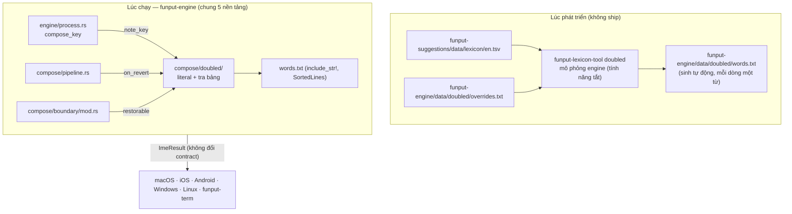

# Khôi phục phím lặp cho từ tiếng Anh

## Trạng thái

**Giai đoạn 1 đã hiện thực** (quyết định ở dấu cách, §5.2); số đo và các điểm lệch khỏi thiết kế ở
[§15](#15-kết-quả-giai-đoạn-1). Giai đoạn 2–4 vẫn là thiết kế (§12).
Nguồn: [issue #611](https://github.com/Funput/Funput/issues/611) — "Tự động hủy dấu khi gõ tiếp từ
và không nuốt phím. Tiện lợi khi gõ song ngữ."

| Thành phần | Ở đâu |
|---|---|
| Logic | `crates/funput-engine/src/compose/doubled/` (`mod.rs`, `lookup.rs`) |
| Trạng thái, công tắc | `Session.literal`, `EngineConfig.restore_doubled_keys` (mặc định bật, chỉ Rust) |
| Bảng từ | `crates/funput-engine/data/doubled/words.txt` (1 054 từ, 9,4 KB), `overrides.txt` |
| Bộ sinh | `funput-lexicon-tool doubled` (`crates/funput-lexicon-tool/src/doubled/`) |
| Test | `compose/doubled/tests.rs`, `tests/restore/doubled/`, `funput-lexicon-tool/tests/doubled_table.rs` |

Tài liệu này viết đủ chi tiết để lập kế hoạch hiện thực mà không cần đọc lại điều tra: mọi điểm
nối đều ghi rõ file, hàm và thứ tự gọi. Các điểm đã quyết và còn mở nằm ở
[§13](#13-câu-hỏi-cần-quyết-định).

### Tóm tắt đề xuất

- Toàn bộ tính năng nằm trong `funput-engine`, nên **cả 5 nền tảng nhận cùng lúc mà không phải sửa
  shell, FFI hay JNI** ở giai đoạn 1–2.
- Khi gõ phím lặp, dấu vẫn bị hủy như hôm nay (`pá` + `s` → `pas`), nhưng engine **giữ lại chuỗi phím
  gốc** (`pass`) thay vì xoá nó đi.
- Engine tra chuỗi phím gốc trong một **bảng từ tiếng Anh nhỏ (~10 KB) nhúng sẵn**. Bảng được sinh tự
  động từ `en.tsv` có sẵn, nên không phụ thuộc `funput-suggestions` lúc chạy.
- Có hai thời điểm quyết định. **Giữa từ**: đổi sang chuỗi phím gốc ngay khi dạng rút gọn không thể là
  từ tiếng Anh nào nữa, vào khoảng 95% số ca. **Ở dấu cách**: dành cho các ca còn lại.
- Có **bất biến an toàn**: từ không có lần hủy dấu nào thì hành vi y hệt hôm nay, nên tiếng Việt không
  bị đụng tới.

## 1. Vấn đề

### 1.1. Hiện trạng

Kiểm chứng bằng `funput dev run -m telex` (cấu hình mặc định: bật khôi phục tiếng Anh và khôi phục sớm),
ngày 21/10/2026:

| Gõ | Hôm nay | Người dùng muốn |
|---|---|---|
| `password ` | `pasword ` | `password ` |
| `correct ` | `corect ` | `correct ` |
| `pass ` | `pas ` | `pass ` |
| `office ` | `ofice ` | `office ` |
| `coffee ` | `cofee ` | `coffee ` |
| `issue ` | `isue ` | `issue ` |
| `seemed ` | `semed ` | `seemed ` |
| `Password ` | `Pasword ` | `Password ` |

Có những từ không bị lỗi (`access`, `class`, `process`, `success`). Lý do là eager restore đã trả chúng
về phím thô **trước khi** tới phím lặp (`acc` đã là ngõ cụt), nên phím lặp không còn là lệnh hủy dấu.

### 1.2. Nguyên nhân

Khi một phím dấu được gõ lại trên chính dấu nó vừa đặt, core trả `TransformKind::Reverted`. Engine
khi đó **ghi đè chuỗi phím thô bằng buffer** (`crates/funput-engine/src/compose/pipeline.rs`):

```rust
    // A revert is itself a restore to raw, so keep `keys` in sync — otherwise a
    // later word boundary sees `keys != buffer` and re-restores the stale original
    // keystrokes (e.g. `mixx` revert → `mix`, then Space → wrongly `mixx`).
    if result.kind == TransformKind::Reverted {
        session.keys.clear();
        session.keys.push_str(&session.buffer);
    }
```

Từ lúc này, phím `s` thứ hai không còn nằm ở đâu trong engine. English restore ở ranh giới từ và
phím Flip đều đọc `keys`, nên cả hai đều không lấy lại được nó.

### 1.3. Vì sao engine làm vậy, và vì sao không được bỏ đi

Đó là thói quen gõ của UniKey mà người dùng Việt đã quen: **gõ lặp phím dấu để lấy lại chữ Latin**.
Hành vi này đang được ghim bằng test:

- `revert_then_space_keeps_reverted_word` (`tests/restore/english.rs`): `mixx ` → `mix `, VNI `a11 ` → `a1 `.
- Danh sách kiểm tra tay của [extra-onsets.md](extra-onsets.md): `fasst ` → `fast `.
- Gõ hằng ngày: `tesst ` → `test ` (vì `test` → `tét`), `iss ` → `is `, `lasst ` → `last `, `off ` → `of `.

Tại phím lặp, engine **không thể biết** người dùng muốn `pas…` hay `pass…`: `iss` thì muốn `is`, nhưng
`issu…` lại muốn `issue`. Thông tin để phân biệt chỉ xuất hiện ở các phím **sau** phím lặp.

### 1.4. Vì sao không chặn sớm từ phím dấu đầu tiên

Có một hướng khác: nhận ra `pá` "không phải tiếng Việt" ngay từ phím dấu đầu tiên. Hướng này không
khả thi. `p` là âm đầu hợp lệ (`pin`, `pô`, Pác Bó, Pá Khoang), và khi đo 724 từ bị nuốt phím lặp thì
**709 từ** tại phím dấu đầu tiên là âm tiết tiếng Việt hoàn toàn hợp lệ: `of` → `ò` (office),
`is` → `í` (issue), `dif` → `dì` (different), `cor` → `cỏ` (correct). Phím lặp là tín hiệu đầu tiên
cho thấy người dùng không gõ tiếng Việt.

## 2. Số liệu

Đo trên 25 979 từ chữ thường của `crates/funput-suggestions/data/lexicon/en.tsv`, mỗi từ gõ kèm dấu
cách, Telex, cấu hình mặc định:

| Nhóm | Số từ | Thuộc phạm vi tài liệu này |
|---|---|---|
| Tổng số từ ra sai | 1 477 | |
| Mất một chữ vì phím dấu lặp (`ss`, `ff`, `rr`, `xx`, `jj`) | 724 | Có |
| … trong đó dạng rút gọn **không** phải từ tiếng Anh (sửa được, không mơ hồ) | 708 | Có |
| … trong đó cả hai dạng đều là từ tiếng Anh (mơ hồ) | ~25 | Có, xem §5.5 |
| Mất một chữ vì lặp nguyên âm hoặc `dd` (`seemed` → `semed`, `daddy` → `dady`) | vài chục | Có, bộ sinh bảng tự bắt (§6.4) |
| Từ tiếng Anh trùng âm tiết tiếng Việt hợp lệ, không có phím lặp (`is` → `í`, `been` → `bên`, `terms` → `tém`) | ~700 | **Không** |

Quyết định giữa từ (§5.3), đo trên 699 từ sửa được:

- **663 từ (95%)** quyết định được trước khi gõ xong, khi người dùng còn trung bình **3,3 chữ** nữa.
  Ví dụ: `password` quyết định ở `passw`, `correct` ở `correc`, `office` ở `offi`, `possible` ở `possib`.
- 36 từ chỉ quyết định được ở dấu cách, vì dạng rút gọn vẫn là phần đầu của một từ khác cho tới
  chữ cuối.

Thói quen gõ lặp kiểu UniKey **không bị ảnh hưởng** vì chuỗi phím gốc của chúng không phải từ tiếng Anh:
`tesst`, `mixx`, `iss`, `ass`, `offf`, `lasst`, `fixx` đều không có trong `en.tsv`.

**Đo sau giai đoạn 1:** số từ hỏng giảm từ **1 477 xuống 597** và không từ nào mới bị hỏng. Không còn
từ nào hỏng vì nuốt phím lặp ngoài 20 cặp mơ hồ được giữ có chủ đích. Chi tiết ở
[§15](#15-kết-quả-giai-đoạn-1).

## 3. Mục tiêu và ràng buộc

Theo thứ tự ưu tiên:

1. **Không đổi tiếng Việt.** Từ không có lần hủy dấu bằng phím lặp thì cho ra kết quả y hệt hôm nay.
   Đây là bất biến cứng, được giữ bằng proptest (§11.2).
2. **Không phá thói quen gõ lặp.** `mixx`, `tesst`, `iss`, `fasst`, `off` giữ nguyên kết quả cũ.
3. **Một lõi cho cả 5 nền tảng.** Logic và dữ liệu nằm trong Rust (`funput-engine`). Giai đoạn 1–2
   không sửa shell, FFI hay JNI.
4. **Không làm chậm luồng gõ.** Từ không có hủy dấu chỉ tốn đúng một phép `is_empty()`. Ngân sách cấp
   phát (`alloc_budget`) và benchmark criterion giữ nguyên.
5. **Có lối thoát.** Người dùng lấy lại được dạng kia bằng Flip, và trên di động bằng Backspace (§8).

### Không thuộc phạm vi

- Từ tiếng Anh thành âm tiết tiếng Việt hợp lệ mà không có phím lặp (`been` → `bên`, `too` → `tô`,
  `terms` → `tém`). Không có tín hiệu nào để phân biệt, và người gõ tiếng Việt cũng đổi dấu theo cách
  đó (`cars` → `cá` là đổi hỏi sang sắc).
- VNI. Phím dấu là chữ số nên từ tiếng Anh không đi qua đường hủy dấu.
- Đề xuất gốc của issue, "bất kỳ ký tự nào sau nguyên âm có dấu thì hủy dấu": đọc theo nghĩa đen thì
  phá cả `má` + `t` → `mát`. Ý đúng của issue là phím lặp, và chính tài liệu này giải quyết ý đó.

## 4. Các phương án đã cân nhắc

| Phương án | Ý tưởng | Chạy ở đâu | Đánh giá |
|---|---|---|---|
| A. Luôn giữ cả hai phím | `pá` + `s` → `pass` ngay | 5 nền tảng | Phá thói quen UniKey (`tesst`, `iss`, `mixx`). Chỉ hợp làm tuỳ chọn tắt sẵn |
| B. Đoán không cần từ điển | Còn gõ tiếp sau phím lặp thì giữ cả hai phím | 5 nền tảng | `tesst` → `tesst`, `lasst` → `lasst`: sai đúng nhóm người dùng hiện có |
| C. Hỏi từ điển của nền tảng | Dùng lại giao thức hai bước của typo-correction | Chỉ iOS, Android | Máy tính không có từ điển. Phải sửa 5 shell. Không quyết định giữa từ được |
| **D. Bảng nhúng trong engine** | Tra chuỗi phím gốc trong bảng sinh sẵn | **5 nền tảng** | **Đề xuất.** Tất định, không sửa shell, quyết định được giữa từ |

Typo-correction chọn giao thức hai bước (C) vì việc **xếp hạng** cần kho từ người dùng đã học, và kho
này chỉ có trên di động. Bài toán ở đây khác: câu hỏi "`password` có phải từ tiếng Anh không" là một
**dữ kiện tĩnh**, giống bảng âm tiết đã nhúng trong core. Đưa câu hỏi ra ngoài engine chỉ thêm độ trễ
và thêm việc cho từng nền tảng. Phương án C vẫn có thể ghép thêm về sau trên di động, để bổ sung từ
người dùng đã học (§12, giai đoạn 4).

## 5. Hành vi

### 5.1. Ba dạng của một từ

Trong một từ có hủy dấu, engine giữ ba chuỗi:

| Tên | Trường | Ví dụ khi gõ `passw` | Ý nghĩa |
|---|---|---|---|
| Dạng tiếng Việt | `vn_form` | `pasw` | Dạng core ghép được, dùng cho Flip |
| Dạng rút gọn | `keys` | `pasw` | Như hôm nay: phím thô sau khi hủy dấu đã nuốt phím lặp |
| **Chuỗi phím gốc** | `literal` (**mới**) | `passw` | Mọi phím đã gõ, kể cả phím bị nuốt. Rỗng cho tới lần hủy dấu đầu tiên |

`keys` **giữ nguyên ý nghĩa**. Gõ tắt, Flip, `verify_alignment` của typo-correction và English restore
đều đang đọc `keys`, nên đổi nghĩa của nó sẽ gây hiệu ứng dây chuyền. Trường mới `literal` tách riêng
đúng phần thông tin còn thiếu.

### 5.2. Quyết định ở ranh giới từ

Khi gặp phím ranh giới (dấu cách, dấu câu, Enter), engine thay phần đang hiển thị bằng
`literal + phím ranh giới` nếu **đủ tất cả** các điều kiện sau:

| Điều kiện | Kiểm ở đâu |
|---|---|
| Không có gõ tắt khớp | `boundary/shortcut.rs` chạy trước, như hôm nay |
| Bật `smart_restore` ("Tự khôi phục tiếng Anh") và `restore_doubled_keys` | `EngineConfig` |
| Method thuộc họ Telex | `method.is_telex_family()` |
| Từ có ít nhất một lần hủy dấu | `!session.literal.is_empty()` |
| Người dùng chưa Flip từ này | `session.restore_override.is_none()` |
| Màn hình chưa hiển thị đúng `literal` | `session.buffer != session.literal` |
| `literal` (so không phân biệt hoa thường) có trong bảng | `doubled::table::contains` |

Kết quả trả về là `ImeResult::send(buffer.chars().count(), literal + boundary)`. Đây đúng là dạng mà
`english_restore_result` đang trả, nên mọi shell đã xử lý được.

### 5.3. Quyết định giữa từ

Mỗi phím gõ khi `literal` đang hoạt động, engine hỏi: **`literal` hiện tại có phải "phần đầu quyết định"
không?** Phần đầu quyết định của một từ trong bảng là phần đầu ngắn nhất mà tại đó **dạng rút gọn
đang hiển thị không còn là phần đầu của bất kỳ từ tiếng Anh nào** trong `en.tsv`.

- `password`: ở `pass`, dạng rút gọn `pas` vẫn là phần đầu của `past` và `pastor`, nên chưa quyết. Tới
  `passw`, không từ nào bắt đầu bằng `pasw`, nên đây là phần đầu quyết định. Engine đổi màn hình sang
  `passw`, rồi `ord` nối vào bình thường.
- `correct`: `core` vẫn là phần đầu của `core` và `cored`. Tới `correc`, dạng rút gọn `corec` không còn
  khớp từ nào, nên engine quyết định ở `correc`.
- `tesst`: dạng rút gọn `test` luôn là phần đầu của từ thật (`test`, `testing`), nên **không bao giờ**
  quyết định giữa từ. Tới dấu cách, `tesst` không có trong bảng, nên giữ `test`. Đúng ý người gõ.

Danh sách phần đầu quyết định được tính **offline** lúc sinh bảng (§6.4). Lúc chạy, engine chỉ tra
xem `literal` có nằm trong danh sách đó không. Vì `literal` dài thêm đúng một ký tự mỗi phím, phép so
khớp chính xác bắt được đúng phím quyết định.

Quyết định giữa từ đi chung công tắc với eager restore: `smart_restore && eager_restore &&
restore_doubled_keys`. Tắt eager restore thì chỉ còn quyết định ở dấu cách (§5.2).

Sau khi quyết định, `buffer`, `keys` và `literal` bằng nhau. Các phím sau đi qua pipeline như mọi từ đã
được eager restore (`text`): core có thể thử đặt dấu, nhưng `is_dead_end` trả về phím thô **ngay trong
cùng phím đó**, nên màn hình không nhấp nháy.

### 5.4. Ví dụ (đích của bảng test)

| Gõ | Hôm nay | Sau tính năng | Quyết định ở |
|---|---|---|---|
| `password ` | `pasword ` | `password ` | `passw` |
| `correct ` | `corect ` | `correct ` | `correc` |
| `office ` | `ofice ` | `office ` | `offi` |
| `different ` | `diferent ` | `different ` | `diffe` |
| `coffee ` | `cofee ` | `coffee ` | `coffe` |
| `pass ` | `pas ` | `pass ` | dấu cách |
| `boss ` | `bos ` | `boss ` | dấu cách |
| `Password ` | `Pasword ` | `Password ` | `Passw` |
| `PASSWORD ` | `PASWORD ` | `PASSWORD ` | `PASSW` |
| `seemed ` | `semed ` | `seemed ` | bộ sinh bảng quyết định |
| `mixx ` | `mix ` | `mix ` | không đổi |
| `tesst ` | `test ` | `test ` | không đổi |
| `iss ` | `is ` | `is ` | không đổi |
| `off ` | `of ` | `of ` | không đổi (cặp mơ hồ, §5.5) |
| `offf ` | `off ` | `off ` | không đổi |
| `passte ` | `paste ` | `paste ` | không đổi (`passte` không phải từ) |
| `mas ` | `má ` | `má ` | không đổi (không có hủy dấu) |
| VNI `a11 ` | `a1 ` | `a1 ` | không đổi (VNI) |

### 5.5. Cặp mơ hồ

Khoảng 25 từ mà **cả hai dạng đều là từ tiếng Anh**, ví dụ: `off`/`of`, `pass`/`pas`, `mass`/`mas`,
`hiss`/`his`, `doses`/`does`, `losses`/`loses`, `dessert`/`desert`.

**Đã quyết:** bộ sinh bảng loại khỏi bảng những từ có dạng rút gọn **phổ biến hơn** trong `en.tsv` (thứ
hạng nhỏ hơn). Như vậy:

- `pass` (hạng 1 349) với `pas` (hạng 10 383): `pass` ở lại bảng, nên `pass ` → `pass `. Đây đúng ví dụ
  trong issue.
- `off` (hạng 153) với `of` (hạng 1): `off` bị loại, nên `off ` → `of ` như cũ. Muốn gõ `off` thì gõ `offf`.
- `hiss`/`his`, `doses`/`does`: giữ dạng rút gọn, đúng với từ phổ biến hơn. Ngược lại `losses`
  (hạng 2 905) thắng `loses` (hạng 8 338) và ở lại bảng.

Ngoài ra có tệp ghi đè viết tay (§6.4) để sửa vài ca mà tần suất trả lời sai, mỗi dòng kèm lý do.

### 5.6. Chữ hoa

Bảng lưu chữ thường ASCII. Phép tra so từng byte sau khi đổi về chữ thường, không cấp phát. Chuỗi trả
về là `literal` **nguyên văn**, nên giữ đúng kiểu chữ người dùng đã gõ: `Password`, `PASSWORD`.
Auto-capitalize vẫn chạy đúng vì `keys` và `literal` đều nhận cùng `raw_key` đã được viết hoa.

### 5.7. Tương tác với tính năng khác

| Tính năng | Hành vi |
|---|---|
| Gõ tắt | Ưu tiên hơn, như với English restore. Trigger khớp theo `keys`/`buffer`, không đổi |
| Flip | Giai đoạn 1–2: Flip đã chọn (`restore_override` khác `None`) thì tính năng này đứng ngoài. Giai đoạn 3: Flip ba trạng thái (§8.1) |
| Typo correction | Khôi phục ở dấu cách thì correction không park ứng viên cho từ đó (`drop_preview`, rồi trả kết quả trước `offer`). Khôi phục giữa từ thì từ đã là phím thô, và correction đối xử với nó như mọi từ tiếng Anh đã eager restore hôm nay |
| Eager restore tắt | Chỉ còn quyết định ở dấu cách |
| Smart restore tắt | Tính năng tắt hoàn toàn, y hệt hôm nay |
| Phụ âm đầu mở rộng | Không tương tác. `ferry` khi bật `f` (hôm nay ra `fery`, theo [extra-onsets.md](extra-onsets.md)) cũng được sửa |
| Telex nâng cao | Áp dụng, cùng bảng (§6.4) |
| VNI | Không áp dụng (`is_telex_family`) |
| Chế độ tiếng Anh | Không áp dụng (không có hủy dấu) |
| `adopt` | `clear()` xoá `literal`. Từ được mở lại không có chuỗi phím gốc |
| Backspace giữa từ | `resync_after_backspace` xoá `literal`. Sửa giữa từ là chỉnh tay, tính năng đứng ngoài từ đó |

## 6. Kiến trúc



Ở giai đoạn 1–2, các shell chỉ thấy `ImeResult::send` theo đúng hai dạng đang có. Thứ nhất là sửa
trong từ, giống eager restore `tẽt` → `text`. Thứ hai là thay cả từ kèm phím ranh giới, giống English
restore `cảd ` → `card `.

### 6.1. Tầng và file

| Tầng | Thay đổi |
|---|---|
| `crates/funput-engine/src/compose/doubled/mod.rs` (mới) | `note_key`, `on_revert`, `restorable` (giai đoạn 2 thêm `decides_raw`): toàn bộ logic, thuần, có unit test |
| `crates/funput-engine/data/doubled/words.txt` (mới, sinh tự động) | `WORDS`: mỗi dòng một từ, đã sắp xếp. Giai đoạn 2 thêm `decisive.txt` cùng định dạng |
| `crates/funput-engine/src/compose/doubled/lookup.rs` (mới) | `SortedLines`: tìm nhị phân trên văn bản nhúng, không phân biệt hoa thường ASCII, không cấp phát |
| `crates/funput-engine/src/model/session.rs` | Trường `literal: String`. `clear()` và `resync_after_backspace()` xoá nó |
| `crates/funput-engine/src/model/config.rs` | `restore_doubled_keys: bool`, mặc định `true`, chỉ có trong Rust (§6.5) |
| `crates/funput-engine/src/engine/process.rs` | `compose_key` gọi `doubled::note_key` sau `keys.push` |
| `crates/funput-engine/src/compose/pipeline.rs` | Gọi `on_revert` trước khi ghi đè `keys`. Thêm nhánh `decides_raw` khi chọn `new_buffer` |
| `crates/funput-engine/src/compose/boundary/mod.rs` | Hỏi `restorable` sau gõ tắt, trước `judge`/correction. English restore và tính năng này dùng chung helper `replace_word` |
| `crates/funput-engine/data/doubled/overrides.txt` (mới) | Ghi đè viết tay: `+word` thêm, `-word` loại, kèm lý do |
| `crates/funput-lexicon-tool/src/doubled/` (mới: `mod.rs`, `scan.rs`, `overrides.rs`) | Lệnh `doubled`: sinh `words.txt` |
| `crates/funput-cli/src/dev/coverage/` | Thêm chế độ đo độ phủ tiếng Anh (§11.3) |

`funput-engine` **vẫn chỉ phụ thuộc `funput-core`**. Bảng là mã nguồn được sinh, không phải dependency.

### 6.2. Trạng thái: `Session.literal`

```rust
/// Every key typed since the word boundary, including any a revert swallowed
/// (`pass` while `keys` holds `pas`). Empty until the word's first revert, so a
/// word without one pays a single `is_empty` check per keystroke.
pub(crate) literal: String,
```

Vòng đời:

1. **Kích hoạt lười.** Lần `Reverted` đầu tiên trong từ: `literal` rỗng thì chép `keys` vào. Lúc
   này `keys` vẫn còn phím lặp, vì `compose_key` đã đẩy nó vào trước khi gọi pipeline.
2. **Đi theo phím.** Khi `literal` không rỗng, mỗi phím tiếp theo được đẩy vào `literal` cùng lúc với
   `keys`. Nếu cùng từ có thêm lần hủy dấu nữa, `literal` không bị chép lại.
3. **Kết thúc.** `clear()` (ranh giới từ, đổi focus, `adopt`) và `resync_after_backspace()` xoá nó.
4. **Không cấp phát khi gõ.** `Session::new` cấp sẵn 32 byte (`LITERAL_CAPACITY`, bằng độ dài tối đa
   của một từ trong bảng), và `clear()` giữ nguyên dung lượng. Vì vậy lần hủy dấu trên đường gõ phím
   không cấp phát. `alloc_budget` bắt được đúng chỗ này: chuỗi Telex nâng cao `WWindowws` có hai
   lần hủy dấu, và nếu không cấp sẵn thì nó tốn thêm 2 lần cấp phát so với chuỗi đối chứng.

`size_of::<Engine>()` tăng 24 byte (152 → 176). Cần cập nhật assert ở `tests/methods/telex_advanced.rs:141`.

### 6.3. Bảng dữ liệu

`words.txt` do bộ sinh viết ra: mỗi dòng một từ chữ thường ASCII, sắp theo thứ tự byte, dòng nào
cũng kết thúc bằng `\n`, không có comment. Diff khi làm mới bảng đọc như một danh sách từ.

```rust
/// English words a Telex revert would shorten, lowercase, sorted.
static WORDS: SortedLines = SortedLines::new(include_str!("../../../data/doubled/words.txt"));
```

- **Vì sao là `.txt` chứ không phải `.rs` sinh tự động:** `scripts/check-loc.sh` giới hạn mỗi file
  nguồn 150 dòng, mà một mảng `&str` 1 054 phần tử vượt xa giới hạn đó. Văn bản nhúng cũng nhỏ
  hơn: không tốn 16 byte con trỏ và độ dài cho mỗi từ.
- **Kích thước thực tế:** 1 054 từ, **9,4 KB** trong `.rodata`, không tốn heap.
- **Tra cứu (`lookup.rs`, `SortedLines::contains`):** tìm nhị phân trên vị trí byte; mỗi lần thử lùi
  về đầu dòng, rồi so dòng đó với từ cần tìm sau khi hạ chữ thường từng byte. Không có chỉ mục dựng
  lúc khởi động, không `OnceLock`, không cấp phát. Từ chứa ký tự không phải ASCII bị từ chối ngay.
- Bất biến của tệp (đã sắp xếp, không trùng, chữ thường, có `\n` cuối) được unit test giữ, vì tìm
  nhị phân chỉ đúng khi các bất biến này đúng.
- Giai đoạn 2 thêm `decisive.txt` cùng định dạng, dùng lại `SortedLines`.

### 6.4. Bộ sinh bảng: `funput-lexicon-tool doubled`

Bảng được sinh bằng cách **cho chính engine gõ từng từ**, với `restore_doubled_keys = false`. Nhờ vậy
bảng luôn khớp hành vi thật của core, kể cả những đường hủy dấu khó đoán bằng regex (`seemed`,
`daddy`, `ươ` + `w`).

Giai đoạn 1 hiện thực phần `WORDS`, ở `scan.rs` (gõ một từ, trả dạng rút gọn) và `mod.rs` (thứ
hạng, cặp mơ hồ, ghi đè, ghi tệp). Bộ sinh quét **bốn cấu hình**: Telex và Telex nâng cao, mỗi
method có và không có phụ âm đầu mở rộng z/f/w/j. Lý do: `ferry` chỉ mất chữ `r` khi `f` được nhận
làm âm đầu. Phần `DECISIVE` trong mã giả dưới đây thuộc giai đoạn 2.

```text
for each word W in en.tsv (ASCII letters, length >= 2), for each setup (method × onsets):
    engine = Engine::new() with that setup, restore_doubled_keys = false
    typed = ""; reverted = false; decisive = None
    for c in W:
        engine.process_char(c); typed.push(c)
        if engine.keys().len() < typed.len(): reverted = true        # a revert swallowed a key
        if reverted && decisive is None
           && !is_prefix_of_any_english_word(lower(engine.buffer())):
            decisive = typed.len()
    if !reverted or engine.buffer() == W: skip                      # not damaged
    shortened = lower(engine.buffer())
    if rank(shortened) < rank(W): skip                               # ambiguous, shortened more common
    WORDS += lower(W)
    if decisive: DECISIVE += lower(W[..decisive])
apply overrides (+word / -word); sort; dedupe; write words.txt
```

- Phát hiện hủy dấu chỉ dùng API công khai: `keys()` ngắn hơn số phím đã gõ. Không cần thêm API.
- Telex và Telex nâng cao: `WORDS` lấy hợp của hai method. Nếu hai method cho phần đầu quyết định khác
  nhau, lấy **phần đầu dài hơn**, tức là quyết định muộn hơn và an toàn hơn.
- `funput-lexicon-tool` thêm dependency `funput-engine`. Crate này không link vào binary nào được ship
  (theo README của nó), nên điều này không ảnh hưởng sản phẩm.
- `refresh.sh` chạy thêm `doubled` ở cuối, để mỗi lần làm mới `en.tsv` thì bảng cũng được làm mới
  trong cùng PR.
- Có test kiểm tra độ mới (`tests/doubled_table.rs`): sinh lại rồi so với `words.txt` đã commit,
  khác nhau thì báo lỗi kèm lệnh sinh lại. Test đặt trong `funput-lexicon-tool`. Nhờ vậy bảng không thể lệch khỏi luật gõ khi core thay đổi.

**Vì sao đặt bộ sinh ở `funput-lexicon-tool` chứ không ở `funput-cli`:** đây là công việc dữ liệu chạy
tay khi từ điển thay đổi, đúng vai trò của crate đó. `funput-cli dev` dành cho debug và đo đạc.

### 6.5. Cấu hình

```rust
/// Give a word back its raw keys when a doubled tone key swallowed one of them and
/// those keys spell an English word (`pass` + `word` → `password`, not `pasword`).
/// Rides on `smart_restore`; the mid-word half also needs `eager_restore`.
pub restore_doubled_keys: bool, // default: true
```

- Giai đoạn 1–2 **không có công tắc trên UI** và **không có setter FFI/JNI**. Tính năng là một phần của
  "Tự khôi phục tiếng Anh": tắt mục đó là tắt luôn tính năng này.
- Trường Rust tồn tại vì ba lý do: bộ sinh bảng cần tắt nó (§6.4), proptest cần so bật với tắt (§11.2),
  và Windows (link thẳng Rust) có sẵn đường để thêm công tắc khi cần.
- Nếu sau này cần công tắc riêng: thêm `funput_set_restore_doubled_keys(engine, bool)` theo mẫu
  `funput_set_extra_onsets`, không nới `FunputConfig` by-value.

## 7. Luồng xử lý chi tiết

### 7.1. Mỗi phím (`engine/process.rs::compose_key`)

```rust
self.session.keys.push(raw_key);
doubled::note_key(&mut self.session, raw_key); // pushes into `literal` only while it is active
correction::drop_preview(&mut self.session);
correction::note_key(&mut self.session, raw_key, touch);
let result = pipeline::process(&mut self.session, compose_key, key, capitalize_shortcut);
correction::verify_alignment(&mut self.session);
```

### 7.2. Pipeline (`compose/pipeline.rs::process`)

```rust
let new_buffer = match session.restore_override {
    Some(RestoreOverride::ForceVietnamese) => composed,
    Some(RestoreOverride::ForceRaw) => session.keys.clone(),
    None => {
        if doubled::decides_raw(session) {
            // The shortened form can no longer begin an English word; the raw keys can.
            session.literal.clone()
        } else if /* existing eager English restore condition */ {
            session.keys.clone()
        } else {
            composed
        }
    }
};
// ... diff + pass-through exactly as today ...
session.buffer = new_buffer;

if result.kind == TransformKind::Reverted {
    doubled::on_revert(session); // copies `keys` into `literal` on the word's first revert
    session.keys.clear();
    session.keys.push_str(&session.buffer);
}
if !session.literal.is_empty() && session.buffer == session.literal {
    // Raw keys are on screen now: keep `keys` in step so boundary restore stays quiet.
    session.keys.clear();
    session.keys.push_str(&session.literal);
}
```

Phím đầu tiên của một lần hủy dấu: `decides_raw` thấy `literal` còn rỗng nên trả `false`, tức là
hành vi y hệt hôm nay. Phím hủy dấu kích hoạt `literal`, và **từ phím sau** việc tra bảng mới bắt đầu.

`decides_raw` kiểm theo thứ tự rẻ trước: `literal` rỗng thì dừng; rồi tới các cờ cấu hình; rồi
`buffer != literal`; cuối cùng mới `lookup::contains(DECISIVE, literal)`.

### 7.3. Ranh giới từ (`compose/boundary/mod.rs::boundary_result`)

```rust
fn boundary_result(session: &mut Session, boundary_key: char) -> ImeResult {
    if let Some(expansion) = shortcut::expansion(session, boundary_key) {
        return expansion;
    }
    if doubled::restorable(session) {
        // The word is English, so typo correction must not park a repair for it.
        correction::drop_preview(session);
        return replace_word(session, &session.literal, boundary_key);
    }
    let verdict = judge(session);
    correction::offer(session, boundary_key, &verdict);
    // ... English restore exactly as today ...
}
```

Đặt **trước** `judge` vì hai lý do. Một là `judge` có thể cấp phát (`is_complete_syllable`), và với
từ này phép kiểm đó là thừa. Hai là typo-correction không được park ứng viên cho một chữ sắp bị thay.

## 8. Lối thoát (giai đoạn 3)

### 8.1. Flip ba trạng thái

Hôm nay, sau khi hủy dấu thì `vn_form == keys == "pas"`, nên `flip()` trả `None`: phím Flip không làm
gì cả. Khi `literal` hoạt động, Flip luân phiên qua các dạng **khác nhau** theo thứ tự:

```text
displayed form → next distinct form in [literal, keys, vn_form] → … (skip empty and duplicates)
```

- Màn hình `password` (đã tự khôi phục): Flip → `pasword`, Flip lần nữa → `password`.
- Màn hình `pasword` (bảng không có từ, ví dụ tên riêng `Jessica`): Flip → `Jessica`.

Mỗi lần Flip ghim lựa chọn bằng `RestoreOverride`. Cần thêm biến thể `ForceLiteral` cạnh `ForceRaw` và
`ForceVietnamese`. Pipeline hiển thị `literal` khi gặp `ForceLiteral`.

### 8.2. Backspace ngay sau khi khôi phục ở dấu cách

Theo đúng mẫu của typo-correction ([typo-correction.md §3.3](typo-correction.md#33-hoàn-tác)):
Backspace ngay sau khi khôi phục thì trả lại dạng rút gọn kèm phím ranh giới, và không khôi phục lại
từ đó ở lần gặp kế tiếp (dấu này dùng một lần).

**Đề xuất kiến trúc:** đưa ô "hoàn tác phép sửa vừa làm ở ranh giới từ" từ `CorrectionState.last` lên
`Session` (ví dụ `boundary_undo: Option<Box<BoundaryUndo>>`), dùng chung cho typo-correction và tính
năng này. Lý do:

- iOS và Android đã gọi `has_correction_undo()` → `on_backspace()` và đã hiện chip `↩ …` từ
  `correction_undo_text()`. Mở rộng nghĩa hai hàm này (hoặc thêm `has_boundary_undo()` /
  `boundary_undo_text()` rồi cho hai hàm cũ gọi sang) giúp di động **có hoàn tác mà không sửa shell**.
- Hôm nay ô này chỉ tồn tại khi bật `typo_correction` (`Option<Box<CorrectionState>>`). Tách ra thì
  tính năng này không phụ thuộc vào việc bật typo-correction.

**Máy tính:** `funput-desktop`, Linux và funput-term chỉ gọi `on_backspace` khi đang soạn, và để phím
Backspace vật lý đi qua. Muốn hoàn tác thì shell phải hỏi engine trước khi cho phím đi qua, rồi nuốt
phím và inject. Phần này để sau. Trên máy tính, Flip (§8.1) là lối thoát chính khi từ còn đang soạn.

## 9. Nền tảng

| Nền tảng | Đường tới engine | Giai đoạn 1–2 | Giai đoạn 3 |
|---|---|---|---|
| macOS | FFI, IMKit (có chế độ ghi thẳng vào tài liệu) | Không sửa | Flip: không sửa. Hoàn tác: để sau |
| iOS | FFI, `FunputCore.xcframework` | Không sửa | Flip: không sửa. Hoàn tác: không sửa nếu mở rộng `has_correction_undo` |
| Android | JNI | Không sửa | Như iOS |
| Windows | Link thẳng Rust (`funput-desktop`) | Không sửa | Flip: không sửa. Hoàn tác: để sau |
| Linux (Fcitx5, IBus) | FFI | Không sửa | Như Windows |
| `funput-term` | Link thẳng Rust | Không sửa | Không áp dụng |

"Không sửa" có cơ sở: cả hai `ImeResult` mà tính năng sinh ra (sửa trong từ, thay cả từ kèm ranh giới)
đều đang được eager restore và English restore dùng hằng ngày trên mọi shell. Việc cần làm trên từng
nền tảng là **kiểm tra tay** (§11.5), không phải viết code.

Có một lợi ích phụ trên di động: sau khi quyết định giữa từ, buffer là `passw`, nên thanh gợi ý tiếng
Anh ([english-lexicon-suggestion.md](english-lexicon-suggestion.md)) gợi ý được `password`. Hôm nay nó
chỉ nhận được `pasw`. Cần xác nhận khi kiểm tra tay.

## 10. Hiệu năng và bộ nhớ

| Hạng mục | Chi phí |
|---|---|
| Phím trong từ không có hủy dấu (gần như mọi phím) | Một `is_empty()` trong `note_key` (giai đoạn 2 thêm một trong `decides_raw`) |
| Phím trong từ đã hủy dấu | Một `push` vào `literal` (giai đoạn 2 thêm một lần tìm nhị phân trên `DECISIVE`) |
| Ranh giới từ không có hủy dấu | Một `is_empty()` |
| Ranh giới từ có hủy dấu | Một lần tìm nhị phân trên `WORDS`, bỏ qua `judge` nếu trúng |
| Cấp phát | Một lần 32 byte khi tạo `Session` (§6.2). Khi gõ: không có. Ở ranh giới từ được khôi phục: một chuỗi kết quả, như English restore. Giai đoạn 2 thêm `literal.clone()` khi quyết định giữa từ, giống `keys.clone()` của eager restore |
| Bộ nhớ tĩnh | 9,4 KB `.rodata` (`words.txt`, §6.3) |
| `size_of::<Engine>()` | +24 byte (152 → 176) |

Cổng: `alloc_budget` (giữ ≤ 2,0 alloc/phím, câu mẫu tiếng Việt không có hủy dấu nên không đổi),
`alloc_budget_correction`, và criterion `process_char` trong ngưỡng 3% của `benchmarks/README.md`.

## 11. Kiểm thử và cổng gác

### 11.1. Unit test (`compose/doubled/`)

- `lookup`: không phân biệt hoa thường, từ không phải ASCII, chuỗi rỗng, danh sách một dòng, hai đầu
  danh sách.
- Bảng: `words.txt` đã sắp xếp, không trùng, chữ thường ASCII, có `\n` cuối; có `password`, `correct`,
  `pass`; không có `off`, `tesst`, `mix`. Giai đoạn 2 thêm: mỗi phần tử của `DECISIVE` là phần đầu của
  ít nhất một phần tử trong `WORDS`.
- Vòng đời `literal`: rỗng khi không hủy dấu, kích hoạt ở lần hủy dấu đầu, không chạy khi tắt công tắc
  hoặc với VNI, bị xoá bởi `clear()` và `resync_after_backspace()`.

### 11.2. Integration test và bất biến

- `tests/restore/doubled/cases.rs`: bảng §5.4, kèm `ImeResult` của phím dấu cách trong `password `
  (xoá 7 ký tự `pasword`, chèn `password `).
- `tests/restore/doubled/toggles.rs`: tắt `smart_restore`, tắt `eager_restore`, tắt
  `restore_doubled_keys`, mỗi trường hợp một test. Gõ tắt có trigger `pas` thắng (`pass ` →
  `Pasteur `). Flip trước phím lặp thì tính năng đứng ngoài.
- Giữ nguyên `revert_then_space_keeps_reverted_word`.
- **Proptest bất biến** (`tests/restore/doubled/invariant.rs`): với mọi chuỗi phím mà engine (tính năng
  tắt) không có lần hủy dấu nào, kết quả bật và tắt **giống hệt từng `ImeResult`**, kể cả phím ranh
  giới, ở cả Telex, Telex nâng cao và VNI. Riêng VNI phải giống hệt ở mọi phím. Đây là bằng chứng cho
  ràng buộc số 1 của §3.
- **Differential tiếng Việt:** Viet74K sinh phím (Telex và VNI, như acceptance của extra-onsets) cho
  0 khác biệt so với `main`.

### 11.3. Đo độ phủ tiếng Anh: `funput dev coverage --english`

Lệnh mới tự động hoá phép đo đã làm tay ở §2: gõ mọi từ trong `en.tsv` kèm dấu cách, phân loại kết quả
sai thành *mất phím lặp*, *trùng âm tiết tiếng Việt* và *khác*. `--json` dùng cho CI. Đường cơ sở được
lưu ở `benchmarks/results/`. CI báo lỗi nếu số từ hỏng **tăng**, và đường cơ sở chỉ được hạ xuống.

### 11.4. Độ mới của bảng

`funput-lexicon-tool/tests/doubled_table.rs`: chạy chính binary `doubled` trên `en.tsv` + overrides
rồi so byte-by-byte với `words.txt` đã commit, sai thì in lệnh sinh lại.
Đổi core làm hành vi hủy dấu đổi theo thì test này đỏ, buộc phải sinh lại bảng trong cùng PR.

### 11.5. Kiểm tra tay (mỗi nền tảng)

Telex, cấu hình mặc định, trong một ô nhập thường (Notes / Notepad / gedit / Tin nhắn):

- `password ` → `password `. Từ giai đoạn 2: màn hình đổi sang `passw` ngay ở phím `w` (không đợi
  dấu cách).
- `correct ` → `correct `, `pass ` → `pass `, `Password ` → `Password `.
- Thói quen cũ không đổi: `tesst ` → `test `, `mixx ` → `mix `, `iss ` → `is `, `off ` → `of `.
- Tiếng Việt không đổi: `xins chaof `, `ddaayf ddur `, `hoir `.
- Tắt "Tự khôi phục tiếng Anh": `password ` → `pasword ` như cũ.
- macOS có thêm chế độ ghi thẳng vào tài liệu (#607). Windows có cả hook lẫn TSF. Mỗi chế độ thử một
  lượt.
- iOS/Android: thanh gợi ý hiện `password` sau khi quyết định giữa từ. Ở giai đoạn 3: Backspace ngay
  sau dấu cách trả lại `pasword ` và chip `↩` hiện đúng.

## 12. Lộ trình

| Giai đoạn | Nội dung | PR đề xuất | Nền tảng phải sửa |
|---|---|---|---|
| 1 (**đã làm**) | `literal`, `restore_doubled_keys`, bộ sinh bảng, `words.txt`, quyết định ở dấu cách, test §11.1–11.2 và §11.4 | 2 commit: (a) engine + test, (b) bộ sinh + bảng | Không |
| 1b | `funput dev coverage --english` + đường cơ sở CI | 1 PR (có thể làm trước để đo) | Không |
| 2 | `DECISIVE`, quyết định giữa từ | 1 PR | Không |
| 3 | Flip ba trạng thái, `boundary_undo` dùng chung | 2 PR | Không trên di động. Máy tính chỉ có Flip |
| 4 (tuỳ chọn) | Di động bổ sung từ người dùng đã học vào bảng (`add_doubled_words`) | Sau khi có số liệu thực tế | iOS, Android |

**Giai đoạn 1 tự nó đã giải quyết issue #611.** Giai đoạn 2 và 3 nâng trải nghiệm.

## 13. Câu hỏi cần quyết định

1. **Cặp mơ hồ (`pass`/`pas`, `off`/`of`): xử lý thế nào?**
   *Đã quyết:* theo tần suất (§5.5), cộng tệp ghi đè. Cách này sửa được đúng ví dụ `pass` của issue mà
   vẫn giữ `off` → `of`.
2. **Có cần công tắc riêng trên UI không?**
   *Đã quyết:* chưa cần ở bản đầu, đi chung "Tự khôi phục tiếng Anh". Chỉ có trường Rust
   `restore_doubled_keys`; thêm setter FFI về sau chỉ tốn một PR nhỏ.
3. **Quyết định giữa từ có bật mặc định không?**
   *Đề xuất:* có, đi chung công tắc eager restore. Người tắt eager restore vốn đã chọn "đợi dấu cách".
4. **Thứ tự của Flip ba trạng thái.**
   *Đề xuất:* `literal` → `keys` → `vn_form`, như §8.1.
5. **Hoàn tác bằng Backspace trên máy tính.**
   *Đề xuất:* để sau giai đoạn 3. Cần thiết kế chung với typo-correction cho máy tính
   ([typo-correction.md §10](typo-correction.md#10-desktop)).
6. **Nơi đặt tệp ghi đè.**
   *Đã quyết:* `crates/funput-engine/data/doubled/overrides.txt`, cạnh `words.txt` và crate dùng bảng.
7. **Có nhận cả từ viết hoa trong `en.tsv` (tên riêng như `Jessica`, `Mississippi`) không?**
   *Đã làm:* có. Bộ sinh hạ mọi từ về chữ thường, nên `jessica ` cũng được khôi phục, và chuyện đó vô
   hại.

## 14. Tài liệu cần cập nhật khi hiện thực

- ~~`crates/funput-engine/README.md` và `README.en.md`, mục "Khôi phục tiếng Anh"~~ — đã làm ở giai
  đoạn 1.
- ~~`docs/features/extra-onsets.md`, mục "Đánh đổi": dòng `ferry` → `fery`~~ — đã làm ở giai đoạn 1.
- ~~`docs/features/typo-correction.md` §3.1: thêm điều kiện "từ không được khôi phục phím lặp"~~ — đã
  làm ở giai đoạn 1. Nếu làm giai đoạn 3, cập nhật thêm §3.3 về ô hoàn tác dùng chung.
- Trang hướng dẫn "Tự khôi phục tiếng Anh" trên docs.funput.app: ví dụ `password`, và cách lấy lại
  `pas` bằng `pass` + Flip.

## 15. Kết quả giai đoạn 1

Đo ngày 22/10/2026, Telex, cấu hình mặc định, trên 25 979 từ chữ thường của `en.tsv`, mỗi từ gõ
kèm dấu cách. "Trước" và "sau" dùng **cùng một bản build**, chỉ khác giá trị `restore_doubled_keys`.

### 15.1. Số đo

| Chỉ số | Trước | Sau |
|---|---|---|
| Từ tiếng Anh ra sai | 1 477 | **597** |
| Từ được sửa | — | **880** |
| Từ mới bị hỏng | — | **0** |

597 từ còn sai, phân loại bằng chính engine (có lần hủy dấu hay không):

| Nhóm | Số từ | Vì sao để nguyên |
|---|---|---|
| Không có lần hủy dấu nào: chữ tự ghép thành tiếng Việt hợp lệ (`is` → `í`, `this` → `thí`, `been` → `bên`, `too` → `tô`, `terms` → `tém`) | 577 | Ngoài phạm vi (§3). Không có tín hiệu nào, và sửa thì phá tiếng Việt thật (`há`, `bên`, `tô`) |
| Có hủy dấu, nhưng dạng rút gọn là từ tiếng Anh phổ biến hơn (§5.5) | 20 | Giữ có chủ đích theo quyết định §13.1 |

20 từ của nhóm thứ hai: `off`, `marry`, `doses`, `dessert`, `desserts`, `casts`, `nests`, `pests`,
`coasts`, `boasts`, `gasps`, `masts`, `err`, `curses`, `duress`, `hiss`, `lass`, `corral`, `posse`,
`barre`. Ví dụ `curses` đi qua đổi dấu hỏi sang sắc rồi mới hủy dấu, ra `cues`, và `cues` phổ biến
hơn `curses`. Muốn đổi ưu tiên cho từ nào thì thêm `+word` vào `overrides.txt` rồi sinh lại bảng.

Số từ được sửa (880) cao hơn ước tính ban đầu (~708, §2). Lý do: bộ sinh hỏi chính engine, nên bắt
được mọi đường hủy dấu chứ không chỉ các cặp `ss`/`ff`/`rr`/`xx`/`jj`. Ví dụ `seemed` (hủy mũ),
`daddy` (hủy `đ`), và các từ đổi dấu trước rồi mới hủy.

### 15.2. Chất lượng và tài nguyên

| Hạng mục | Kết quả |
|---|---|
| Test toàn workspace (`cargo test --workspace`) | 1 435 qua, 0 lỗi |
| Test riêng của tính năng | 11 unit test (`compose/doubled/tests.rs`), 13 integration test kể cả proptest bất biến (`tests/restore/doubled/`), 9 unit test của bộ sinh, 1 test độ mới của bảng (`doubled_table.rs`) |
| `cargo clippy --workspace --all-targets -D warnings`, `cargo fmt --check` | Sạch |
| `scripts/check-loc.sh` (150 dòng/file, 5 file/thư mục) | Đạt |
| `alloc_budget` | Không đổi: 1,1 alloc/phím với cấu hình mặc định; Full Telex 55 lần cấp phát, bằng chuỗi đối chứng |
| Criterion so với `main` (baseline `before_doubled`, cùng máy, cùng toolchain) | `process_char/paragraph/telex` +0,99%, `paragraph/vni` +0,62%; 6 bench `process_char` còn lại và 2 bench FFI `latency` không đổi. Tất cả trong ngưỡng 3% |
| Bảng từ | 1 054 từ, 9,4 KB |
| `size_of::<Engine>()` | 152 → 176 byte |

### 15.3. Khác với thiết kế ban đầu

- **Bảng là `words.txt` chứ không phải `table.rs` sinh tự động.** Một mảng `&str` 1 054 phần tử vượt
  giới hạn 150 dòng của `check-loc.sh`. Bảng văn bản cũng nhỏ hơn: 9,4 KB thay vì ~35 KB ước tính (§6.3).
- **Bộ sinh quét bốn cấu hình** (Telex và Telex nâng cao, mỗi method có và không có phụ âm đầu mở rộng),
  để `ferry` vẫn được sửa khi bật `f` (§6.4).
- **Cấp sẵn 32 byte cho `literal` khi tạo `Session`.** `alloc_budget` bắt được chuỗi Telex nâng cao
  `WWindowws`: nó có hai lần hủy dấu và tốn thêm 2 lần cấp phát. Sau khi cấp sẵn, đường gõ phím không
  cấp phát (§6.2).
- **Phát hiện hủy dấu trong bộ sinh chỉ cần so độ dài `keys()` cuối cùng** với số phím đã gõ, vì chỉ
  hủy dấu mới làm `keys` ngắn đi. Không cần theo dõi từng phím như mã giả §6.4.

### 15.4. Cách đo lại

Cho tới khi có `funput dev coverage --english` (giai đoạn 1b, §11.3):

```bash
awk -F'\t' '!/^#/ && $1 ~ /^[a-z]+$/ {print $1}' crates/funput-suggestions/data/lexicon/en.tsv > /tmp/en_words.txt
(sed 's/$/ /' /tmp/en_words.txt; echo ':q') \
    | cargo run -q -p funput-cli -- dev repl -m telex 2>/dev/null | sed 's/ $//' > /tmp/en_out.txt
paste /tmp/en_words.txt /tmp/en_out.txt | awk -F'\t' '$1 != $2' | wc -l   # 597
```

Số "trước" (1 477) có được bằng cách tạm đặt mặc định `restore_doubled_keys: false` trong
`model/config.rs` rồi chạy lại các lệnh trên. CLI chưa có cờ cho công tắc này; giai đoạn 1b sẽ thêm.

### 15.5. Chưa làm trong giai đoạn 1

- **Chưa kiểm tra tay trên 5 nền tảng** (§11.5). Lý thuyết là không phải sửa shell, vì `ImeResult` có
  cùng dạng với English restore, nhưng chưa thử trên thiết bị thật.
- Các giai đoạn tiếp theo theo §12: 1b (lệnh đo trong CI), 2 (quyết định giữa từ), 3 (Flip ba trạng
  thái và hoàn tác).
